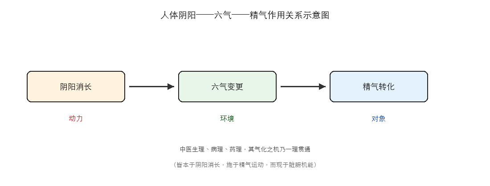
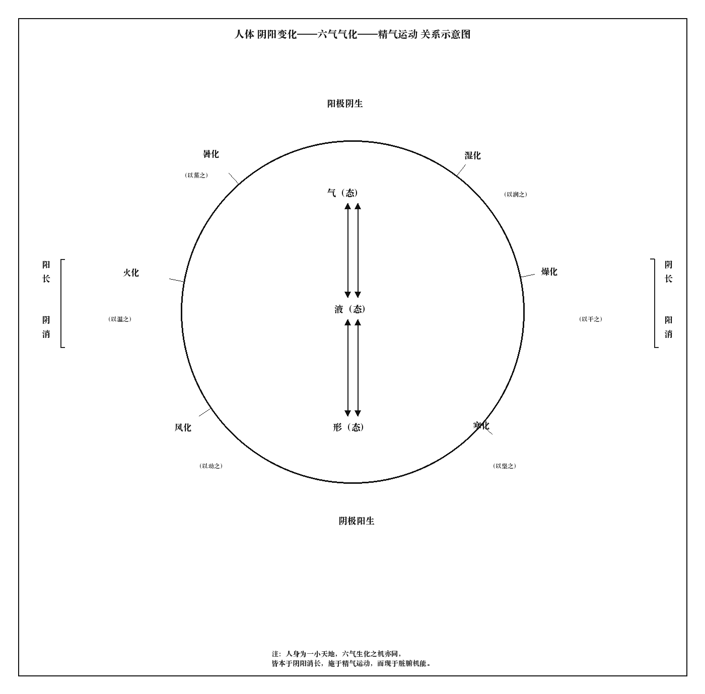
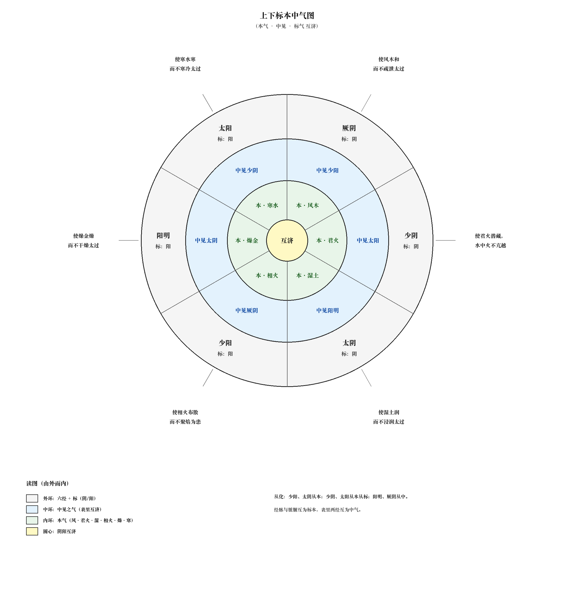
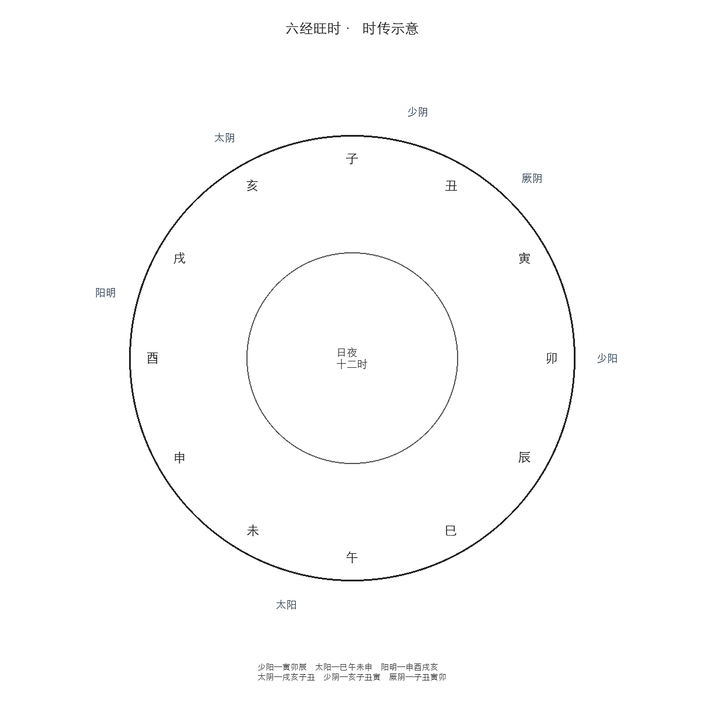
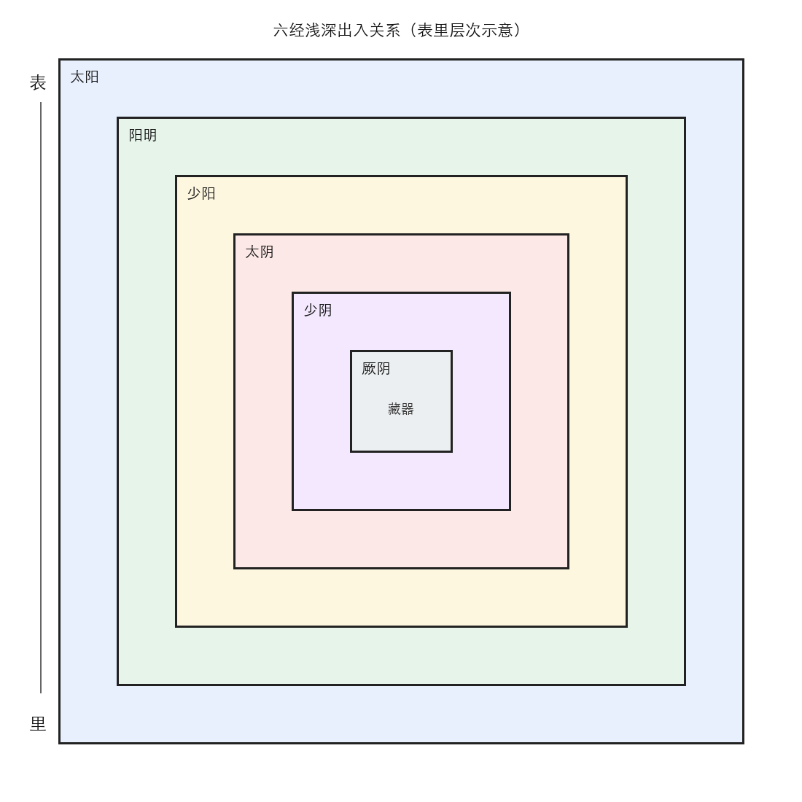
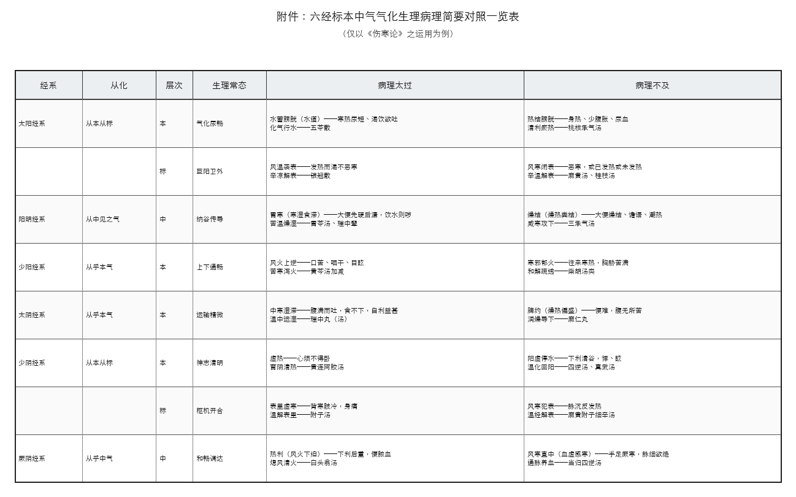
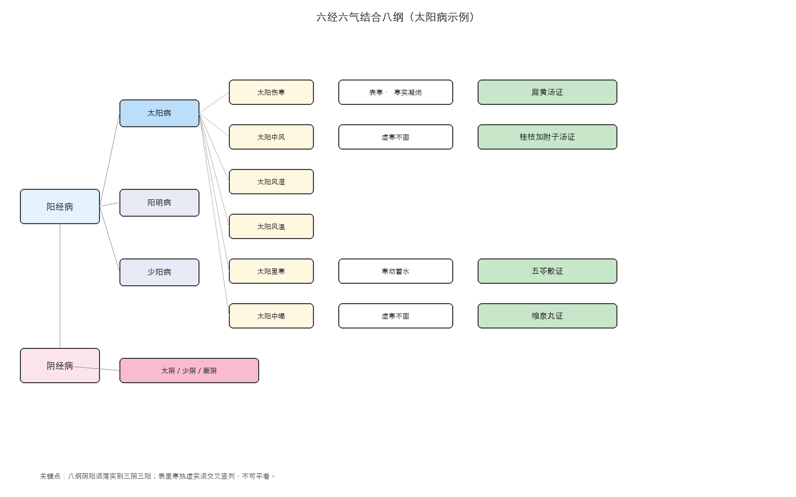
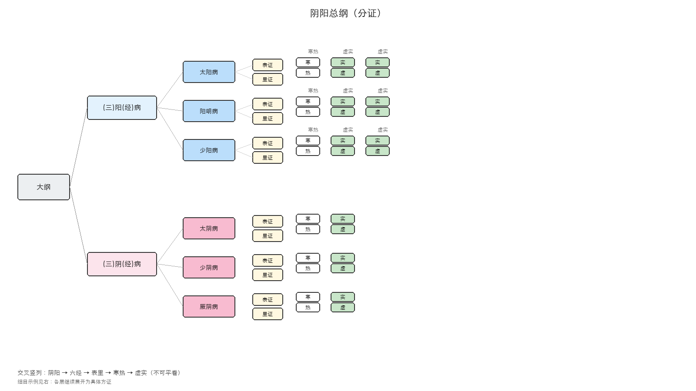

# 六经的实质界定

> 来源：扫描讲义 OCR 校对稿（第二节至第四节相关内容）
> 说明：原扫描件噪点较多；示意图已重绘；正文经 Vision OCR 后人工校对。

## 第二节 六经的实质界定

### 一、六经学说之源流

#### 1. 导源于《易经》，起始于《内经》

六经有天人之分，自然之六经导源于《易经》，人体之六经始立于《内经》。

《易·系辞下》：“易有太极，是生两仪，两仪生四象，四象生八卦。”

太极生两仪，立分阴阳；两仪生四象，变生阴阳太少：太阳、少阳、少阴、太阴，反映阴阳有多少差异。太少进一步消长变更，使阴阳由一而二、再由二而三，各加一阳明、厥阴过渡，则由四象变为天之三阴三阳，后人则把此太阳、阳明、少阳，太阴、少阴、厥阴合称六经。

《内经》则始将人天之六经移用于人身。即基于天食人以六气，地食人以五味，地有五行而人生五脏，天有六气而人生六腑，人禀天地之气质而生，人也有六经之分。

三阴三阳在人体中的形成也是以阴阳之气的盛衰多少为依据的。《素问》中的《热论》《刺疟》《刺腰痛》《厥论》四篇，都运用了三阴三阳六经分证的概念。

#### 2. 树立于《伤寒》，彰显于明清

仲景立六经以辨伤寒，后世则发展成六经为百病立法。

《内经》运用六经，还主要是基于以经络学说为主；东汉张仲景《伤寒论》“撰用《素问》九卷、《八十一难》”，继承《内经》理论，则进一步结合六气气化、藏象学说，结合丰富的伤寒病临床实践，将六经分证发展至极致，建立了能够充分反映外感病变传变规律的六经辨证方法。

《伤寒论》自问世以来，历代都有研究，但从宋代以前，多以编校为主；宋金期间，小有高潮，但对六经实质的认识，也多停留在脏腑、经络的层面上。降至明清，才注家蜂起，学派争鸣。对六经的研究也进入鼎盛时期，六经之经界说、气化说、形层说、八纲说、治法说，纷纷涌现，提出了六经乃万病之六经，非独伤寒也。

#### 3. 混战于民国，徘徊于当代

随着西学东渐的影响，中西汇通学派的渗透，病程阶段说、证候群说、综合体说、时空说、应激说等新理念，也纷纷踏入，反使对六经实质的认识更难以形成共识。

目前教材通常尽量回避对六经实质的定义，仅对六经病证表述为：是六经所属脏腑经络的病理变化反映于临床的各种证候。对六经辨证表述为：是以六经所系的脏腑经络、气血津液的生理功能与病理变化为基础，并结合人体抗病力的强弱、病因的属性、病势的进退缓急等因素，对外感疾病发生、发展过程中的各种症状进行分析、综合、归纳，借以判断病变的部位、证候的性质与特点、邪正消长的趋向，并以此为前提决定立法处方等问题的一种辨证论治的方法与体系。

### 二、六经实质之界定

《伤寒论》的主要学术成就之一，在于其创立了六经辨证论治体系。千百年来，古今中外众多学者十分重视对伤寒六经的研究，并为此做出了不懈的努力。正如恽铁樵所说：“《伤寒论》第一重要之处为六经，而第一难解之处亦为六经，凡读伤寒者无不于此致力，凡注伤寒者亦无不于此致力。”

#### （一）古今六经概念研究

王氏等通过查阅了大量的古今文献，对六经实质界定诸说加以分析归纳，具体有 41 种之多。下面则择其主要，归类列举分析如下：

##### 1. 经络说

代表者宋代朱肱，其于《类证活人书》中强调：“治伤寒先须识经络，不识经络，触途冥行，不知邪气之所在。”认为六经指手足阴阳十二经脉，六经病证是由风寒侵犯经脉所引起，故应以“太阳经”“阳明经”“少阳经”等称之。后汪琥等亦响应此说。

##### 2. 脏腑说

以李时珍、高学山为代表。李氏《本草纲目》指出：“夫寒伤营，营血内涩，不能外通于卫，卫气闭固，津液不行。然风寒之邪，皆由皮毛而入。皮毛者，肺之合也。肺主气，包罗一身，天之象也。证虽属太阳，而肺实受邪也。”

##### 3. 标本中气说

以张志聪、陈修园为代表的一些注家，根据《内经》六气标本中气的气化理论解释《伤寒论》中的六经。认为三阴三阳、六经六气，天地之间有，在人身之中亦有。无病则六气运行，上合于天；若外感风寒，更以邪伤正，始则同气相求，继则从气而入经，由经而入脏。例如：“太阳之上，寒气治之，中见少阴”。太阳病从本气，故必有恶寒；寒邪郁于太阳之经，邪正相争之发热则是从标。太阳病不解，可内陷少阴，故“中见少阴”。

##### 4. 地界说

柯韵伯为代表。认为《伤寒论》六经是“地界”之经，而非“经络”之经。其《伤寒论翼》中说：“仲景书只宗阴阳大法，不拘阴阳之经络也”；“六经是分区地面，所赅者广。虽以脉为经络，而不专在经络上立说。……请以地理喻，六经犹列国也。”较大地提升了六经的观念。

##### 5. 六部说

代表方有执，把六经比喻为门类或职能部门。于《伤寒论条辨》云：“六经之经，与经络之经不同。六经者，犹儒家之六经，犹言部也。部，犹今六部之部。……天下之大，万事之众，六部尽之矣。人身之有，百骸之多，六经尽之矣。”

##### 6. 形层说

程郊倩、俞根初皆持此说。俞氏《通俗伤寒论》提出：“太阳经主皮毛，阳明经主肌肉，少阳经主腠理，太阴经主肢末，少阴经主血脉，厥阴经主筋膜。太阳内部主胸中，少阳内部主膈中，阳明内部主中脘，太阴内部主大腹，少阴内部主小腹，厥阴内部主少腹。”

##### 7. 八纲说

日本学者喜多村直宽认为，《伤寒论》六经的实质就是八纲分证，他在《伤寒论疏义》（1851）指出：“本经无六经字面，所现三阴三阳，不过假以标表里寒热虚实之义，因非脏腑经络相配之谓也。此义讨究本论而昭然自彰，……细而析之，则邪在表而热实者，太阳也；邪在半表里而热实者，少阳也；邪入胃而热实者，阳明也。又邪在表而虚寒者，少阴也；邪在半表里而虚寒者，厥阴也；邪入胃而虚寒者，太阴也。”此说似乎简明扼要，易得要领。

##### 8. 治法说

代表有钱天来、尤在泾。认为仲景六经是治疗大法的纲领。钱氏《伤寒溯源集》云：“大约六经证治中，无非是法，无一字一句非法也。”尤在泾《伤寒贯珠集》则以治法为主线，来分类贯穿六经病证。如：太阳治法，不外乎正治、权变、斡旋、救逆、类病、明辨、杂治七种，其他诸经亦各有法，诸法如珠之贯通于全论。

##### 9. 病界说

恽铁樵、刘绍武等。认为六经病，是对六类不同病型的划分。恽氏认为：“六经者，就人体所著之病状，为之六界说者也。是故病然后有六经可言。不病直无其物。”刘氏认为：“在《伤寒论》的原著中找不到‘六经’立论的有力依据。《伤寒论》的六病是病理的，是人为的划分证候类型的方法。无病则‘六病’不复存在。”

##### 10. 症群说

此说受西医学理论影响，首先由陆渊雷提出：“太阳、阳明等六经之名，……指热病之证候群，为汤液家所宗，《伤寒论》及《素问·热论》是也。”50 年代不少现代名医也执此说。如黄文东曰：“所谓六经，就是太阳、阳明、少阳、太阴、少阴、厥阴，就这六个病型的症候群，利用分经辨证，及其诊断方法，以鉴别表、里、寒、热、虚、实等种种轻重不同的情况，来运用汗、吐、下、和、温、清、补、涩以及针灸等种种不同的治法，这就是中医治疗伤寒的基本法则。”

##### 11. 病阶段说

以近代陆渊雷、祝味菊等为代表。陆渊雷认为，伤寒六经实质上就是病变过程中的不同阶段。他在《伤寒论今释》中说：“盖伤寒六经，不过就病变上分作六个阶段。”祝味菊也认为《伤寒论》中的六经是指正邪相争的不同阶段。他在《伤寒质难》中说：“太阳之为病，正气因受邪而开始合度之抵抗也；阳明之为病，元气偾张，机能旺盛，则抵抗太过也；少阳之为病，抗能时断时续，邪机屡进屡退，抵抗之力，未能长期相继也；太阴少阴之为病，正气懦怯，全体或局部之抵抗不足；厥阴之为病，正邪相搏，存亡危急之秋，体工最后之反抗也。”

以上三种，共同的观点是：六经本无独立实质，六经病是对疾病反应状态的六种分型。牛元起对此解释道：“把六经理解为证候类型的抽象，并不是否认它与脏腑、经络、气血、营卫等有关；恰恰相反，它能更正确、更客观地反映脏腑、经络、气血、营卫的病理而不囿于经络之狭。”

##### 12. 病理层次说

郭子光提出：“把三阴三阳解释为疾病变化发展的六个阶段是不合适的”，“三阴三阳实际上是六个大的病理层次的反应。所谓太阳病，属于人体肤表阴阳的失调；阳明病是病在里，多涉及胸中胃肠；少阳病在半表半里，多涉及胆和三焦；太阴病的病位较深，多涉及脾胃；少阴病的病位更深，多涉及心肾；厥阴病则多涉及肝经。这六个大的病理层次里面，又可分为若干较小的病理层次，人们将这种小的病理层次的反应和针对其治疗的方药联系起来，称为汤证”。

##### 13. 时空辨证说

岳美中认为“仲景之《伤寒论》，在总的辨病上，既审查到病在空间上的客观存在，又抓住时间上的发展变化”。因此，伤寒六经把外感病分成三阴三阳，旨在空间和时间，不仅明辨了空间上客观存在的“证”，而且又认识了在变化发展时间上的“候”。因此各方治的运用亦“都是既掌握了空间，又抓住时间，针对病情，很仔细地随机以应付之”。同时指出，《伤寒杂病论》对于急性热病和慢性杂病“掌握了空间和时间的辨证规律，给我们不少启示，有助于我们更好地继承、挖掘祖国医学的精华”。

##### 14. 阴阳动态说

柯雪帆、陈治恒等人提出，六经辨证，具有从整体出发、从动态变化看问题的观念，主张从阴阳的整体动态变化来认识六经内涵。柯氏主张用阴阳胜复解释六经，可以更充分地反映外感热病发展具有的病症的全身性与病程的阶段性两大特点。陈氏主张从阴阳出入离合来探讨六经规律，他认为：“《伤寒论》以三阴三阳作为辨证纲领，本于阴阳离合的理论。张仲景撰述的《伤寒杂病论》，在论述外感病部分，以三阴三阳作为辨证纲领、论治准则，正是他根据《内经》阴阳离合理论，结合实践的具体运用。”由于“人是一个有机的整体，阴阳保持着相对的平衡。在正常情况下，是不可能察见阴阳所属的经络、脏腑及其气化的不同表现。当人体感受外邪之后，阴阳的相对平衡和协调统一遭到破坏，就会导致阴阳的离而失和，根据所呈现的脉证，并‘以常测变’的原则，就可辨其病之所在”。因此，“在研习《伤寒论》时，对三阴三阳开阖枢的关系是不应忽视的”。

##### 15. 综合体说

现代名家李培生、万友生、姜春华等多持此说。主要基于对六经辨证内涵十分丰富而复杂，难以以某一、二之说统括无遗的情况提出的。他们提出：六经是脏腑、经络、气化、部位等方面的有机结合，要综合认识。

如姜氏云：“《伤寒论》六经之名来自《内经》，但其内容实质已非经络之旧，作者融会《内经》全部阴阳概念，包括了表里寒热虚实经络脏腑营卫气血邪正消长等，成为一个多种概念的高度综合体。它不是单纯的经络，也不是单纯的地区和病程划分，更不是简单的症候群。后人不从六经全部精神与《内经》的全部阴阳概念来联系体会，而拘于《伤寒》六经中某些符合于《内经》的经络途径的症状为说，因此不能阐明仲景六经的实质。吾人欲认识仲景六经，必须从《内经》的全部阴阳概念（包括经络脏腑气血营卫等）来理解，决不可单纯地用某些观点来理解，否则就会陷于片面。”

##### 16. 子系统说

张长恩、肖德馨等认为：“人体是自然界里的一个系统，而六经是人体六个相互联系的子系统。”并进一步提出：“《素问·热论》就已把六经做为系统概念，用来概括外感疾病的发展过程。《伤寒论》在此基础上，总结前人及汉代医家治疗一切外感病的经验、方法，以六经系统概念做为理论支架，形成了理法方药完整的六经辨证体系。整个六经系统，是代表整个病人是由六个相互联系的部分组成的有机整体，和疾病是由六个相互联系的阶段组成的总体过程”，“每个子系统由哪些要素（成分）组成，要视各要素在外感病过程中相互联系、相互影响、相互作用、相互制约的关系来决定”。并对六经各系统的要素组成（经络、脏腑、体形、皮部及官窍）进行了逐一归纳。

##### 其他说

随着现代多学科的渗透，不少研究人员，也从各交叉学科的角度，对六经内涵作了一些探讨或诠释。如：

##### 17. 机体反应说

朱家鲁等认为：“在伤寒六经病证的演变过程中，机体的防御机能是随着疾病的变化为转移的。因此，可以根据六经的传变规律来掌握其不同阶段起作用的抗损伤反应过程。”认为“三阳病变都是正盛邪实，机体之抗损伤反应较为显著。至于邪入三阴，多系正气溃败，机体的抗损伤反应受到破坏，此时多表现为机体的保护性代偿作用为其特征”。并结合六经病证加以论述。

##### 18. 体质反应说

郑元让等认为：“病发于阳、病发于阴是仲景对体质的划分”，并以机体脏腑功能状态为依据提出六经人假说：认为气血充盛、脏腑健和者为太阳人；胃阳素盛、津液偏欠者为阳明人；胆火偏盛、三焦枢机不利者为少阳人；脾阳不足、不耐寒湿者为太阴人；气血不足、心肾阳虚者为少阴人；肝肾阴虚、相火偏亢者为厥阴人。“伤寒六经人之假说归纳了人体千差万别的素质。虽然尚存在介于这些类型之间的体质，但提挈此六种体质，基本上可以驾驭对所有人的辨证论治。”

##### 19. 病变环节说

孙泽先等提出：“六经不是六个独立的病，也不是六个独立的证候群，它是疾病变化之中具有不同性质的六个环节。这六个环节分别标志着正邪力量对比的不同情况，它们有机地联系而来，构成了疾病由量变到质变、由开始到终结的全部过程，从而概括出疾病发生发展的一般规律。”其中太阳病的主要矛盾在于相对阳虚；阳明病的主要矛盾在于过度阳盛；少阳病的主要矛盾在于气郁不伸；太阴病的主要矛盾在于中阳虚衰；少阴病的主要矛盾在于元阳衰微；厥阴病的主要矛盾在于气机阻滞。

##### 20. 病理时相说

杨麦青等从细胞和细胞因子水平探讨《伤寒论》六经学说，认为：“《伤寒论》是一部临床生理病理学，凡热性病伴全身性机体反应、发展及其转归者均用伤寒。其间显示炎症、微循环障碍、发热、水电解质代谢和酸碱平衡紊乱、缺氧、休克、毒血症、弥漫性血管内凝血以及心力衰竭等不同病理时相。轻者仅演进一、二阶段‘不传’而‘自止’，重者‘传经’、‘直中’、‘合病’、‘并病’，迅兼数个阶段。”

##### 21. 神经病理动态说

50 年代全国曾掀起对巴甫洛夫高级神经活动学说的学习热潮，不少中医学者，试图运用这一学说阐释六经证治原理。如王慎轩提出：“中医学术的理论和经验，有很多部分，可以用巴甫洛夫的学说来解释它的原理，伤寒论的六经证治法，也可以用他的学说来证明。”认为“大脑皮质内经常发生着两种神经活动过程，即兴奋与抑制。兴奋和抑制，调节适当，就是生理健康的现象；兴奋和抑制反射太过，就是病理变化现象。仲景以兴奋太过而发生的症候群，叫做三阳证”。太阳病是兴奋反应趋向表部；阳明病是兴奋反应趋向在里部；少阳病是神经的兴奋太过，而正气抵抗病毒的能力乍强乍弱。而又“以抑制太过而发生的证候群，叫做三阴证”。轻度的抑制太过为太阴病；高度的抑制太过为少阴病；抑制过于强烈，反会出现兴奋反抗现象的为厥阴病。

朱式夷从现代神经病理学的观点，探讨伤寒辨证论治规律，认为六经为不同“病理神经动态”的六个病理阶段。太阳即先有抑制转向兴奋；阳明即兴奋期；少阳即兴奋抑制交替期；太阴即抑制期；少阴即机能衰竭期；厥阴即中枢衰败期。并指出：“为什么伤寒论有这样高的评价，丰富的内容呢？主要是，它充分地说明‘伤寒’病的各种不同体质、不同病灶、不同证候的复杂情况；归纳出其中的规律，而这种规律反映的不仅具有伤寒的特征，而且实际上讨论了其他疾病都可遇到的神经动态。”

##### 22. 位向性量说

肖德馨提出：“归纳六经含义有四种：定位、定向、定性、定量”。定位，即六经有表示病变部位的含义。定向，即六经有表示外感病发生、发展和演化趋向的含义。定性，即六经有表示疾病性质或属性的含义。定量，即六经有表示病情虚实或盛衰程度的含义。认为“只有把四种含义综合起来，才能比较全面地反映六经的内涵”。

##### 23. 集合论说

杨培坤等认为：“仲景学说中的六经一体观，就是把人体的总体系统视为一个集合，而六经中的每一经视为这个集合中的元素……，就六经系统中的每一个子系统而言，其所属的脏腑、经络、官窍等等，又均为一个集合，因而我们也可以用集合的表示法予以描述。”同时“结合集合的有关运算，就可以通过集论的数学模型对仲景学说中的辨证与论治的思维过程予以描述”。

##### 24. 模糊聚类说

孟庆云等认为：“中医诊断处方可以说是典型的模糊现象，使用的语言是模糊语言。”而“控制论中的模糊控制，是建立在模糊数学基础上，运用模糊概念对模糊现象进行识别、控制”。因此提出：“六经为六种模糊聚类分析，其识别要点，主要应从正邪（抗干扰力与干扰）、病期（时间）、脏腑（病变空间）等因素加以分析。即六经病是正邪、时间和表现于脏腑经络之症状的函数。”

##### 25. 理想模型说

瞿岳云等认为：“从方法论的角度而言，《伤寒论》六经分证的实质，是运用理想方法建立的‘理想模型’。属于抽象科学。”并解释说：“所谓‘理想模型’就是为了便于研究而建立的在思维中可以实现的一种高度抽象的理想形态。”因为“用单一的脏腑、经络、气化和时空的观点来解释和表述外感热病的发展规律，都有一定的局限性。于是张仲景不自觉地运用了科学抽象中的理想化方法。并且为了强化说理，使自己的抽象思维更加纯化：在《内经》的影响之下，借用六条经络之名，抓住热病发展过程中的主要矛盾和主要特征，排除种种次要的、非本质的因素干扰，而建立了既有脏腑经络，又有邪正消长阴阳胜复和时间空间概念的六个理想模型——六经分证理论”。

##### 26. 二值逻辑三维说

黄宗南等对《伤寒论》三阴三阳进行了数学模型设计，认为：“阴阳二值逻辑是仲师《伤寒论》的主要思维方法，表里寒热虚实是由阴阳逻辑衍生出来的具体逻辑值，成三阴三阳辨证论治的主要思路，而三阴三阳提纲的精神恰好与这三组二值逻辑相一致，于是构成了三维立方体的几何模型设计条件。”

此外，还有一些中外学者，研究了伤寒六经与时间生物学、与逻辑学、与自然辩证法、与哲学等的关系。

#### （二）六经名义规正

##### 1. 自然之“六经”本义

**（1）天地广义之经：**

- 经纬之经：经天纬地之经——天运经常之气——经气
- 地理区域之经——纵经横纬之界——经界
- 路径之经——交通干道之经——区域交往之道——经路

**（2）六经之经本义：**

- 太阳、阳明、少阳——阳经
- 太阴、少阴、厥阴——阴经

六经本是天地自然之纲纪阴阳的细分，所谓“天经地义”。

《素问·天元纪大论》：“夫五运阴阳者，天地之道也，万物之纲纪，变化之父母，生杀之本始，神明之府也……，在天为气，在地成形，形气相感而生化万物矣……气有多少，形有盛衰，上下相召而损益彰矣。……阴阳之气各有多少，故曰三阴三阳也。形有盛衰，谓五行之治，各有太过不及也。……寒暑燥湿风火，天之阴阳也，三阴三阳上奉之。木火土金水，地之阴阳也，生长化收藏下应之。天以阳生阴长，地以阳杀阴藏。……”

“……厥阴之上，风气主之；少阴之上，热气主之；太阴之上，湿气主之；少阳之上，火气主之；阳明之上，燥气主之；太阳之上，寒气主之。所谓本也，是谓六元。”

《素问·五运行大论》：“故燥胜则地干；暑胜则地热；风胜则地动；湿胜则地泥；火胜则地固矣。”

可见，六经之经，首先是统天之六气——天之经常之气。

##### 2. 人体之“六经”本义

六经乃人身之本有！《医碥》何梦瑶云：“有在天之六气，有在人之六气”。

**（1）承天地之理**

人禀天地之气质而成，“天人相应”——“人身为一小天地”，故人也应有此六经六气。

如《素问·六微旨大论》：“天枢之上，天气主之；天枢之下，地气主之；气交之分，人气从之，万物由之。”

《素问·六节藏象论》：“天食人以五气，地食人以五味”。

《侣山堂类辨》指出：“天有六气，地有五行，人禀天地之气而生，兼有此五行六气。”

《医宗金鉴·运气要诀》：“五运者，即经曰木、火、土、金、水，地之阴阳也，生、长、化、收、藏下应之也。六气者，即经曰风、暑、湿、燥、寒、火，天之阴阳也，三阴三阳上奉之也。是以在地之火分为君火、相火；在天之气为热气、暑气，为合人之五脏六腑，包络十二经也，天干阴阳合而为五，故主五运。……地支阴阳合而为六，故主六气……”

天气地形，交合成人。人应地之五运而有形，人应天之六经有气，形气交感而成人物。故人身之六经，必应经天之六气，但又须与经地之五行相应，即六经无形之气必附五行有形之质，相结合才能形成人格化的六经系统，才能作用于人。

**（2）丰富内涵**

人体六经——经系之经。经气必循一定的运动途径而到达所作用地域。＝经气＋经路＋经界。

故人体六经既有经气之义，又有经界、经脉之义，也就是说，是具有具体经界、具体经脉为结构基础的经气体系——是人体外应天地五运六气之纲纪变化的六大气化生理系统。

**（3）准确定义**

- 是以六气气化为核心，以营卫气血津液精神为功用载体，以脏腑经络体窍为结构体架的六大生理体系（系统）。（暂以“经系”称之，以示区别）。
- 每一经系各有其所主之经气、经脉、经脏、经域。每一经皆由其相应的手足经脉，及其相应所内联的脏器，与外联的形骸苗窍组成，且包括在此基础上所形成相应的气化经气与统属精气。

如：太阳之经：太阳手、足经脉及其所外循的躯干地带、所内属的膀胱、小肠，所连系的体窍，所蕴含的精气等均属之。

#### （三）六经的特点意义

##### 1. 建立了高度整体统一的生理体系

即：每一经系都将一定的经络、脏器、气化、精气、形体、窍道联系为一个系统，并与天之六气、地之五行形成一定的呼应关系。整个六经乃能上应天之六气、下合地之五运，内应脏腑精气、外合经络体窍。这样不仅使人体内外诸身连为一体，而且也能展示人体与天地气质相互感应融合的整体关系。

脏腑经络各有学说，各经各脏相对独立。六经则不仅将脏腑经络、形骸苗窍有机地结合起来了，而且还把它们之间的主从关系，尤其是它们与整体的阴阳分属关系紧密地统一于阴阳气化这个生理第一要义之下。完成了人体阴阳的整体统一和天人阴阳的总体呼应。

各种病因侵犯人体为病，皆不能出其范围，故“六经乃万病之六经，非独伤寒也”。

##### 2. 突出了六气气化对脏腑精气的基础作用

**（1）生命活动原理**——生命活动基于脏腑功能，脏腑功能本于精气运动，精气运动依赖气化状态，气化状态根于阴阳作用。

**（2）“气化”之义**——概指气的变化。

古多指诸气的性质变化——寒热六气之转化；今多指物质的形气转化——成形化气之转化。

六气变化——气的六种运动属性/状态，简称气化。

《素问·五运行大论》：“地为人之下，太虚之中者……大气举之也。燥以干之，暑以蒸之，风以动之，湿以润之，寒以坚之，火以温之。故风寒在下，燥热在上，湿气在中，火游行其间，寒暑相得，令虚而生化也。”

**（3）阴阳与气化——标本关系**

阴阳消长——寒热变更，六气从化。

六气变化乃阴阳变化的基本类型，所谓“寒热者，阴阳之化也”（张景岳），因而也是天地万物变化的基本类型。人为万物之一，亦乎不离其中。可以说，万物内部的变化和彼此之间的相互作用与影响，首先就是基于阴阳的六气变化的内外作用与影响。

**（4）人体阴阳气化精气作用关系：**

中医生理、病理、药理，其气化之机乃一理贯通。（另见下图）

总之：人身为一小天地，六气生化之机亦同。皆本于阴阳消长，施于精气运动，而现于脏腑机能。

> 注：人身为一小天地，六气生化之机亦同，皆本于阴阳消长，施于精气运动，而现于脏腑机能。

##### 3. 奠定了天人气化相互联系的变化基石

**（1）内外六气：**

人禀天地气质而成，人身本有六经，也就本有六气——内六气：风寒热湿燥火。

人身六气，性用不同，互济互制，适度则气化温和以助生机，太过或不及互有胜负则气化偏颇而为病害——脏腑精气运动的内环境。

**（2）内外感应**

外六气与内六气，具有同气相长、异气相制的基本关系。

- 致病原理——同气相求：寒易伤阳而病冷，热易伤阴而病温，湿易滞气而病满，燥易耗津而病竭……
- 治病原理——异气相克：寒者热之而药取温，热者寒之而药取凉，湿者燥之而药取干，燥者润之而药取润……

可以充分展示、反映外感病以干扰六气异常为主的发病机理、传变规律和证治特点。（如伤寒为例，详见后六经病证举例）。

## 第三节 六经的生理概说

### 一、六经生理构成

《伤寒浅注补正·卷首·原序》：

“补正：仲景序中，天布五行以运万类，人禀五常以有五藏，经脉府俞，阴阳会通。此数句已括全书大义。盖伤寒以六气立论，而此序则以五行开宗，五行为体，六气为用。人禀五行而有五藏，然后有六府，有五藏六府遂有经络俞穴而成为三阴三阳。总皆秉天之阴阳，以为人身之阴阳，其间藏府经俞，贯通会合，必先洞悉而后可见病知源。

病之用药，亦因药在万类中，同禀五行六气，故借以治人之病，要皆天地万物，阴阳一体之义。

仲景此数句，最有包蕴，故曰元冥幽微，变化难极。自非才高识妙，岂能探其理致哉。吾于各经篇首特补总论，以明药旨！”

#### （一）六经与阴阳气化关系

##### 1. 阴阳六经之始，六经为阴阳之分

始有太极，太极生两仪（阴阳），两仪生四象（阴阳多少，而分作太阴、少阴、太阳、少阳），四象变六经（阴阳过渡，由极而衰，太阴少阴则补充厥阴，太阳少阳则补充阳明，所谓“阳明何谓也，……两阳合明也。……厥阴何也，……两阴交尽也。”《素问·阴阳离合论》）。

即六经乃阴阳多少的细分。

| 阴阳  | 六经  | 含义            | 层级  |
| --- | --- | ------------- | --- |
| 阳   | 太阳  | 天之巨阳——太者，阳之至大 | 三阳  |
| 阳   | 阳明  | 两阳合明——明者，阳气之极 | 二阳  |
| 阳   | 少阳  | 阳初生——少者，阳之初生  | 一阳  |
| 阴   | 太阴  | 阴中至阴——太者，阴之至大 | 三阴  |
| 阴   | 少阴  | 阴气初生——少者，阴之初生 | 二阴  |
| 阴   | 厥阴  | 两阴交尽——厥者，阴气之尽 | 一阴  |

即：

1. 阴阳各有初盛，物极必反，盛极必衰，两少为阴阳之生长，两大为阴阳之壮盛，因而明、厥为阴阳之盛极而衰阶段。即阳之极为阳明，阴之极为厥阴，为四象由极转衰的过渡阶段。
2. 太极——阴阳——四象——八卦，非常近似于细胞分裂程序（阴阳无限可分，一定阶段的产物）。

##### 2. 阴阳为六气之源，六气为阴阳之化

六气是阴阳消长运动的六种基本变化类型——称之为气化，即阴阳之气化。即：

1. 阴进阳退，气从寒化——寒气
2. 阳进阴退，气从热化——热气
3. 水火交蒸（阴阳交混），气从湿化——湿气
4. 水火不交（阴阳分隔），气从燥化——燥气
5. 阴阳动荡，气从风化——风气
6. 阴阳敷布失舒，气聚化火——火气

总之，六气是阴阳进退消长、离合往复的不同气化状态，是天元一气的六种运动属性。故六气乃阴阳之变化，为天地人身之所具有，其具体之所司，即为六经。故六经为司六气之纲纪——六经之气化。

即：六气气化得其常度，则生机调和为生；太过不及，失其常度则生机失和为变。如季节正常的气候变化，是植物生长化收藏的必要条件，人能与之相应，不会导致疾病。气候反常，则损害作物；体质不能与之协调，则会导致病理现象。

##### 3. 六经为阴阳体用动静的综合产物

- 静现——多少 → 六经
- 动现——消长 → 六气

六经为六气变化之处所，六气为六经司职之性用。

在自然界，太阳辐射，地球有子午线，产生经纬界域（纵横界限），且地球自转公转，产生六气变化（经常之气），此为自然之六经。其应于人，督任脉为人身之子午线，十二经脉循此分布其界域（经脉之经），且人应四时六合而产生六经变化（经气之经），此乃为人身之六经。

故一言六经，即含经气存在其中，故大于经脉之意。

总之六经为统司六气气化之所。各经各有所主之气，见前述。“厥阴之上，风气主之……”

#### （二）六经与经脉脏腑关系

##### 1. 六经为统司六气变化之所

六经作为统司气化的场所，是以经脉、脏腑为人身气化的结构基础的。

其基本关系是：脏腑为体气机之本源，经脉为人体气化之通道，脏腑各禀天地之气质而生，通过经脉的上下沟通和内外感应，形成自成一体而又与天地相应的气化系统。

> 注：经络的三大功能之一是人体与自然气化感应的通道，有协调气化的作用。

##### 2. 每一经各统属手足两条经系

其具体关系是每一经各统属手足两条经脉，通过经脉，又各属一定的脏器。经脉各有循行地带为其统属区域，脏器各有气质禀性，为其气化核心。

如厥阴经：统领手厥阴经脉与足厥阴经脉，并分别内属于心包与肝脏，心包禀火质而主火气，肝禀木质而主风气，故风、火之气借其经脉而散布全身，外通天地。

太阳经：统领手太阳经脉与足太阳经脉，并分别内属于小肠与膀胱，小肠禀火质而主热气，膀胱禀水质而主寒气，故寒、热之气借其经脉而散布全身，外通天地。

##### 3. 六经气化与经脉脏腑是形气统一、密不可分的关系

即六经气化是建筑在脏腑经脉之生理结构的基础之上的。但六经又不等于脏腑经脉，而高于脏腑经脉。其将脏腑经脉统一于阴阳气化一理之中。其统一的关键在于：手足十二经系，两经一气，强弱从化，并产生标本中气的相互联系。

仍以厥阴经为例：

其手厥阴经脉，内属心包，足厥阴经脉内属肝脏，手足经脉上下相贯而贯彻全身，而心包禀火之性，肝为风木之脏，两者气质虽异，但心包为心之附属器官，仅得心之离火之余气，肝则得震卦之全而独主风木，因此，心包火弱而肝风气强，强者司令，弱者从化，自然构成“厥阴之上，风气主之”，即厥阴以肝为主脏、风为主气的气化系统。

##### 4. 六经气化有标本中气的复杂关系

六经气化其分标本中气，是由于气化之中，脏腑为本，经脉为标，是脏腑居经脉之上，故称上焉（即经曰“厥阴之上，风气主之”）。

> 小结：姚老曰：六经“其应于人身，则通过三阴三阳之六经经气所主的手足两种经脉——十二经脉，内属脏腑，外循肢体，脏腑的气质各有不同，但其间通过强弱从化达到两经一气，仍以六经上应天之气，下应地之五行。”

#### （三）六经与精气、体窍关系

六经气化，不仅要以脏腑经脉为结构基础，还要以精气为人体气化的物质载体，经气的气化效应还要作用于全身精气形骸与苗窍。其联系桥梁与作用的机关就是十二经脉及其属络之脏腑。

##### 1. 即六经气化影响精气状态

气化适度，六气调平，则气血温和（如天然植物之生长）；气化失度，六气偏颇，则气血失和（如自然灾害）。如：

寒化太过则凝敛气血，热化太过则气血蒸腾，燥化太过则气津消耗，湿化太过气血粘滞，风化太过气血动荡，火化太过则气血妄行。

总之，人之六气，不偏则不显，如人之运动屈伸，得力于风气之转动，习以为常，并不显症。体温的平衡得力于寒热制动；水谷的消化得力于热消湿腐的交替。病则随偏而各显其症，如恶寒、恶风、恶热、口渴、口腻等。

**六经六气与精气物质的相互关系（气与质的阴阳对应关系）**

- 寒为水之气——水液，如寒动其水。
- 热为火之气——卫、气，如气郁生热。
- 燥为金之气——津、气，如燥伤津气。
- 湿为土之气——谷、营气，如营逆腠理，化腐生脓，水谷不化，停聚为湿。
- 风为木之气——血、精，如血虚生风，精枯风动。
- 火为火之气——元阴元阳（精神），如阴亏火旺，虚阳浮火。

##### 2. 六经经脉联系体窍形成地界

六经通过经脉循行，及内属之脏腑的分应，外联形体苗窍，形成经界地带，如：

- 太阳主背面心胸，主皮毛。
- 阳明主腹面中脘，主肌肉。皆上行而交头面。
- 少阳主侧面胁肋间，主腠理。
- 太阴主腹面大腹四肢。
- 少阴主背面小腹，主骨脉。皆内行而交胸腹。
- 厥阴主少腹，主筋膜。

即六经气化之异常总会通过一定的部位表现出来，且有一定分布关系。如：

- 太阳寒化太过——全身恶寒，无汗——皮毛。
- 阳明燥化太过——一身热，汗自出——肌肉。
- 少阳火化太过——口苦咽干目眩——清窍。
- 太阴湿化太过——腹满而下利——大腹。
- 少阴热化太过——心烦小便赤热——小腹。
- 厥阴风化太过——消渴，气从少腹上冲心——少腹。

六经气化各有其出入的主要地带（集中区域）。

六经统属十二经脉及其络属之脏腑，其对其精气分配也有相对的统属关系（详见于各论）。

### 二、六经系统框架

#### （一）六经经系结构

1. **太阳经：** 统足太阳经脉及膀胱，手太阳经脉及小肠；外应皮毛，统摄营卫，主气为寒，主质为水。
2. **阳明经：** 统足阳明经脉及胃，手阳明经脉及大肠；外应肌肉，水谷津液之海，主气为燥，主质为金。
3. **少阳经：** 统足少阳经脉及胆，手少阳经脉及三焦；外应腠理，水火之道路，主气为火，主质为火。
4. **太阴经：** 统足太阴经脉及脾，手太阴经脉及肺；外应四肢，气、营之源，主气为湿，主质为土。
5. **少阴经：** 统足少阴经脉及肾，手少阴经脉及心；外应骨节，阴阳之根，精神之宅，主气为热，主质为水火。
6. **厥阴经：** 统足厥阴经脉及肝，手厥阴经脉及心包；外应筋脉，藏血疏气，主气为风，主质为木。

#### （二）六经经脉分布

即十二经脉起止地带。

1. 手之三阴从胸走手，手之三阳从手走头，足之三阳从头走足，足之三阴从足入腹（升降）。
2. 起于手太阴肺经，终于足厥阴肝经，三阳交会于头，三阴交会于胸腹，阴阳交会于四末。
3. 太阳少阴循身之背，阳明太阴循身之前，少阳厥阴循身之侧。
4. 三阳经脉循于臂、肘、股、胫之外侧，阳明循前廉，太阳循后廉，少阳循中间；三阴经脉循于臂、肘、股、胫之内侧，太阴循前廉，少阴循后廉，厥阴循中间（具体手足有所不同）。
5. 阳经属腑络脏，阴经属脏络腑。
6. 太阳与少阴相为表里，阳明与太阴相为表里，少阳与厥阴相为表里（经脉有相对浅深，似可从针刺深浅着手研究）。

以上只是循环分布之大概，实际上不是直线到底，而是有扭曲、交会、交叉，甚至粗细、聚散等情况（如三阴交之足三阴交会，足厥阴与督脉会于巅顶，手阳明挟口环唇，左之右，右之左——所以中风有健侧、患侧，病在左，取之右等问题），还有支脉、络脉、大络、经筋、经别等具体内容。

#### （三）六经形骸苗窍分属

1. 头为诸阳之会，三阳经脉皆上于头。而阳明甚于头面，太阳甚于头项，少阳甚于头侧，另外三阴经脉独厥阴上头，会督于巅。
2. 太阳之气出入于心胸，阳明主膺胸，少阳主胸胁，胸背为心肺所居，膻中为心之宫城。
3. 脘腹为脾胃肝胆所居，胃主中脘，脾主大腹，心下为中焦之枢。
4. 胁为肝胆所居，为三焦水火升降之道路。
5. 腰为肾府，亦为肾所主，为足太阳经脉所通过。
6. 小腹为膀胱、胞宫所居，肾之所主，少腹为肝所主（足厥阴所循）。
7. 补充：肺亦主皮毛（太阴），脾亦主肌肉（太阴），心亦主血脉。
8. 太阳起于目内眦，少阳起于目锐眦，肝开窍于目；阳明起于鼻之交頞中，肺开窍于鼻，旁纳太阳之脉。
9. 阳明主额前，太阳别下项，颈为人迎所在属胃，又为少阳、阳明所下之处。
10. 阳明挟口环唇，脾在窍为口，其华在唇四白。
11. 脾脉挟舌本散舌下，舌为心之苗。
12. 肾脉挟咽，喉为气管之口属肺，咽为食管属胃。
13. 少阳环耳前后，肾开窍于耳，心亦寄窍于耳。
14. 肾开窍于前后阴，肝经绕阴器，阳明主润宗筋。

#### （四）六经气化（两经一气关系）

##### 1. 六经各具六气，六经又各具主气

六气各为一经所主，风寒热湿燥火。

四时气候，为风寒暑湿燥火——乃时令之气季节性变化，非经常之气；六经气化为风寒热湿燥火——为人身本有，不随季节来去，经常之气。即：六经之气四时皆有，既可是生理，又可是病理。时令之气，虽有常态，但不会单纯，不仅多相互兼夹（主次不同，划分季节），尤其是暑气，本身就是杂气，为火土合化之气（少阴君火，少阳相火，太阴湿土三气杂行其令于长夏，故非少阴独主，少阴只是主热气），独立性很小，且时间、空间都有限得很。暑在人身，只能言病理。

> 注：六经所主之六气，并非外六气，而是人身六经本有的内六气，是“内六经”为病基础；也是外六淫为病的条件。即：六经六气太过为病，与外六气引动有关，即内外相引或外从内化；与内伤之“内六淫”为病有偏实偏虚之分。

##### 2. 手足两经，强弱从化，合化一气（两经一气）

六经每一经系，都包括手足两经（经脉），手足两经各属一脏，两脏各具其气，而同以一气为其主者，是因为脏腑气质各有强弱，强者司令，弱者从化，譬如将冷、热之水同盛一盂，冷者多则热水从之而变（偏冷），反之则冷水从之而变（偏热）。故强者司行其令，弱者顺从其化，两经调和而成一气。因此一经统属二脉，但手足有强者司令、弱者从化之关系。即：太阳、太阴、厥阴——足经之气司令、手经之气从化；阳明、少阳、少阴——手经之气司令、足经之气从化。

具体如下：

1. **太阳经系：** 足太阳膀胱为寒水之腑，手太阳小肠仅得心火之余气，火热不胜寒水，则膀胱足经之寒水司令，而小肠手经之火热从化，自然形成太阳之上、寒气主之。
2. **阳明经系：** 手阳明大肠属燥金、足阳明胃属燥土，手经既得火之气、又得燥之质（燥为金之气），而足经气燥而质土、土中多少含有湿气，但气质相制，而湿也不得盛，故湿不胜燥，而偏从手经之气，自然形成手经司令，足经从化，而阳明之上燥气主之。
3. **少阳经系：** 手少阳三焦为相火之腑，足少阳胆为阳木，木遇火则易燃烧而从火气，何况木之阳，更容易木从火化，自然形成三焦手经司令、胆腑足经从化，而少阳之上，火气主之。
4. **太阴经系：** 足太阴脾为湿土，手太阴肺为清金，湿与土气质相合，故湿气偏盛，而清金其燥偏寒（凉燥）。金遇土则易从湿化，故燥不胜湿，自然形成脾之足经司令、肺之手经从化，而太阴之上，湿气主之。
5. **少阴经系：** 手少阴心为君火，足少阴肾主寒水，心为君主之官，五脏六腑之大主；肾为生之本，五脏六腑之根，南北坎离两王相搏，势均力敌，水火相制，故既不从火化，也不从水化，而是水火相交，蒸化为热，故形成手足合司其令，仍从热化，故少阴之上不是火气主之，而是热气主之。（可见热关乎火）
6. **厥阴经系：** 足厥阴肝，得震卦之全，而独主风木；手厥阴心包，附属器官，仅得心中离火之余气，是心包火弱而肝风强，火不胜风，木不化火，而火反从风化。自然形成肝之足经司令，心包手经从化，两经一气，而厥阴之上风气主之。

##### 3. 标本中气，阴阳互济

六气气化，不是互不相关的平面关系，而是立体，是圆形球体，且可旋转变化的关系——相反相成，制约转化，动态平衡。六经标本中气从化，就是这种关系的体现之一。回顾《上下标本中气图》和《素问·至真要大论》（见下图）。

说明：一经之经气（气化）不等于孤立的六气之气，其等于本经所属的脏腑之气——为本气（主导），加上本经所属之经脉之气——为标气（引导），再加上本经所络属之脏腑之气——为中见之气（监制），形成了综合的一经之气，故并非纯气，而是本气为主的复合偏胜之气。即如非孤阴孤阳，而是阴中有阳，阳中有阴，阴阳调和，各有偏胜而已。经脉与脏腑，互为标本，表里两经，互为中气。

这种阴阳之气相互渗透的关系，是六经气化互相调济、转化承接和能统一的基础之一。而实现这种联系的组织结构是经脉（表里属络联系），故经脉不仅是气运行之通道，也是气机感应之途径。

> （刘：标本中气从化关系，各适其度则为生态，“从化”协调变化也，但“从化”之中发生过强与偏弱（即有太过与不及），则经气也失其常度而偏为病态。所谓六经，有从本者，有从标者，有从标从本者，有不从标本从乎中者，似应指各经从化异常的纵向而言，即病则可从可化）。

即：

1. **“少阳、太阴从本”：** 少阳本火而标阳，太阴本湿而标阴——标不敌本。虽然少阳有中气——厥阴风木，太阴亦有中气——阳明燥金，但标本同气，远胜于中气，则木见火，风火相值，易从火化；金遇土，土金相生，而燥易从湿化，故不易从中气而化。
2. **“少阴、太阳从本从标”：** 少阴本热标阴，太阳本寒标阳——标本异气，故不易单独从本而化；又因少阴中气——太阳寒水，太阳中气——少阴热气，皆同于标气，故虽然标本异气，而虽标不敌本，但得中气之力，中标同气，而能与本气相敌——故既可能从本，也可能从标，而中气之化自在其中。
3. **“阳明、厥阴不从标本、从乎中者”：** 阳明虽然本燥标阳，但燥有温凉两种，而其中气为太阴湿土，湿土皆阴，金土相生，燥易从湿化，故中气易胜，而易从乎中。厥阴本风标阴，标本异气，相互牵制，而中见少阳相火，五行之气以木遇火则易从火化，故不从标本，而易从乎中（蚌鹬相争，渔翁得利）。

总之，视其经气中阴阳之气的盛衰而定。（生态、病态、常见、殊见皆如此）。

附：落实到具体临床，则视发病的具体条件而定。故实际病证各经经气为病，既有从本气而化，亦有从标气而化，亦有从中气而化，甚至有人推论：六经不仅各具主气，而且各具六气，病则各经皆可有六气为病，皆可有六气相兼为病、错杂为病。故万病之寒热变化，即可由此囊括以尽了。

#### （五）六经之精气统属

##### （1）营卫

营卫以太阳为主，营以太阴为次，卫以少阴为次，皆以少阳为出入之枢。营行脉中，卫行脉外，营卫作用发挥以外为主，太阳行于背，主皮毛，主身之表；脾生营，营出中焦，卫出下焦，清者为营阴，浊者为卫阳——即以刚柔分之；卫：慓悍滑疾；营：清润濡养。

附：营卫也有少量里证：“昼行于阳（外）二十五度，夜行于阴（里）二十五度”，五十度而会于太阴肺经。如：腹内痈疽，也是营卫阻滞关系。如《金匮》肺痈。

> 附：姚老：营卫为气血之标，即气血之运行于体表者；气血营卫之根——肺主气属卫，心主血属营。

##### （2）气血

气血，自阳明主里之后，直至厥阴，都以气血为主。其中：

- 阳明多气多血——气血俱旺，十二经脉皆禀水谷精微之气于胃。
- 少阳少血多气——气机之枢，元气之道。
- 太阴多气少血——宗气、中气之藏，肺藏津气，脾藏营气。
- 少阴少血多气——肾间动气（原气）。
- 厥阴多血少气——血为主——肝藏血。
- 太阳多血少气。

##### （3）津液

津液以阳明为主，津以太阳为次，液以少阴为次，皆以少阳为上下之枢。胃为水谷之海，阳明主润宗筋，脾为胃行其津液。

胃津肾液之说：温病学说：不耗胃津必耗肾液；“肾主五液”，“肾主水”，“肾为胃之关”。

##### （4）精神

精神以少阴为主，厥阴次之。

肾藏精，心藏神。心肾上通于脑，脑为髓之海，元神之府；肝肾乙癸同源，精血互生；心包为心之宫城，代君行令；肝藏魂，随神往来谓之魂。肾为元阴元阳之宅，阴从阳化为精气，阳从阴化为精液；（刘）精为阴阳和合之体，神为阴阳变化之用。

#### （六）六经基本关系

##### 1. 六经阴阳离合关系

- **阳经：** 太阳为开，阳明为合，少阳为枢。  
  “是故三阳之离合也。三经者，不得相失也，搏而勿浮，命曰一阳。”
- **阴经：** 太阴为开，厥阴为合，少阴为枢。  
  “是故三阴之离合也。三经者，不得相失也，搏而勿沉，命曰一阴。”

##### 2. 六经旺时

**（1）日传。** 由阴而阳，由一而三（由深出浅）。  
厥阴（一阴、木）→ 少阴（二阴、火）→ 太阴（三阴、土）→ 少阳（一阳、火）→ 阳明（二阳、金）→ 太阳（三阳、水）

**（2）时传。**

- 少阳——寅卯辰巳（寅到辰上）
- 太阳——巳午未申（巳至未上）
- 阳明——申酉戌亥（申至戌上）
- 太阴——戌亥子丑（亥至丑上）
- 少阴——亥子丑寅（子至寅上）
- 厥阴——子丑寅卯（丑至卯上）

##### 3. 六经的浅深出入关系

1. 由阳而阴，由三而一，由经脉而脏腑。
2. 各经皆内外，相互如犬齿交错关系。
3. 阴阳互为表里关系。

##### 4. 六经的气血分配

《素问·血气形志篇》：“夫人之常数，太阳常多血少气，少阳常少血多气，阳明多气多血，少阴常少血多气，厥阴常多血少气，太阴常多气少血。此天之常数。”

附：《灵枢·九针论》：“阳明多血多气，太阳多血少气，少阳多气少血，太阴多血少气，厥阴多血少气，少阴多气少血，故曰刺阳明出血气，刺太阳出血恶气，刺少阳出气恶血，刺太阴出血恶气，刺厥阴出血恶气，刺少阴出气恶血也。”姚老认为，此指病理。

##### 5. 六经的阴阳内外配合

《素问·血气形志篇》：“足太阳与少阴为表里，少阳与厥阴为表里，阳明与太阴为表里，是为足阴阳也。手太阳与少阴为表里，少阳与心主为表里，阳明与太阴为表里，是为手之阴阳也。”

##### 6. 六经的标本中气

- 少阳之上，火气治之，中见厥阴；火制其太过？
- 阳明之上，燥气治之，中见太阴；湿制其太过
- 太阳之上，寒气治之，中见少阴；热制其太过
- 厥阴之上，风气治之，中见少阳；火制其太过
- 少阴之上，热气治之，中见太阳；寒制其太过
- 太阴之上，湿气治之，中见阳明；燥制其太过

> 表里配合，气化相制，以求平衡。

所谓本也，本之下，中之见也，见之下，气之标也，本标不同，气应异象。（《素问·六微旨大论》）

“寒湿相遘，燥热相临，风火相值，其有间乎？……气有胜复，胜复之作，有德有化，有用有变，变则邪气居之。……夫物之生从于化，物之极由乎变，变化之相薄，成败之所由也。……”（《素问·六微旨大论》）

“夫六气之用，各归不胜而为化，故太阴雨化，施于太阳；太阳寒化，施于少阴；少阴热化，施于阳明；阳明燥化，施于厥阴；厥阴风化，施于太阴。各命其所在以征之也。……自得其位，常化也。……”（《素问·六元正纪大论》）

“六气标本，所从不同奈何？……气有从本者，有从标本者，有不从标本者也……少阳太阴从本，少阴太阳从本从标，阳明厥阴不从标本从乎中也。故从本者，化生于本，从标本者，有标本之化，从中者，以中气为化也。……是故百病之起，有生于本者，有生于标者，有生于中气者，有取本而得者，有取标而得者，有取中气而得者，有取标本而得者；有逆取而得者，有从取而得者。逆，正顺也，若顺，逆也。故曰，知标与本，用之不殆，明知逆顺，正行无问。”（《素问·至真要大论》）

**附：摘录《中医病理学讲义》，姚国美**

至真要大论曰：少阳太阴从本；少阴太阳从本从标，阳明厥阴不从标本而从中，何也？少阳太阴从本者，以少阳本火而标阳，太阴本湿标阴，标本同气，故当从本，然少阳太阴亦有中气而不言从中者，以少阳之中，厥阴木也，木火同气，木从火化矣，太阴之中，阳明金也，土金相生，燥从湿矣，故皆不从中也。少阴太阳从本从标者，以少阴本热而标阴，太阳本寒而标阳，标本异气，故或从标或从本也，然少阴太阳亦有中气，以少阴之中太阳水也，太阳之中少阴火也，同于本则异于标，同于标则异于本，故皆不从中也。至若阳明厥阴不从标本从乎中者，以阳明之中太阴湿土也，亦以燥从湿化矣，厥阴之中少阳火也，亦以木从火化矣，故阳明厥阴不从标本而从中气也。要之五行之气以木遇火则从火化，以金遇土则从湿化，大旨不离乎水流湿、火就燥同气相求之义耳。

夫人之六气，不病则不见，病则一经之气见，或自见其令气，或自见其本气，或主令者而见从化之气，或从化者而见主令之气，视其经气之盛衰焉。

厥阴太阴太阳，足经主令而手经化气者也，足厥阴风木也，手厥阴之火应从风化，而厥阴经病，阳虚则手厥阴化气于风木，阳盛则手厥阴不从风化而从少阳之火化。足太阴湿土也，手太阴金应从湿化，而太阴经病，阳虚则手太阴化气于湿土，阳盛则手太阴不从湿化而从阳明之燥化。足太阳寒水也，手太阳之火应从寒化，而太阳经病，阳虚则手太阳化气于寒水，阳盛则手太阳不从寒化而从少阴之热化。

少阴少阳阳明，手经主令而足经化气者也。足少阴水也，水之气为寒，少阴经病，阳盛则足少阴化气于君火，阳虚则不从火化而从太阳之寒化；足少阳木也，木之气为风，少阳经病，阳盛则足少阳化气于相火，阳虚则不从火化而从厥阴之风化；足阳明土也，土之气为湿，阳明经病，阳盛则足阳明化气于燥金，阳虚则不从燥化而从太阴之湿化。主令者盛，则化气者从之，化气者盛则主令者从之，总之不离乎本气之虚实耳。

## 第四节 六经病理与分证方法

### 一、六经的病理概述

#### 1. 病理内涵范围

六经是以经气气化为核心，以营卫气血津液精神为功用，以脏腑经络体窍为体架的六大生理体系。其能上应天之六气，下应地之五运，内应脏腑精气，外合经络体窍，故各种病因侵犯人体为病，皆不能出其范围，正如清代柯琴所说“六经乃万病之六经，非独伤寒也”。因此，六经病变其实质就是人身之本有的六大经系，受到内外病因作用，产生偏离原有生态的异常转化过程的病理，其具体内容则涉及：

1. 各经所主的经气病变。
2. 各经所属的经脉、经脏病变。
3. 各经所系的形骸苗窍病变。
4. 各经所系的精气（即营卫、气血、津液精神等）病变。
5. 各经之间彼此关系的异常变化。

#### 2. 六经病变涉及内外妇儿，范围极为广泛

因为六经体系是人身阴阳矛盾统一体，其经气之间互相影响，经脉、脏腑互相联系，体窍精气互相作用，是一切病变的内在环境，一旦疾病发生也就自然会产生相互牵涉、相互兼挟、相互传变的演变过程。

因此，其病理纵揽阴阳八纲，其类型难以举例穷尽。

附：《伤寒论》特为伤寒流行病变而作，其实际病例虽然十分有限，但其采用六经六气结合八纲的病证分类方法，确能在与伤寒有关的病变分类中提纲挈领地构划出六经病理的大体框架，显示其统括万病的分类原理。仲景有谓：“若能寻余所集，则能见病知源，思过半矣”，就是指以六经病理框架统属万病分类的思想方法，而并非以《论》的这种有限病例统揽万病的所有病变内容。

因此，《论》的六经，仅仅是六经学说在与伤寒有关的病变中的运用举例，尽管由于伤寒病变传变广泛，涉及六经，所涉病例当然丰富足以显示六经病理类型的大致轮廓，但决不代表六经学说在疾病分类中的全部内容，更不能认为六经分类只是外感伤寒所特有。

六经病证分类是仅根据天地司天在泉的自然气化规律在人身的相应作用来研究气候医学、时间医学和流行病学的产物，其适用广泛决非《论》所能囊括，《论》仅仅是将之运用于伤寒流行病变，故在实际病证实例中，自然会详于六气之气化而略于脏气之形质，而于寒热虚实之中，又会详寒而略温，重实而轻虚。

因此，就《伤寒论》来研究六经学说之运用，应该思其理而不拘其病，思其法而不拘其方，才能真正举一反三达到见斑窥豹、见滴水而知大海的作用。

各经经气病变，由于各经各有其主气，同时又各经各具六气，因此各经以主气病变为其主证，以非主气病变为其变证；各经经脉、经脏、体窍病变，则以经脉体窍病变为其表证，以所属之脏腑病变为其里证。

**（1）六经之经气病变，** 即六气气化之异常（太过不及皆可）为病。

> 夫人之六气，不病则不见，病则一经之气见，或自见其令气，或自见其本气，或主令者而见从化之气，或从化者而见主令之气，视其经气之盛衰焉。
>
> 厥阴太阴太阳，足经主令而手经化气者也，足厥阴风木也，手厥阴之火应从风化，而厥阴经病，阳虚则手厥阴化气于风木，阳盛则手厥阴不从风化而从少阳之火化。足太阴湿土也，手太阴金应从湿化，而太阴经病，阳虚则手太阴化气于湿土，阳盛则手太阴不从湿化而从阳明之燥化。足太阳寒水也，手太阳之火应从寒化，而太阳经病，阳虚则手太阳化气于寒水，阳盛则手太阳不从寒化而从少阴之热化。
>
> 少阴少阳阳明，手经主令而足经化气者也。足少阴水也，水之气为寒，少阴经病，阳盛则足少阴化气于君火，阳虚则不从火化而从太阳之寒化；足少阳木也，木之气为风，少阳经病，阳盛则足少阳化气于相火，阳虚则不从火化而从厥阴之风化；足阳明土也，土之气为湿，阳明经病，阳盛则足阳明化气于燥金，阳虚则不从燥化而从太阴之湿化。主令者盛，则化气者从之，化气者盛则主令者从之，总之不离乎本气之虚实耳。（《中医病理学讲义》，姚国美）

由于各经各有其主气，故各经病变则以主气异常为其主证，同时由于六经气化互相渗透，六经又各具六气，故以非主之气异常为其变证。

**（2）六经之经脉、脏器病变，** 即六经经界受病。

由于脏腑深居于内，经脉循行于外，故各经病变皆以脏腑为里证，经脉为表证；又由于六经之间经界所主之脏腑、经脉及经界地带有浅深之偏，故六经虽然各有表里，但所主之偏向则各有不同：三阳表多于里，其又以太阳主表，阳明主里，少阳主半表半里；三阴里多于表皆主于里，又以太阴偏表，少阴偏里，厥阴偏表里错杂。

**（3）六经精气体窍：** 由于生理上气化影响精气，经界涉及体窍，故六经为病就有与各自紧密相关的精气、体窍的异常变化。

一般来说，各经皆有营卫气血津液等不同变化，但太阳以营卫失调为主，阳明以津气异常为主，少阳以气液失布为主，太阴以气营失和为主，少阴以精气受损为主，厥阴以血神受害为主。

就正邪斗争关系而言，六经病虽然都有虚实之分，但虚实之所主也各有差异：三阳以实为主，太阳主实，阳明主实极，少阳主实中虚；三阴以虚为多，其中太阴主虚，少阴主虚甚，厥阴主虚中夹实。

#### 3. 六经标本中气气化生理病理举例

另请参见下面：六经标本中气气化生理病理简要对照一览表。

**附件：六经标本中气气化生理病理简要对照一览表**  
（仅以《伤寒论》之运用为例）

| 经系 | 从化 | 层次 | 生理常态 | 病理太过 | 病理不及 |
| --- | --- | --- | --- | --- | --- |
| 太阳经系 | 从本从标 | 本 | 气化尿畅 | 水蓄膀胱（水道）——寒热尿短、渴饮欲吐；化气行水——五苓散 | 热结膀胱——身热、少腹胀、尿血；清利瘀热——桃核承气汤 |
|  |  | 标 | 巨阳卫外 | 风温袭表——发热而渴不恶寒；辛凉解表——银翘散 | 风寒闭表——恶寒，或已发热或未发热；辛温解表——麻黄汤、桂枝汤 |
| 阳明经系 | 从中见之气 | 中 | 纳谷传导 | 胃寒（寒湿食滞）——大便先硬后溏，饮水则哕；苦温燥湿——胃苓汤、理中辈 | 燥结（燥热粪结）——大便燥结、谵语、潮热；咸寒攻下——三承气汤 |
| 少阳经系 | 从乎本气 | 本 | 上下通畅 | 风火上逆——口苦、咽干、目眩；苦寒泻火——黄芩汤加减 | 寒邪郁火——往来寒热，胸胁苦满；和解疏透——柴胡汤类 |
| 太阴经系 | 从乎本气 | 本 | 运输精微 | 中寒湿滞——腹满而吐，食不下，自利益甚；温中运湿——理中丸（汤） | 脾约（燥热偏盛）——便难，腹无所苦；润燥导下——麻仁丸 |
| 少阴经系 | 从本从标 | 本 | 神志清明 | 虚热——心烦不得卧；育阴清热——黄连阿胶汤 | 阳虚停水——下利清谷，悸、眩；温化回阳——四逆汤、真武汤 |
|  |  | 标 | 枢机开合 | 表里虚寒——背寒肢冷，身痛；温解表里——附子汤 | 风寒犯表——脉沉反发热；温经解表——麻黄附子细辛汤 |
| 厥阴经系 | 从乎中气 | 中 | 和畅调达 | 热利（风火下迫）——下利后重，便脓血；熄风清火——白头翁汤 | 风寒直中（血虚感寒）——手足厥寒，脉细欲绝；通脉养血——当归四逆汤 |

### 二、六经的病证分类

#### 1. 发病原理

姚荷生先生认为，中医的疾病观是：人禀天地之气质而成，在人体内外环境的相互作用中，生者为常，病者为变，任何的太过不及，皆可成为致病因素。其发病之机理：总是一定的病因（包括六淫、七情、痰、水、虫、饮食、劳逸、虫毒、外伤等）特性，干扰机体某部（包括脏腑、经络、体窍等）的生理功能（包括卫营、气血、津液、精神等），以致影响整体，产生阴阳、寒热、表里（上中下）、虚实各有偏差的异常转变。因此疾病的病理本质就是病因（致病因素）作用于病位（受病处所）产生病机（病变机转——包括病性、病势）的过程。疾病的进退胜负则取决于致病因素（邪）与抗病因素（正）的力量对比。不同病理本质的疾病会有不同的表现特征和不同的演变过程，因而反映出一定的现症规律。

#### 2. 分证原则

由上可见，病因、病位、病机、病征（主要现症特征）和病程（传变特点）是反映疾病本质与规律的基本要素，而如何系统完整地展示疾病之病因、病位、病机、病征和病程的具体类别，这便是中医诊断的基本目标，也是中医辨证的基本原则。

中医原有的各种诊断分类，之所以各有优点，在于它们各自从不同的方面丰富了这些诊断目标的基本要素；其所以各有不足，也在于它们各有偏重、各有疏漏，而未能达到反映全面的要求。

#### 3. 分类方法

##### （1）六经六气结合八纲

- 阳经病
  - 太阳病
    - 太阳伤寒 → 太阳表寒
      - 寒实凝闭——麻黄汤证
    - 太阳中风
      - 虚寒不固——桂枝加附子汤证
    - 太阳风湿
    - 太阳风温
    - 太阳里寒
      - 寒动蓄水——五苓散证
    - 太阳中暍
      - 虚寒不固——缩泉丸证
  - 阳明病
    - ……
  - 少阳病
    - ……
- 阴经病
  - 太阴病
    - ……
  - 少阴病
    - ……
  - 厥阴病
    - ……

阴阳总纲（分证）展开为：

- （三）阳（经）病 / （三）阴（经）病
  - 太阳病 / 阳明病 / 少阳病 / 太阴病 / 少阴病 / 厥阴病
    - 各经：表证 / 里证
      - 各表里：寒证 / 热证
        - 各寒热：实证 / 虚证

因此，形成六经各具表里、寒热、虚实变化的证候分类格局。

> 关键点：八纲之阴阳要具体落实到三阴三阳，八纲之六要（表里寒热虚实）要交叉竖列，不可平看。

##### （2）病所为纲，因机为目

如太阳表证：

- 风寒束表——麻黄汤证
- 寒风袭表——桂枝汤证
- 风温犯表——银翘散证
- 风湿滞表——麻黄加术汤证
- 风暑郁表——银翘香薷饮证

##### （3）划分主证变证，区别兼挟主次

六经各具六气气化，但六经又各有主气不同，因而病证也有主气为病与非主气为病之别；  
六经各具表里变化，但六经又各有主位不同，因而病证也有主位为病与非主位为病之别；  
六经各具虚实变化，但六经又各有主机不同，因而病证也有主机为病与非主机为病之别。

所主之病为其常，非主之病为其变，故各经病变证候类型之中，也必有常见证与非常证之异。

如：

- 太阳病，以寒证、表证、实证为主证；以热证、里证、虚证为变证。
- 太阳病——以表寒实证为主中之主证：
  - 风寒束表（麻黄汤）证、寒风袭表（桂枝汤）证等——主中之主证
  - 寒动蓄水（五苓散）证、虚寒不固（缩泉丸）证等——主中之变证
  - 风温犯表（银翘散）证、风暑郁表（银翘香薷饮）证等——变中之主证
  - 热结膀胱（桃核承气汤）证、膀胱湿热（八正散）证等——变中之变证

六经生理整体相联，病理也必会相互牵涉或兼挟，故六经为病，不止会本经自病，还会相兼为病，六经之间相互兼涉即成各经兼证。

如：

- 太阳兼阳明——葛根加半夏汤证（风寒外束）
- 太阳兼少阳——柴胡桂枝各半汤证（风寒郁火）
- 太阳兼太阴——桂枝加厚朴杏子汤证（寒动气逆）
- 太阳兼少阴——桂枝加桂汤证（寒动肾气）
- 太阳兼厥阴——麻黄升麻汤证（寒陷火郁）
- 三阳合病——柴葛解肌汤证（风寒闭热）
- 三阴兼病——参附加龙牡汤证（阳气虚脱）

---

*OCR 校对说明：原 PDF 为扫描件，无文字层；正文经 Apple Vision OCR 后校对；示意图已矢量式重绘。*
