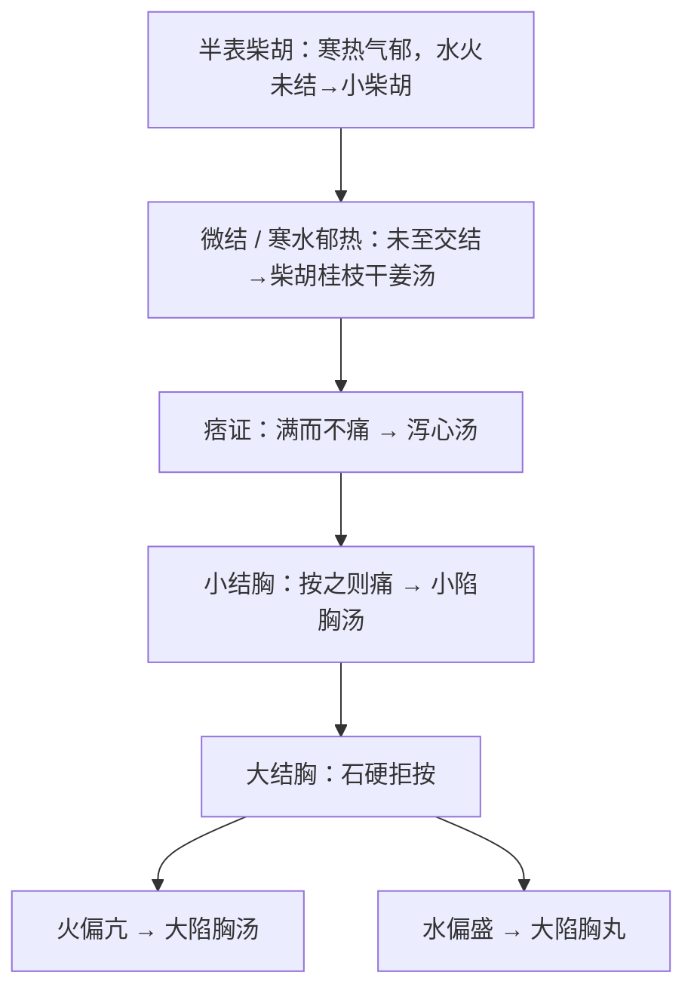
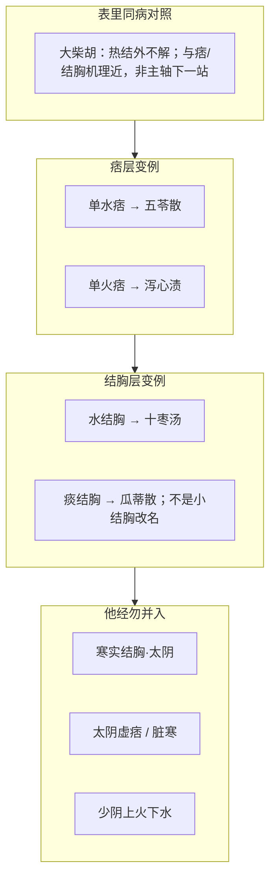
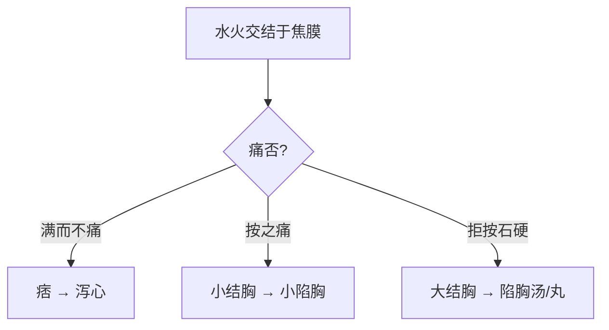

# 《伤寒论》有关疾病分类学纲目

> 副题：硕士研究生教学讲义  
> 编著：姚荷生　汪栋材  
> 整理协助：刁军成　姚茞龄  
> 原印：江西中医学院研究生科  
> 电子底本：网络流传扫描整理本（北斗导航，2022.12.05）  
> 本稿：据 PDF 文字层转写；章节大纲按原书目录四级重建（六经总题 → 主证/变证 → 表里纲 → 病名目）。  
> 校对：对底本残留明显讹误作迳改（如成无已→成无己、名白横→名曰横、后贻→后遗、少明→少阴等）；条目标题字段已规范分段（不加粗）。  
> 条号：依原书所引序号照录（整理者云近商务印书馆光绪本），与通行宋本 398 条或有出入，不擅改。

---

## 整理者前言

古代中医属于百工之一，个人除了自我学习历代著作，大多还要拜师学艺方能成才，古时一日为师，终身为父，关系严肃而深刻。年移代革，时过境迁，现在师徒联系越来越弱，很多老先生虽然各有学生，师门广大，但多得官运而少有荷担传承者，后人为个人前途命运计，或生前已冷落，或树倒猢狲散，早早自立分家，别开生面，一味创新与炒作，甚至断绝代际传承，扭曲、移植、隐藏前人成果，造成建国以后个人学术传不过三代的尴尬局面，最后松松散散没有深度，做的多是低级重复的工作。在这种环境下，江西姚派显得尤为可贵，通过家族血脉实现了对于传承的坚守，在脉学、伤寒等多个领域进行了三代百年的研究，成果璀璨，本书就是成果之一，严谨深刻，值得学习、效法。本文档是由网络流传的原书扫描文件整理的。整理原因：1、帮助推广江西姚派学术。2、促进读者提高学术与诊疗水平。3、扫描文件质劣，整理可以提高可读性。4、打击倒卖者，帮助其少赚黑心钱。整理除照录全文，较于原本另有如下变化：1、标点：二十年来标点符号的用法逐渐规范，故整理时根据现行《标点符号用法》(GB/T 15834-2011)进行部分标点符号的修正与增补，对一些当断未断的地方增加标点以降低阅读难度。对药名后的炮制文字，以及其他夹注类文字，均加圆括号。2、校补：本世纪初输入法尚未成熟，且转手他人录入，利益无关，没有校对，故原件中多有讹误。整理时对明显录入错误迳改，不作特别标明。原文有些地方出现了空格，联系上下文以意揣之，发现多半是录入人员不会输入疑难字导致的，整理时尽力进行了合理的填补，少数仍留白。原书所引《伤寒论》原文及序号，应系“光绪二十五年商务印书馆”刊印的《伤寒论》的版本原文与序号，文字略有出入，本人无法得见相应版本，故对于《伤寒论》内引文、序号，除明显录入错误外，均不予以修改。此本与当下通行本采用的《伤寒论》条文序号不尽相同，但最多不会前后移位三条，读者可以自行查找，增补。原文证、症、条、节的用法不同于今，不做修改。《伤寒论》外相关方药原文的引用文字进行了校对，人名错误迳改，使用非通用药名，剂量不符或缺失等情况不修正。为了便于阅览，进行规范，对于栏目标题做了加粗，将药物组成直接以冒号连接在方名后，不另作分段。对个别有制法服法但未分出的地方进行了分离。正文第一页首就有六经辨证论治的大号标题高悬，概括了全部正文内容而无其他同级标题呼应，应是本书内容仅编著者写作计划之一角，因篇幅、时间、环境的局限，未能完全编写、出版。整理均为一人完成，学业紧张，时间有限，个人难免疏忽，若发现有文字错漏及其他资料，欢迎联系QQ344804669 进行反馈、交流、更新版本，万分感谢。

*北斗导航*

*2022.12.05*

---

## 目录

- 六经辨证论治
  - 太阳主证
    - 表证
      - 一、伤寒(表实)
      - 二、中(伤)风表虚
    - 表里同病(客寒动水)
      - 一、水饮犯肺
      - 二、水停心下
      - 三、水蓄膀胱
  - 太阳变证
    - 表证
      - 一、寒风闭热
      - 二、素质阴虚风寒郁热
      - 三、风温
      - 四、营卫自虚(不和)
      - 五、水郁肤表
      - 六、刚痉(风寒痉)
      - 七、柔痉(风湿痉)
      - 八、风湿(湿痹之一)
      - 九、中暍(伤暑)
    - 里证
      - 一、热结膀胱
  - 阳明主证
    - 里证
      - 一、胃热
      - 二、肠热
      - 三、津虚便秘(蜜煎导证)
    - 表证
      - 一、风温
      - 二、风燥
    - 表里同病
      - 一、热郁胸膈
  - 阳明变证
    - 里证
      - 一、水谷不别(痼瘕)
      - 二、湿热发黄
    - 表证
      - 一、风寒
      - 二、风湿
  - 少阳主证
    - 半表证
      - 一、少阳中风
      - 二、少阳伤寒
    - 表里同病
      - 一、热结外不解
    - 半里证
      - 一、痞证(水火交结)
      - 二、结胸(热实结胸)
  - 少阳变证
    - 半表证
      - 一、水饮游移
      - 二、寒水郁热
    - 半里证
      - 一、单水痞
      - 二、单火痞
      - 三、水结胸
      - 四、痰结胸
  - 太阴主证
    - 里证
      - 一、中寒挟湿
      - 二、脾虚气滞
    - 表证
      - 一、太阴伤寒(寒湿)
      - 二、太阴中风(风湿)
      - 三、营气不足
    - 表里同病
      - 一、客寒内陷
      - 二、中虚挟表(虚痞挟表)
  - 太阴变证
    - 里证
      - 一、脾约
      - 二、寒邪格热于上
      - 三、寒实结胸
      - 四、脏寒类痞
    - 表里同病
      - 一、霍乱挟表
      - 二、气虚受暑
  - 少阴主证
    - 里证
      - 一、虚热
      - 二、虚寒
      - 三、真寒假热(阴盛格阳)
    - 表证
      - 一、中风
      - 二、伤寒
    - 表里同病
      - 一、历节风痛
      - 二、阴虚水逆
      - 三、阳虚水逆
      - 四、协热利
  - 少阴变证
    - 里证
      - 一、心血空虚
      - 二、阴虚尿血
      - 三、虚利(痢)
      - 四、下厥上竭(衄血)
      - 五、热结旁流
      - 六、冷结关元
    - 表证
      - 一、汗伤心气
      - 二、汗动肾气
  - 厥阴主证
    - 里证
      - 一、阴阳错杂(虚风内动)
      - 二、阴阳消长(厥热交替)
      - 三、有阳无阴(纯阳证)
      - 四、有阴无阳(纯阴证)
    - 表里同病
      - 一、热入血室
    - 表证
      - 一、伤寒(血虚感寒)
  - 厥阴变证
    - 里证
      - 一、水渍入胃
      - 二、血虚寒疝
      - 三、肝寒犯胃
      - 四、便血
      - 五、肝肾阴寒(脏厥)
    - 表里同病
      - 一、肝乘脾
      - 二、肝乘肺
      - 三、喉痹(寒风郁火)
    - 表证
      - 一、协热利

---

## 六经辨证论治

1、《伤寒论》乃仲景为伤寒疾病流行而作，故详于寒证而略于其它病变，其所以能统属万病者，因其以六经六气结合八纲作疾病分类方法。六经上应天之六气，下应地之五行(含相火)。外合经脉，内合脏腑，经气有兼挟传变，经脏有相互影响，疾病纵有千般，都不外病因(六气为主)特性干扰机体(经、脏为主)某部(病所部位)之机能之所致，因而《伤寒论》尽管在病例上有其一定的范围，但对其他病变仍可相对统属，正是这种关系。2、六经立足于经脉，而不完全等于十二经脉，因为六经乃经天之六气，故经有二个含义：经气、经界。经界指经脉诊区，经气则有阴阳之属性。六经提纲，即以脉证之表现，实六气之性质为主，因而六经提纲中的证候，当然即六经主证的核心，而却非六经现证的总纲。3、《伤寒论》以六经六气结合八纲作为疾病分类方法，根据这种分类方法来划分六经之主证与变证。所谓六经主证即本经的主气作为病因侵犯了本经所主之部位而形成的病证。变证则是本经主气之外的客气为病，根据其病位有无兼挟与转属，则有本经变证、兼挟他经变证和转属他经变证之分。本经变证是病因变化而病位没离本经，为本书变证的主要内容。兼挟他经变证和转属他经变证则可归入兼挟证(即合病、并病)，或直接属于他经的病证。

### 太阳主证

#### 表证

##### 一、伤寒(表实)

有关原文：1、35、3、46、17、31、38。

证候：头项强痛，或已发热，或未发热，必恶风寒，无汗，身疼，(或)腰痛、骨节疼痛，喘(兼呕)，呕逆而胸满，脉浮紧，(阴阳俱紧)或浮数，或但浮(虽不紧数，但必不弱)。

病因病机：总的为寒风(56、38)外束肤表卫分(12)，寒性凝敛，外束侵犯太阳经脉，则疼痛下引后项拘急不适。其外扰营卫则寒热并作，不过初起卫阳有的一时不得伸张而表现或未发热，少顷卫阳奋起与寒邪相争即发热明显增高，恶风寒还是必然存在，营卫受阻无汗而身疼、腰痛、骨节疼痛，甚则气机不利逆而犯肺则喘，犯胃则呕，脉象因正气奋起与邪相争而现浮，但终因寒邪外束有力而现紧数。

鉴别：伤寒表实与中风表虚鉴别在于无汗脉紧，寒热较甚，头身紧痛，脉紧与弦相配，但弦直上下行、紧如转索，左右弹指(内外)南方较少典型(卑湿之地湿性缓，寒闭较轻之故)，正因其有右左弹指显示不静，故兼数象，但现浮者并必有力而不缓弱。与风温鉴别，发热不恶寒。与风湿鉴别，风湿身疼重。

治法：当发其汗(51)(辛温发表取微汗，以驱客寒)

方药：麻黄汤主之(35、46)：麻黄三两(去节)，桂枝二两(去皮)，甘草一两(炙)，杏仁七十个(去皮尖)。

煎法：四味以水九升，先煮麻黄，减二升去上沫内诸药，煮取二升，去滓。

服法：温服八合，覆取微汗不须啜粥，若一服汗出病差(服药后)，停后服不必尽剂，若不汗更服依前法，一日一夜服一剂尽(参考桂枝汤方后服法如桂枝汤将息(包括禁忌))。

服后反应：太阳病无汗(恶寒)发热身疼痛(失治)八九日不解表证仍在，此(仍)当(以麻黄汤)发其汗，服药已微除(但因其表卫阳之气被郁过重而有化热趋势以致)其人发烦，目瞑，剧者必衄，衄乃解(46)。

预后：太阳病七日已去，脉浮细而嗜卧，外已解也，设后遗有胸满胁痛，与小柴胡汤，脉但浮者(再)与麻黄汤(37)。

转归：太阳伤寒表实证，当恶寒发热，脉若静者为不传，颇欲吐，若躁烦脉数急者，为欲传也，服药如法，可一剂知，二剂已，(不服药)可七日愈，以行其经尽故也，如欲传阳明，针足阳明(三里穴)使经不传则愈。

##### 二、中(伤)风表虚

有关原文：1、13、169、2、12，61、147、386、42。

证候：头项强痛，发热，汗出恶风，寒，身疼，(或)鼻鸣干呕，脉浮(浮弱(42)、阳浮阴弱(12))。

病因病机：风主疏泄而寒性凝敛，风挟寒束表故仍可压迫经脉而头痛项强，肌表感受外邪毛窍仍欲闭拒而啬啬恶寒，欲闭不能自充藩篱空疏而淅淅恶风，此难开难合形成翕翕发热，开则营弱汗出，而热势暂低，合则卫阳浮越而热势复高，毛窍开合不利鼻亦难独任呼吸，壅塞不通而或鼻鸣，肌肉受邪，影响脾胃升降失常而干呕，邪正相争于表，卫阳较强，故脉浮，营阴偏弱，稍按又觉弛缓无力，而非紧实。

鉴别：与伤寒表实鉴别，在于有汗不彻，脉浮缓不紧。与风湿鉴别，头身痛沉重感或首如裹，一般风湿汗出不能下达且寒热都不太显著，只是不欲去衣服，手足温温发热而不自觉，但风湿过重，突发体较壮实亦有振寒壮热头痛身痛呻吟不已者，但汗终难下达，甚至无汗。

治法：欲救邪风(96)当以和营解肌(17)而后得汗病解(42)。

方药：桂枝汤主之(12、13、42)：桂枝三两(去皮)，芍药三两，甘草二两(炙)，生姜三两(切)，大枣十二枚(擘)。

煎法：五味㕮咀，以水七升微火煮取三升，去滓。

服法：适寒温服一升，服已须臾，啜热粥一升余，以助药力，温覆令一时许。遍身微似有汗者益佳，不可令如水流漓，病必不除。若不汗，更服依前法，又不汗后服小促其间，半日许令三服尽。若病重者，一日一夜服。周时观之，服一剂尽，病证犹在者，更作服若汗不出者，乃服二三剂。

服后反应：有的先烦汗解(119)，有的热多寒少一日二三度发，如疟状而不呕，圊便自可，脉微缓者，为欲愈也(23)。禁忌：禁生冷、粘滑、肉面、五辛、酒酪、臭恶等物。禁用：桂枝本为解肌，若其人脉浮紧，恶寒发热汗不出者不可与服之。酒客(即使患此) 病(仍)不可与桂枝汤。得汤则呕以酒客(往往湿邪内蕴)不喜甘故也。

#### 表里同病(客寒动水)

太阳为寒水之经，寒为水之气，同气相求很容易引动水饮，太阳之气出入于心胸，若被客寒所阻气遇寒变化为水(废水)停于心下膈间，上逆犯肺宣降失职，不能布津通调，则为喘咳胸满。阻于中脘不能下交于肾，则悸动不安。或更心下满痛，甚则水渍入胃下走肠间而为肠鸣(沥沥有声)下利，蓄于膀胱不能化气行水，则小便不利少腹满而苦里急。它们的病因病机既可简述如上，因而它们的证候鉴别除体表之发热不解之外，水在上焦者，以喘咳胸满为特点，水在中焦者以心悸心下逆满为特点，水在下焦者以小便不利少腹满必苦里急为特点，尽管有时会交叉出现但病机分析依然可以从此处着眼，不过水在上焦(水饮犯肺)现症比较稳定，一切分目均照原定分列，到了水在中焦(水停心下)则因治疗经过反应，个别症状更不稳定，为了叙述方便只有基本保持原文叙述方式，总的因机鉴别先作交待外，其中个别证状的发作机理见下列夹注之中，此外，还有水郁肌腠的特殊表现只好附列于三者之后。
     太阳表里同病·客寒动水
     表寒发热不解（贯穿）

┌──人身──┐          ┌────────侧面（证·方）────────┐
│        │          │                            │
│  上焦  │··········│ 水饮犯肺                    │
│ (胸)    │          │ 症：喘咳胸满                │
│           │          │ 方：小青龙汤                │
│           │          ├────────────────────────────┤
│  中焦  │··········│ 水停心下                    │
│(心下)  │          │ 心下悸 → 茯苓甘草汤         │
│            │          │ 心下逆满、起则眩 → 苓桂术甘汤│
│            │          │ 脐下悸欲奔豚 → 苓桂枣甘汤   │
│            │          │ 心下满微痛（表里俱重）       │
│            │          │   → 桂枝去芍加茯苓白术汤    │
│            │          │ 肠鸣下利 → 茯苓甘草汤先治水 │
│            │          ├────────────────────────────┤
│  下焦  │··········│ 水蓄膀胱                    │
│(少腹)  │          │ 症：小便不利·少腹满·苦里急  │
│            │          │ 方：五苓散                  │
└────────┘          └────────────────────────────┘
##### 一、水饮犯肺

有关原文：40、41、37。

证候：(恶寒无汗)(参麻黄汤)发热之表证不解，咳而微喘，甚则喘而胸满(参37，《金匮·痰饮篇》)干呕，不渴，或(先)渴后呕(参《金匮·痰饮篇》)，或(饮食梗阻而)噎或利，甚或小便不利少腹满，脉浮而紧(弦)。

病因病机：太阳伤寒(40、41)表寒不解(40)，心下有水气(40、41)，上逆犯肺肺气不利(或因太阳风寒表证以饮水多或以水灌之取汗均可致喘(75))。

证候鉴别：表之寒热无汗不解之外主要为咳喘，甚则胸满。

治法：表里双解，散寒涤饮。

方药：小青龙汤：麻黄三两(去节)，芍药三两，五味子半升，干姜三两，甘草三两(炙)，细辛三两，桂枝三两半，半夏半升(汤洗)。

煎法：八味以水一斗先煮麻黄减二升，去上沫纳诸药，煮取三升去滓。

服法：温服一升(日三服)。

预后：服药已渴者寒饮去欲解(41)。

##### 二、水停心下

有关原文：72、130、354、28、66、64。

证候：
(1)表里俱轻：伤寒表(之寒热)不解(参(40)小青龙汤)，汗出不渴，小便利(130)(只是因为医欲)以(饮水取汗而)饮水(过)多必心下悸(此水停心下的表里俱轻证常见现象)，茯苓甘草汤主之。
(2)表里俱重：(若太阳伤寒，因)服桂枝汤(若发汗不及及表不解，医)或(又误)下之，(不但)仍(恶寒)头项强痛，翕翕发热无汗(并且)心下满微痛小便不利者(这就不但表寒较重，里水也有欲结之势，影响水道不畅，方宜稍重)，桂枝去桂加茯苓白术汤主之。
(3)表轻里重：(若太阳)伤寒(经过)若吐若下后(表证大减，却)心下逆满，气上冲胸，(是吐下伤阳)水停心下，仍欲表解，自觉心下胀满，气机上逆冲胸(清阳之气反为水气所郁，不能上升，而骤)起则头(觉)眩(冒，并且)脉(转)沉紧(大有由表入里的趋势，外邪虽有仍从外解之机，却不大)发(其)汗，茯苓桂枝白术甘草汤主之。
(4)表里俱轻，但初动肾气：(若)发汗(太过)后，其人(只出现)脐下悸欲作奔豚(而未成，是客寒初动肾气而水势未盛，可以)茯苓桂枝甘草大枣汤主之。

治法：水停心下，基本上以解表行水为原则视其轻重不同，而选方择药各异。

方药：①表里俱轻者，宜茯苓甘草汤：茯苓二两，桂枝二两(去皮)，生姜三两(切)，甘草一两(炙)。以水四升，煮取二升，去滓，分温三服。 ②表里俱重者：宜桂枝去芍加茯苓白术汤：桂枝三两，甘草二两(炙)，生姜、茯苓、白术各三两，大枣十二枚。六味㕮咀以水八升，煮取三升去滓，温服一升小便利愈。 ③表轻里重者：宜茯苓桂枝白术甘草汤：茯苓四两，桂枝三两(去皮)，白术、甘草各二两。四味，以水六升煮取三升，分温三服。 ④表里俱轻初动肾气：宜茯苓桂枝甘草大枣汤：茯苓半斤，甘草二两(炙)，大枣十五枚(擘)，桂枝四两(去皮)。四味以甘澜水一斗，先煮茯苓减二升，内诸药，煮取三升去滓，温服一升，日三服。作甘澜水法：取水二斗置大盆内，以杓扬之，水上有珠子五六千颗相逐取用之。

##### 三、水蓄膀胱

有关原文：70、72、73、162。

证候：太阳风寒病(表之寒热)不解，微烦热汗出渴欲饮水，水入则吐(甚或形同)消渴，水药不得入口，小便不利，少腹满，必苦里急(或)下利，脉浮兼数。

病因病机：本病多由太阳病发汗不当(70、71、76)或饮水过多(130)阳气受伤，阳伤不能卫外则恶寒微热不解，阳不能使寒水化气升津则烦渴，时欲饮水有的消渴，但喜热饮而量不多，水入反自觉欲吐，甚则水药不得入口，气不化则水不出而小便不利，蓄于膀胱则少腹满而胀急(难以忍耐)，废水不能从尿道正常排出，有的横溢谷道下利。表里之正邪分争，脉自浮不静了。

证候鉴别：烦渴消渴有似热伤津液，但水入则吐是供鉴别。水停中上小便均或不利，但少腹满而苦里急则为水蓄下焦膀胱之特征。

治法：当利其小便(160)，若更发其汗(重伤其阳)，必吐下不止(76)。

方药：五苓散主之(70、71、72、73、144、244、385)：茯苓、白术各十八铢，猪苓十八铢，泽泻一两六铢，桂枝半两(去皮)。

煎法：上五味，捣为散。

服法：以白饮和服方寸匕，日三服，多饮暖水，汗出愈，如法将息。

### 太阳变证

#### 表证

##### 一、寒风闭热

有关原文：38、27、46、24、48、105、126、55、56。

证候：太阳中风而挟寒较重，脉浮紧，发热恶寒，头身疼痛之势都比较突出，不汗出而且烦躁不安者，此为寒风闭热重症的典型表现，宜大青龙汤主之。若发热恶寒而发热多(较重)，恶寒少(较轻)，汗出不彻而郁郁微烦，脉浮稍数者，此寒风闭热的轻症，只须桂枝二越婢一汤方。若太阳病，麻黄证具，八九日不解，表证仍在，此当仍以麻黄汤发其汗，但服药以后，恶寒已微除，其人反烦热，目因畏光而瞑合，剧者必衄，衄后病乃得解，所以然者，卫阳之气为外寒久闭而化热较重故也。当其未衄之前未尝不可与桂枝二越婢一汤之类主之。若太阳病桂枝证具，但初服桂枝汤，反烦不解，头痛不已者，或虽已解而半日许复烦，脉数者，此寒风郁热于经脉，宜先刺风池、风府以泄经脉之热，却再与桂枝汤以祛风寒则愈。

病因病机：风性易动，故六气以风为阳邪，风主疏泄，故外风多现有汗。不过风势之动，常挟寒挟热与之同来。挟热者，即为风热(温)，挟寒者，即为风寒。太阳桂枝证名为中风，3、12 条之风，乃风寒之风。风虽疏泄而寒性凝敛，其有汗无汗当视其挟寒之轻重而有时不同，**挟寒较轻当然风胜表虚而有汗，挟寒较重当然寒胜表实而无汗**。所以，38 节的大青龙汤证，尽管原文称为太阳中风，而脉证除了烦躁为热外，实与麻黄证之名为伤寒者无异，并且从大青龙汤的麻黄用量倍于麻黄汤，可以推知其寒闭的程度，必更有甚于麻黄汤证者。不过要知道，这只是寒风闭热典型重证的用药方法。其实寒风闭热无论气候失常、生活失节都会造成这种临床常见的病变，其发病机理并不局限于太阳一经，其治疗方法也并不局限于大青龙汤一种。以太阳一经而论，原文就有四节之多，治疗之轻重缓急已自各异，27 节桂二越一所主治之证状记载中不够具备，但从以方测证之惯例看来，药味与大青龙汤基本相同，而用量则相差甚远，不及十分，无异示人以两方主治之病因病机相同，其现证自然亦同，而只有轻重的差别罢了。这与我们临床常见非常相符，并以后方适应范围更广。因此，原文虽较难解，编者不得不尽其所知，适当延伸其应用证状，以求达到本方之推广应用。其义另详拙作《伤寒论27 节难解条文》，兹不复赘。46 与27 节，同样是太阳本经寒风闭热的变证，不过却是发病过程中，因机已微微有所转化，直至随证治之引起反烦不解，才发现它同中有异。如46 节原属寒邪外来之麻黄证，因八日没有得到及时适当的治疗而病未解除，只要表寒仍在，依法本可仍予麻黄汤，不料卫阳被寒闭已久而化热较重，以致服麻黄汤后，恶寒虽稍见减轻，却引起发烦，两目畏光而不能张开，原不应有的反应，仲师据此作了上述的因机解释，并预测其衄解的转归，却没有举方备用，愚意以为桂二越一正好用上。不只是说明它应用之广，像这种衄即可解之病情，似乎正是桂二越一的轻剂所适合，未必一定要用大青龙的牛刀小试。24 节初具桂枝证即已初服桂枝汤，其反烦不解虽非因失治导致转变，但热伏经脉，有非一般解肌之桂枝汤所易直达者，是其因机原已同中略异，不如先刺风池风府，以直泄其经脉之热，而后再与桂枝汤以解肌表之风寒，使之两不相妨，顺利地达到两解之目的。于此可见，寒邪闭热发病之多机理稍有不同，即当以不同的具体方法对待。

证候鉴别：大青龙证既然是寒风闭热的典型证状，那么，列举本病的主要脉证，应以大青龙证为准，也就是本病除具有麻桂的风寒主证之外，其闭热的鉴别特点，公认在于不汗出而烦躁。因为烦躁多属热象，不汗出正示寒闭的机理，这与麻黄汤证区别是不成问题的。若桂枝证，本自汗出(12、13、52、53 等节)，脉浮紧，发热汗不出者，是不可与桂枝汤的(17)。即云自汗，何闭之有？此因桂枝证之自汗，只是对麻黄证之无汗而言，其实它的发病机理，仍属汗出不彻。临床常见的桂枝证，得汗则发热之势暂低，汗收则发热之势复高，必须以桂枝汤复发其汗，然后才会好转，即其有力的反证。汗出不彻本身就存在郁闭的机理，它与无汗只是寒闭轻重程度之分(包括脉紧与缓，又参考下文阴虚风寒郁热，自汗出而心烦)，读者幸勿以辞害义，才不会陷于胶柱鼓瑟。其次，是烦躁与热多，很多疾病甚至寒热性质相反，顺逆机转关头都可出现。本病的因机属于寒风闭热，正好具备相反的两种因素，请仅就本病范围，鉴别其烦躁与热多两种证状的顺逆机转。上面已经指出，烦躁多属热象，热多，在具有热的因素的本病，无可否认也代表热的象征。不过我们无论从脉证或方药的主次分析，本病的主要矛盾还在寒闭方面，而不在烦热。大青龙的烦躁并作恶寒、无汗、身疼、脉紧等寒闭的现象特别突出，其发热并多(重)于恶寒。相反，桂二越一的热多寒少一证而烦躁反无明显记载，说明寒闭其热的烦躁，关键仍在于寒。大青龙证寒闭更重则烦躁亦重，桂二越一寒闭较轻，则烦躁亦轻，因为表寒轻则所闭之热易于外达，故表热重于恶寒而内烦反不自觉。这正是桂二越一虽与大青龙同属表寒闭热，而轻重则相差很远的缘故，也正是表寒闭热与表里俱热的鉴别特点。假使属于表里俱热，则不但外证一定俱热不寒，并且内烦重则外热亦随之更重，决不像热为外寒所闭，其表热多于寒，反内烦容易外达而反不自觉也。因此，更可以悟到纯属外感风寒，并无郁热之桂枝证，在欲解未解之前，可以先烦汗解，乃被郁压之卫阳斗争欲出之先兆也。在表解不了了者，可以半日许复烦，卫阳欲解而全畅。若本文之服桂枝汤反烦不解，头痛不已，则知兼有热伏经脉，一时不易外达，初次得到桂枝之辛温，不免反助其热，故必先刺风池，风府，直泄其经脉之热，再与桂枝汤以祛外寒，则不致寒热两妨，而易于两解矣。46 节的麻黄证，寒中较重，但热非原有，乃卫阳郁久所化，自然热势较轻，服麻黄后尽管也增加了内烦，但寒势已减，因而热之外达亦较易，得衄即可两解。那末，未衄之前，自然桂二越一即可胜任了。

治法：解表兼清，随证轻重，或先刺风池、风府，再与桂枝汤、

方药：①大青龙汤：麻黄六两(去节)，桂枝二两(去皮)，甘草二两(炙)，杏仁四十枚(去皮尖)，生姜三两(切)，大枣十枚(玉函经，成无己本均作十二枚擘)，石膏如鸡子大(碎)。

煎法：七味，以水九升，先煮麻黄减二升，去上沫，内诸药，煮取三升，去滓。

服法：温服一升，取微似汗，汗出多者，温粉粉之(成无己本作“温粉扑之”)，一服汗出者，停后服，汗多亡阳，遂虚，恶风，烦躁不得眠也。后遗：伤寒，大青龙汤发之后，身不疼但重，乍有轻时，无少阴证者，此津气未复，拟查难解条文。 ②桂枝二越婢一汤：桂枝(去皮)，芍药、麻黄(去节)、甘草各十八铢(炙)，大枣四枚(擘)，生姜一两二铢(切)，石膏二十四铢(碎，绵裹)。(林亿按：越婢汤：麻黄二两，生姜三两，甘草二两，石膏半斤，大枣十五枚)

煎法：七味，以水五升，煮麻黄一二沸去上沫，内诸药，煮取二升去滓。

服法：温服一升，本方当裁为越婢汤、桂枝汤合饮一升，今合为一方，桂枝汤二分，越婢汤一分(据宋本)。

##### 二、素质阴虚风寒郁热

此症与上列寒风闭热，从病因，病位来看本属同一病变——太阳寒风闭热，只是患者的机体素来稍偏阴虚，以致原发病形与续发转变都大相径庭。这在临床上虽属常见，而在《伤寒论》中却较少见，故不能不单独提出，使读者注意到，不但病因病位不同应该作不同的对待，即使二者相同而素质有异，也不能粗心大意地混同处理。否则，疾病即是同一伤寒，那么，理应治法只要同用发汗即可，何以有咽喉干燥，淋家，疮家，衄家……不可发汗的戒条，一连串即达七节之多，这正是辨证论治周密之所在，也就正是中医异病同治，同病异治，整体与个体灵活适应的特点。本症原发与续发辨证论治都较复杂，可与《伤寒论》难解条文第29 节互相参照。

有关原文：29、84、309。

证候：脉浮，发热，微恶寒，自汗出(汗出不彻)而心烦，小便短数，脚挛急，拟仿栝楼桂枝汤(见《金匮》)倍芍(参新加汤、芍药甘草汤)加苓(参考《千金》阴旦汤)之类主之。

因机鉴别：脉浮，寒热自汗乃风寒外犯的一般应有现证，其中宜加以注意者：
(1)原文并无发热的记载，乃论中简文互见之通例，决非无热恶寒的阴证。
(2)微恶寒由原文重点提出，可见有热多寒少的存在。
(3)寒风闭热与风寒郁热其因机基本相同，只是病因之主次，病机之轻重稍有差异。上文寒风闭热寒胜于风，寒性凝闭，故以不汗出而烦躁为鉴别中的典型证状，如27、24 等节以桂枝证为基本现象者，而汗出不彻仍属寒邪郁闭之征。“证象阳旦”(30 节语，阳旦汤即桂枝汤)，风胜于寒，风性涣散，故以自汗出而心烦为鉴别之点，不过桂枝证的中风到底属于寒风，其自汗同样属于汗出不彻，较之不汗出的凝闭程度自然较轻，这才不说闭而说郁罢了。这只是临床习用，借文字显示病机几微之别而已。此后，有关病邪互“郁”的含义，例多准此。
(4)心烦当然多数属于热象，**本节汗出不彻而心烦，正是热为风寒所郁的表现，直待误用纯辛温取汗，助长郁热之势而后心烦加重而为烦躁，与寒愈闭则热愈不得发越的不汗出而烦躁，正好显示郁与闭的轻重程度**。
(5)小便数主要指小便的次数频繁，如果色赤不畅，多为热迫所致；色白不利多为寒水不化；**色量一般而频数，多与亡津攸关**(先兆)。《论》中所谓“小便数者，大便必硬”“小便数少以津液当还入胃中，故知不久必大便也。”本节即只提小便数而未提及色与量，可见它与寒热的关系虽然不大，而导致亡津液——阴虚的前因，直至本病发时依然没有消失。
(6)脚挛急一证，阴阳寒热都可形成，根据原文“反与桂枝汤”的“反”字，下文从热化的突出，以及作芍药甘草汤，其脚即伸，以及30 节的“虚则两胫挛”，参合临床常见，断为素体阴虚，感受风寒郁热者——尤其是妇科较多，才容易产生这种因机比较复杂而又易于恢复的现象。
(7) 上文所引《论》中不可发汗84 节的咽喉干燥者，85 节的淋家，86 节的疮家，87 节的衄家，都可作素质阴虚，风寒郁热看待。

治法：原文只指出了误治之桂枝汤而未指出正面的治法。笔者认为在本病原发未经误治之前，似宜在桂枝解肌和营的基础之上，兼以清热生津。

处方：拟仿《金匮》治疗柔痉的栝楼桂枝汤，再仿本节芍药甘草汤倍芍，《千金》阴旦汤加芩。今收三方附例于下，以备参考。 ①金匮栝楼桂枝汤：栝楼根二两，桂枝三两，芍药三两，甘草二两，生姜三两，大枣十枚。

煎法：六味，以水九升，煮取三升。

服法：分温三服，微汗，汗不出，食顷啜热粥发。 ②本节芍药甘草汤：白(《玉函经》芍药上无白字)芍药、甘草各四两(炙)。

煎法：二味，以水三升，煮取一升五合，去滓。

服法：分温再服 ③《千金》阴旦汤：桂枝汤加黄芩一钱五分，干姜五分。

##### 三、风温

根据《伤寒论》第6节“太阳病，发热而渴不恶寒者，为温病。若发汗已，身灼热者名风温。”柯韵伯由此悟出“六经各具六气”，太阳病不仅有风寒症，同样也有风温症。不过，太阳主表，以寒为主气，因而，太阳以表之风寒为主症，而风温表症则属太阳表症中的变证罢了。

有关原文：6、115、117、62、165。

证候：发热而渴不恶寒，(初起或微恶风，参《温病条辨》)而热甚，其脉浮弱不弦紧，此风温外犯营卫，宜银翘、桑菊之类主之。有的误诊为太阳风寒反与辛温之桂枝汤，以致汗出而喘，表无大热，不可更行桂枝汤者，此风温已兼犯气分，可与麻黄杏仁甘草石膏汤。

因机与鉴别：
(1)原文第六节开头的“太阳病，发热而渴不恶寒者，为温病”数语，为太阳伤寒与温病总的鉴别要点，风温自不例外。不过，**温病学说的风温，指的都是风温表证——肌肤的卫分，营分受到外来的时气、风热的干扰**。**而《伤寒论》第六节原文从若误用辛温发汗以后，身转灼热者，名曰风温以下，已经转变为风温(里证、气分血分)坏病，不能再与风温表证同样看待**。历代注家混同立论，以致把原来想沟通伤寒、温病学说的一番美意，变得欲详反晦，义详拙作《伤寒论难解条文》第6、115。只有115 节的曲曲描绘，才活活画出风温表证的异同特点。故本文证候，首先根据第6 节标出温病共有之证以后，接着即以115 节脉象的原来语意殿之，以显示不但证不恶寒，脉不弦紧，可供温邪与寒邪总的鉴别，并且可与温病共同脉证之中的弱字，寻出风温表证的独异之点。
(2)温病学说以三焦，卫气营血作疾病分类，又以“卫之后方言气，营之后方言血”两语，显示其上下表里层次深浅之不同，颇引起后学对其严格次序的排列——尤其是伤寒、温病学说的对立统一发生疑问。我曾作简要示意图以明之。本文的麻杏甘石症正是由卫到气的例证。
(3)麻杏甘石证的症状：“汗出而喘，无大热。”据柯韵伯的意见认为原文有误，应改为：无汗出而喘，大热。”其他注家则多认为原文的无大热乃表无大热，个人觉得似以后者为是。因为《伤寒论》中对明属热症而反有无大热或微热记载不乏其例，如129 节的大结胸证，172 节的白虎汤加参证，242、252 节的大承气汤证，还有《金匮·水气篇》用越婢汤治疗风水，原文明白记载“自汗出无大热”，以及历节篇引《千金》越婢汤治脚弱的 “腠理开，汗大泄”的记载，难道原文都属错误必须一一如柯氏加以改正吗？尤其是临床常见风寒犯肺无汗为多，或汗出不彻，寒风闭热于肺，初起恶寒无汗，发热多高，得到合法治疗，寒除热透，往往热势暂时见高，立即汗出而热势随之渐退。若风温犯肺之表证，则多不恶风寒，更以有汗，热不高为常例(里热证大热大渴大汗例外)。可见风温表证之发热高低，关系到汗之有无，而汗出之彻不彻，更关系到恶风寒之轻重。本证既非寒风闭肺而属风温犯肺之表证，则当不恶风寒，最多微恶风寒，自然以汗出，无大热另常例了。**其所以反见肺气不利之喘，并非寒风闭塞毛窍，影响肺的呼吸的机理，是表虽无大热而风温上犯，却影响肺的清肃使然**。于此，更可反证本症的“汗出而喘，无大热”不但不是原文错误，而是正好与恶寒、高热、无汗而喘的麻黄症，适足构成鲜明对比的鉴别特点。

治法：前半属于风温犯卫分、营分的表证，解之之法仍当以汗出而愈，不过却宜辛凉解表而不是辛温解表；后半属于风温兼犯肺之气分的表证，则宜兼以甘寒以清气分之热。

处方：①附：桑菊饮(《温病条辨》方，辛凉轻剂)：桑叶二钱五分，菊花一钱，杏仁二钱，薄荷八分，连翘一钱五分，芦根二钱，苦桔梗二钱，甘草八分。

煎法：八味，水二杯，煮取一杯，去滓。

服法：日二服。 
![[Pasted image 20261119144437.png]]

![[Pasted image 20261119144424.png]]

②附银翘散(《温病条辨》方，辛凉平剂)：连翘一两，银花一两，薄荷六钱，牛蒡子六钱，竹叶四钱，生甘草五钱，苦桔梗六钱，荆芥穗四钱，淡豆豉五钱。

制法：九味杵为散，每服六钱，鲜芦根汤煎香气大出，即取服，勿过煮。肺药取轻清，过煮则味厚入中焦矣。

服法：病重者约二时一服，日三服夜一服，轻者三时一服，日二服夜一服。病不解者，再作服。
![[Pasted image 20261119144724.png]]

③麻黄杏仁甘草石膏汤：麻黄四两去节，杏仁五十个去皮尖，甘草二两(辑宋本有炙字，可疑)，石膏半斤，碎，绵裹。

煎法：四味，以水七升，先煮麻黄减二升，去上沫，内诸药，煮取二升，去滓。

服法：啜服一升(新辑宋本下有“本云黄耳杯”五字，但方后校释[一四]有云三字不可解，汪琥《伤寒论辨注》云：“想系置水器也”。日人丹波元坚《伤寒述义》云：“汪说难信”，或曰“此传写有伪脱，当是本云麻黄汤，今去桂枝加石膏。”)

##### 四、营卫自虚(不和)

此症根据第52、53 两节列出，原文叙证各有侧重不同，推理乍看似相矛盾，而处方却又同一桂枝汤，所以同样列为难解条文。串解时，不免大犯加字解经之戒。并且为了使之较易理解，不得不把此症已经各自发展之后的常用的不同处方分别举例，以显示其原发机理早具同中之异。

有关原文：52、53。

证候：病人藏无他病(却有的)常自汗出，恶风，(有的定)时发热自汗出，而(同样)不愈者。

病因病机：此为营卫自虚不共相和谐使然。不过，前者偏卫虚不能固表，不共营气和谐，后者偏营虚不能为卫之守，不共卫气和谐使然。因而营单独自行——沉涩于脉中，卫气单独自行——浮越于脉外，不能很好互相协调完成守卫(营为卫之守)作用，所以都要少与桂枝汤复发其汗，使之互通声息(信息)，才能恢复互相和谐守望相助的作用。不过后者发热即有定时，则须于发作之前进行这种处理，以便先发制人罢了。若二者分别发展到气虚不固(前者)和(后者发展到)阴虚血少阶段则病已转入或兼挟太阴或少阴。

证候鉴别：偏卫虚不固者，证多汗出恶风而未必发热，或虽微热而不自觉，汗出较多而清稀，发作虽属经常无故性，却也有时常阵发性。偏营虚不守者，发热并不见高，时间多在午后甚或入暮，并不恶风或发热前微觉怯寒，汗出不多而稠粘，得汗则热暂退。

治法：二者均须复发其汗，后者当先其时发汗，若前者发展到气虚不固，宜助气解表，如玉屏风散之类；后者发展到阴虚血少，宜育阴清热，如青蒿鳖甲汤之类。

处方：①桂枝汤：见太阳主证。 ②附1：玉屏风散或汤(《世医得效方》)：防风二两，黄芪六两，白术二两。

制法：研为细末。

服法：每服三～四钱，黄酒调服汤加生姜、大枣(量另定)。

煎法：清水煎服。 ③附2：青蒿鳖甲汤(《温病条辨》方)：青蒿二钱，鳖甲五钱，细生地四钱，知母二钱，丹皮三钱。

煎法：清水五杯煮取三杯。

服法：日再服(结合先其发热之前时服)。

##### 五、水郁肤表

有关原文：141。本病为太阳外感风寒，正当恶寒，发热，欲汗的高潮，医者误以古法口含冷水喷洒患者面部或浸灌患者全身以求退热而得与风寒内动其水者不同，故属太阳变证之一。今日这种原始疗法早已废置，但以冷水冰袋外敷仍在经常使用。因而本病并未绝迹，医者仍当注意。

证候：太阳外感风寒，正当恶寒，发热欲汗的高潮，误用冷水潠灌反之后，出现肉上(白㾦)粟起，弥更(五更终了的时候)益(更加)烦(躁)，意欲饮水反不(能解)渴者。

因机与鉴别：①本节原文首先诊断它“病在阳”而没有肯定三阳中哪一经，我们根据下文论治“应以汗解之，反以冷水潠之，若灌之……”知道，三阳不一定都要发汗，少阳并且有“不可发汗"的明文，以及临床常见事例，出首加上“太阳外感风寒，正当恶寒，发热，欲汗的高潮，误用……”云云，似不致有多大错误。 ②原文“其热被劫不得去”对本病的发病机理说的非常简明，正是中医对外感风寒高热忌冷敷冷浴的正确论据。因为外感风寒的发热，乃卫外之阳气(正气)抵抗寒邪(病因)驱逐外患的正常作用，与真正热性病变的发热，病为热气有余的表现，治疗应以“热者寒之” 有本质上的不同。 ③本证病机为郁热于肤表，那么热由何来？此热是病程高热之时，发热未透，“高热” 症状造成的后患。本证病机转归及病因的本质均为寒，热只是标热，是热在肤表被水所逼，残留在肌表，所以《金匮要略》的文蛤汤中用了麻杏甘石汤。中医治疗热证强调清解，不能过早使用苦寒，以防内闭，对于热性病变如此，更何况此为标热者。所以本证治疗只以文蛤一味，使水郁得散，余热得透，不以寒凉治而热证得除。 ④本病的主要三个证状，都与热为水郁于肤表的机理分不开，也就与热盛于里者大有区别。“肉上粟起”(白㾦)当然是水郁热于肤表的特征，它与热入血分的红疹不同。“弥更益烦”是热为水郁，乘五更终于平旦阴尽阳生时，热与水抗而烦甚，与实热为病，热邪不解则烦，持续不除不同。意欲饮水反不(能解)渴，热为废水所伏，真津不布，欲饮水不能解渴，与实热消耗津液，饮水自救，得水则快者不同。

治法：行水以清热。

处方：文蛤散：文蛤五两。

制法：一味为散。

服法：以沸汤和一钱匕(宋本作一方寸匕)服，汤用五合。

##### 六、刚痉(风寒痉)

刚、柔等本属杂病范围，古以伤寒为外感病变之总称。仲景作《伤寒杂病论》合十六卷，列痉、湿、暍于《金匮》(杂病)之首。以其与伤寒相似又重附于《伤寒论》之后。其所以《金匮》以脏腑辨证论治，而《伤寒论》则以六经辨证论治者，因为脏腑经脉五行六气都是人秉天地之气，与生俱来所固有的生理结构，不过脏腑居里，经脉居表，为了便于临床分类，才采取两种不同的做法。可见，无论六经辨证，脏腑辨证以及温病之三焦营卫气血辨证，都不外各取其便，作出疾病分类方法之一种罢了。本文把三百九十七法之外的痉、湿、暍病，合列于六经六气病变之中，不但取《金匮》的病名——如刚痉、柔痉等，并将温病学说的风寒痉、风温痉等(参考《温病条辨·解儿难》)夹注其后，说明各种疾病分类方法本属一脉相通，正如柯韵伯所云：“六经者，万病之六经，非独伤寒有也。”并且，一定要能融会各种文献记载，才能够为“六经各具六气”之说，找到比较充分与完整的例证。

有关原文：31、附399《金匮·痉湿暍篇》。

证候：太阳病，项背强几，发热、无汗，反恶风寒附，(甚则)无汗而小便反少，气上冲胸，口噤不得语(参考《金匮·痉湿暍篇》)，名曰刚痉，脉紧如弦直上下行(参考《金匮》)，葛根汤主之。

因机与鉴别：太阳经脉循身之背，上额交巅入络脑，还出别下项，**故风寒外犯太阳的一般全身证状**——陈注所谓气之为病，恶寒发热之中，**经脉受其影响即出现头部连项强痛，进而有项背强几几，此时虽未至于背反张，临床检查已具有项部轻度抵抗**。所以31 节出现此证的时侯，即可知其欲作刚痉而与葛根汤作同样的治疗，于此可见，**项背强几为病背反张之前驱。而太阳的刚痉、柔痉与厥阴督脉的痉症，则有病位之深浅，病因寒温之各异**，太阳的刚、柔二痉，观其所用方药应该说病因同属风寒，其伴随证候的鉴别应该一如麻、桂两方的无汗与有汗之分，无汗为表实，有汗为表虚，因而它的经脉强急程度，刚痉则强而有力，柔痉则强而无力(见陈莲舫批《金匮心典》)。不过根据原文叙证，还有更重要的

鉴别：**刚痉有发热、无汗、反恶寒，柔痉则发热、汗出而不恶寒**，此种区别似乎不像麻、桂两症那末简单，此义当于柔痉中再作申述。此外，本症还有寒动其水而小便反少，风势上逆而气上冲胸，风中经络而口噤不得语，这样，痉病的主证“胸满口噤”才算初步具备。

治法：辛温以驱风寒，升津以舒经脉。

方药：葛根汤：葛根四两，麻黄三两(去节)，桂枝二两(去皮)，生姜三两(切)，甘草二两(炙)，芍药二两，大枣十二枚(擘)。

煎法：七味以水一斗，先煮麻黄、葛根，减二升，去白沫(《玉函经》《外台秘要》均作去上沫)，内诸药，煮取三升，去滓。

服法：温服一升，覆取微似汗，不须啜粥，余如桂枝汤法将息及禁忌(宋本下有诸汤皆仿此)。

##### 七、柔痉(风湿痉)

有关原文：14、附402、附400。

证候：太阳病，项背强几几，发热，反汗出，恶风者，桂枝加葛根汤主之。(若)发汗太多(仍)发热汗出而不恶寒，身体(亦)强，脉反沉迟，名曰柔痉，师栝楼桂枝汤之大法，改取辛凉之银翘加花粉之类主之(参考《金匮·痉湿暍篇》)。

病因病机：本病初起有似太阳表证之中风——桂枝汤症。所不同，后者只头痛连项，而本病初起则项强连背，知其筋脉受病，大有发展成为欲作柔痉之先兆。不过，此时风寒尚未全去，故现证仍觉恶风，用药只须在桂枝汤辛温解肌祛寒风的基础上加葛根的藤，其最长入土最深，能引黄泉之水上达(参考唐14 节方后注)，因而可升津以舒筋脉者，即可胜任。若用不如法，发汗太多，风寒虽去，恶寒已罢，但津液更伤而全身俱强，其脉反现沉迟，一如新加汤之营虚而少(参考61、50、49 节)，则不得不改取栝楼根(天花粉)的甘酸微寒，生津润燥不为功了。不过，不恶寒而仍与桂枝汤不免令人怀疑，再详于下。

证候鉴别：(根据)《伤寒论》第3 节“太阳病，或已发热，或未发热，必恶寒……” 第6 节“太阳病，发热而渴不恶寒者为温病。”的原文，是仲景对伤寒，温病两种病变的证候鉴别的大前提，临床上奉行至今，丝毫不爽。自温病学说成熟以后，两病的治疗大法，风寒表症宜辛温解表，风温表症宜辛凉解表，几乎也已经得到医家公认。刚痉、柔痉虽同为痉病的表症，但刚痉发热无汗恶寒，初起的前驱证状与刚痉同样恶风寒，此时病因的风寒当然尚未全去，那末它的治疗，仍当以风寒论治，桂枝加葛根可也。**及至汗多亡津，寒已化热，一转而为不恶寒，则本质已变——病因已由寒转热，论治即当随之由辛温转为辛凉，也就是说不应该仍以风寒看待，而应当以风温看待**。因此，笔者对本病参考吴氏论痉，迳以风温夹注于柔痉之后，奈何仲景明知“发汗太多”为太阳致痉之因，“发热汗出而不恶寒”为柔痉之特征，用药虽改取栝楼根之甘寒为君，而基本方却仍不弃温之桂枝汤呢？意者当时辛凉概念并不成熟，明知形作伤寒而实非伤寒的风温表证并未处方，以致对由风寒转化为风温之柔痉，亦原未处方。栝楼桂枝汤一方只是后人(包括笔者在内)认为适合柔痉的主方罢了。一如笔者欲启发后学，融合伤寒、杂病、温病为一体，因而作出集李杜句而非李杜诗的未必恰当的安排。其实，本方《金匮》原文上文本有“太阳病，其证备”的字样，尽管三字也可以用“形作伤寒”，病证像桂枝证，但不包括桂枝证的恶寒，未必恶寒。临床上由风寒转为风热的痉证，也未必不具有恶寒未罢的过释，原意即非专为恶寒的柔痉而设，仲景何矛盾之有哉？笔者既凭主观愿望作了这样的安排，那么鉴别治疗的实际运用，就不能不提出这必不可少的疑问。并必须切实指出柔痉与刚痉的证候鉴别，不只如陈莲舫所指：无汗为表实，刚痉者强而有力，有汗为表虚，柔痉者强而无力。更重要的是，刚痉发热无汗而恶寒，因为本质(病因)为风寒，柔痉发热汗出不恶寒，因为它误汗出伤阴，风寒已质变而为风热，因而栝楼桂枝汤只能作为生津兼解表治疗大法来师承，具体方药，只好**改取银翘加栝楼根**之类来狗尾续貂，以免误人自误。好在原书具在，读者尽按而指正之。

治法：师栝楼桂枝汤大法，改取甘寒清润，兼辛凉以解其表。

处方：①桂枝加葛根汤：即桂枝汤加葛根四两。 ②栝楼桂枝汤(《金匮》方)：栝楼根二两，桂枝三两，芍药三两，甘草二两，生姜三两，大枣十二枚。

煎法：六味，以水九升，煮取三升。

服法：分温三服，(取)微汗。汗不出，食顷，啜热粥(以助)发。
新加汤与栝楼桂枝汤同可出现在「汗后脉沉迟」一带，但：  新加汤补的是营气虚少（身痛）；栝楼桂枝汤补的是津伤筋燥（体强／痉）。

③银翘散(见前风温)加瓜蒌根为主药。

##### 八、风湿(湿痹之一)

有关原文：附404、177、28、21。

证候：太阳病，风湿相搏而身体疼烦(而重)不能自转侧，不呕不渴，脉浮虚而涩者，**桂枝附子汤**主之。若其人大便硬，小便自利者，**去桂加白术汤**主之。(若恶寒)头项强痛，翕翕发热无汗，可与麻黄加术汤(参考《金匮·痉湿暍篇》)。

|     | 风湿挟寒痹表（偏实） | 风湿犯表 + 卫气不足（偏虚）     |
| --- | ---------- | ------------------- |
| 汗   | 多无汗        | 汗出恶风，但汗出不彻（剂颈/剂腰而还） |
| 寒热  | 恶寒可稍显      | 发热微，甚不自觉            |
| 脉   | 浮，或兼弦涩     | 浮虚而涩                |
| 代表方 | 麻黄加术汤      | 桂枝附子汤               |
| 法   | 辛温发表兼运湿    | 助卫＋温阳胜湿             |
**汗出不彻与桂枝中风不同：风湿是湿趋下，下部难汗；中风是一时全身、一时又收。**
**若兼 脉沉、小便不利、大便（溏而）反快 → 已是太阳兼太阴，里湿在太阴，不单表证**。

因机与鉴别：**太阳为寒水之经，故以外感风寒为其主证，外感风温(热)为其变证，至若风湿则水湿同源，更易类聚**。**肢体烦疼现象非常近似营卫受阻，机理也基本相符，所不同者，寒性凝敛，故以恶风寒为主而体痛次之，湿性滞着，不但以体痛为主并多在关节痛而兼重，不易转侧，恶风寒则多不显著或只是关节恶风，发热更是多不自觉**。典型痹证并不一定发热，全身寒热既不常有，因而汗出一证，本不足据为鉴别，本文援引28 节的翕翕发热无汗与21 节的汗出恶风者，不过藉作麻黄加术汤与桂枝附子汤一属表实，一属表虚的难得成例罢了。其实**太阳风寒与风湿的鉴别，重点不在汗之有无，并且二者有汗也同属汗出不彻**。不过**风寒的汗出不彻是时有时收，风湿的汗出不彻则是汗出不能下达或剂颈或剂腰而已**。脉浮虚而涩当然是太阳风湿表虚——桂枝附子汤证的脉候，麻黄加术汤表实的脉候，《金匮》原文虽未指出，未尝不可据此推知其脉亦浮但不虚弱而兼弦涩。临床典型湿痹本属杂病范围，易涉多经多气新痼结合，脉证未必如此单纯，今既以太阳表证论治，自当从单元立论，以示一般常规的同中之异。

治法与预后：**表实者，当以发其汗为宜，慎不可以火攻之**(见《金匮·痉湿暍篇》)。**表虚者，亦当以汗出而解(附408)，但均不可令其汗大出。(若)值天阴雨不止，(肢体疼痛发作较甚)，医云此可发其汗……汗大出者，但风气去，湿气在，(病必)不愈，(若)但微微似欲汗出者，风湿才可俱去也(附408)。**

方药：①麻黄加术汤(《金匮》方)：麻黄三两(去节)，桂枝二两，杏仁七十(俱去皮尖)，甘草一两(炙)，白术四两。

煎法：五味以水九升，先煮麻黄减二升，去上沫，内诸药，煮取二升半，去滓。

服法：温服八合，覆取微汗。 

②桂枝附子汤：桂枝四两(去皮，宋本)，附子三枚(炮去皮，破八片)，生姜三两(切)，甘草二两(炙)，大枣十二枚(擘)。

煎法：五味，以水六升，煮取二升，去滓。服法与反应：分温三服

**如果其人大便硬，小便自利者，说明关键矛盾不是 “风”，而是脾不转津、水湿只往膀胱走，肠道失润，所以大便硬、小便自利**。 

③桂枝附子去桂加白术汤：白术四两，附子三枚(炮)，甘草二两(炙)，大枣十二枚(擘)，生姜三两(切)。

煎法：五味，以水七升(宋本作六升)，煮取三升(宋本作二升)，去滓。服法(遵宋本)：分温三服，初一服其人身如痹，半日许复服之，三服都尽，其人如骨状，勿怪。此以附子、术并走皮内，逐水气未得除，故使之耳。当加桂四两，此本一方二法，以大便硬，小便自利去桂也。以大便石硬，小便不利当加桂。附子三枚恐多也，虚弱家及产妇宜减服之。

##### 九、中暍(伤暑)

暍，音谒，即伤暑也。暑为夏季时令之气，经称后夏至为病暑，言节令暑气极盛(小暑、大暑)之常。喻氏进一步指出春分后，秋分前，少阴君火，少阳相火，太阴湿土三气合行其令，火湿合化，暑气以成，故临床常见时未盛夏，感冒即多挟暑，处暑已过，犹有秋凉晚发。未至而至，至而不去，虽季节之变，亦可见炎暑湿热之气弥漫六合之中，其肆虐于人身确有先声夺人，余威未息之苦。不过像这样的暑病，往往兼挟他气，本文的太阳伤暑多挟风寒，即其例证之一。本论对太阳中暍之条均未出方，《金匮》则对附411 节处以白虎加人参汤，对附412 节曾处以一物栝楼汤，那么前者应从太阳转属阳明暑病中之，热伤津气解释。后者应从太阳转属少阳暑病中之湿浊，蕴阻上焦，胸痹欲吐不吐的痧症解释。二者不但原文脉证的记载相差很多，并且在临床远不及太阳风寒挟暑所见之广。因此，本文宁按太阳风寒挟暑的病变立论，方而选者，宁另选习用方剂以补充之。

有关原文：附411、412。

证候：太阳中暍，其人汗出恶寒，身热而(烦)渴，(或)身疼重而脉微浮虚弱者，拟霍香正气散之类主之。(有的)口渴，(有些)津气(气阴)较虚，并不以轻度寒热姿态出现，而是小便已洒洒然毛耸，手足逆冷，小有劳身即热，口开前板齿燥，其脉弦细芤迟者，拟清暑益气之类主之。

因机与鉴别：如上所述，暑为火湿合化，温热相兼。有的为风寒触发则发热恶寒；汗出有似桂枝症，身疼而重有似风湿症。**但它的寒热疼重往往并不明显，而只是无衣则凛凛，着衣则烦，汗出不止而肢体倦怠，与寒凝湿痹显著不同**，其烦渴虽然与热邪有关，但其机理是暑喜伤心，暑伤津气，病机常现虚实挟杂。所以其烦为烦则喘喝，静则多言(当然暑热证又当别论)。渴虽喜冷，却只现口开前板齿燥。即不同阳明实热的大烦大渴，口干舌燥，又不同于水蓄膀胱的烦渴，水入即吐，小便不利而小腹胀满(本病最多不过心烦尿赤而已)，若出现小便洒然毛耸以下的证状更属暑伤津气的特有，连风寒也几无近似之处了。

治法与预后：前者宜芳香解暑为主，兼祛风寒；后者宜清暑益气。若(误)发汗则益虚其表而恶寒更甚，加温针则助热而发热更甚，数下之则湿热下陷而尿赤涩转为淋甚。

仲景「暍」是暑热迫津外泄、津气两伤（白虎加人参汤一路）；藿香正气是寒湿闭郁焦膜，湿浊壅而不热，即便有热也是湿中微郁，绝不是燔炭、烦则喘喝那一类。
**阳暑病机**：暑热直接灼伤肺膲、阳明气分，逼迫津气向外散泄
**阴暑病机**：本有暑季，但是被寒湿闭住三焦焦膜，升降通路壅塞；暑只是时令背景，邪气主体是寒、湿浊

方药：藿香正气(丸)散(《太平惠民和剂局方》)：藿香、大腹皮、白芷、茯苓、紫苏各三两，陈皮、白术(土炒)、厚朴(姜制)、苦桔梗、半夏各二两，甘草(炙)一两。

制法：㕮咀，为细末。

服法：每服五钱，加生姜三片，大枣三枚，清水煎去滓，不拘时服。
![[Pasted image 20261120173342.png]]
#### 里证

##### 一、热结膀胱

有关原文：108、85、292、224、318。

证候：太阳病(寒热)不解，(出现小便赤涩)，少腹急结，其人如狂，(此)热结膀胱，血自下，下者愈，(血不自下而)其外(之恶寒仍)不解(未罢)者，尚未可攻，当先(少与桂枝汤(参考徐灵胎)以)解其外。外解已，乃可攻之，宜桃核承汤方。(有的)淋家(新感本可以导赤散加薄荷荆芥之类主之)，不可(纯以辛温)发汗，(强使)汗出必(伤阴)，发热，不恶寒，小便不利，烦渴不寐(而)便(尿)血，(拟与猪苓汤)。(有的)风热直中少阴，一身手足尽热，八九日(不解)，以(肾移)热于膀胱，也会(小)便癃闭而(尿)血，(遵谢师双湖活用白头翁汤屡效)。

因机与鉴别：膀胱为足太阳经脉所属，与足少阴肾相为表里，“膀胱者，州都之官，津液藏焉，气化则(尿)能出。”同时“膀胱者，胞之室也。”膀胱为水府，肾为水藏，胞为血室乃肝之所司。膀胱、血室，紧密相连，同居下焦脐下少腹地带，故太阳外受寒热之邪不解，均可随经自传其腑。客邪直中少阴，肾不受邪，亦可中阴溜府。不过寒邪则内动其水，而水蓄膀胱，小腹满而小便不利，病势纯在气分，虽发热仍伴恶寒。热邪则易兼涉血室之血分，血随尿下者，热可随之下泄而自愈。否则气血两燔，其人如狂，小便赤涩难通而少腹急结灼热，非桃核承气不足以解热结。只因病由客寒化热而来，必待客寒尽罢才可攻下罢了。淋家乃湿热素蕴下焦，阴液早已暗伤，一旦感寒以辛温强汗，水行未畅，烦热，不寐，口渴，尿血已成，少腹虽未必急结，烦满郁热在所难免。阴伤不任纯攻，只好猪苓汤育阴利水，差堪缓解其动血之势。至若风热骤中少阴之经，一身手足厥热，势将直逼肝肾血分，所幸正未大伤，仍能移热于膀胱，而未全陷血室，暮则谵语如见鬼，更无血蓄少腹硬满，小便自利，大便黑硬反易，但阴静阳动势更急迫，血已动而尿癃闭，少腹反觉胀急殊苦，唇舌俱红，脉弦而数，根据谢师治严翁中风后遗，冒暑奔迫，血尿骤闭，巧思夺天工，仿热痢下重，急投白头翁汤愈案，同治此症屡见奇效，因敢以此法妄续于本文之后，幸毋以阿其所好而忽之。上述三条，现证虽各有出入，均以热结膀胱之机理为主，它与热入血室，血蓄下焦者，已自阴阳殊途。而与冷结膀胱关元之手足逆冷，小便清白，小腹硬满痛而拒按，乃肝肾阴寒凝结者，则寒热因素更属相反，前者病见厥阴，后者于少阴中求之。

治法：①宣瘀泄热；②育阴利水；③熄风清热。

处方：①核桃承气汤：桃仁五十个(去皮尖)，桂枝二两(宋本去皮)，大黄四两，芒硝二两，甘草二两(炙)。

煎法：五味以水七升，煮取二升半，去滓，内芒硝，更上火微煮下火。

服法：先食温服五合，日三服，当微利。 

②猪苓汤：猪苓去皮，茯苓、泽泻、阿胶、滑石碎各一两。

煎法：五味以水四升，先煮四味取二升，去滓，内阿胶烊消。

服法：温服七合，日三服。 

③白头翁汤：白头翁二两(《玉函经》《仲景全书》《金匮》均作三两)，黄柏三两，黄连三两，秦皮三两。

煎法：四味以水七升，煮取二升，去滓。

服法：温服一升，不愈更服一升。

### 阳明主证

#### 里证

##### 一、胃热

(1)热盛证

有关原文：248、25、26、48、185、224、349。

证候：蒸蒸发热，大热，大汗出，不恶寒，反恶热，大渴，脉洪大，甚则谵语，脉滑而厥，面合色赤。

因机：阳明为两阳合明，本燥而标阳，无论热邪直中或由太阳服桂枝汤大汗传来，或由它经传来，常从热化而表现热气有余，表里俱热，外证则高热大汗如蒸，内证则津液越出而大烦渴，甚则胃络通心，胃热上扰心神而谵语、脉为热势所鼓涌而洪大，有的热极壅阻清阳，可热深厥深而表现脉滑，手足逆冷。

证候鉴别：**阳明热气有余的发热为但热不寒**，与太阳阳明感受风寒营卫抗邪之发热为寒热并作者不同：阳明高**热大汗**，消耗水分之口渴为**喜冷饮量多**，与太阳客寒动水不能化气升津之口渴喜热，饮量不多，甚则水入口则吐者不同。阳明热厥脉滑大与少阴寒厥脉微细不同。

治法：大剂甘寒，清气分之热。

方药：白虎汤：知母六两，石膏一斤(碎绵裹)，甘草二两，粳米六合。

煎法：四味以水一斗，煮米熟汤成去滓。

服法：温服一升日三服。(2)热伤津气(气阴两伤)

有关原文：26、70、169、170、224、225、173、246。

证候：(白虎汤证具)大汗出后，(有的)表无大热，口干舌燥(或、仍)汗多而渴，欲饮水数升，烦躁且不得眠，(有的仅)时时恶风，(或)背微恶寒，(却)无表证，脉浮(大)而芤。

因机鉴别：阳明虽以燥气为主，但胃为水谷之海，津液气血补充之原，胃热初盛或津液尚未大伤，干燥的现象并不显著，直至壮热大汗出后，或太阳病发汗太过大汗出胃中干，才出现口干舌燥，而渴欲饮水数升，烦躁不得眠，谵语，在白虎汤主治的内热有余阶段，临床上未尝不可同具热伤津气的过程，其需水量之多少与烦躁不寐之轻重，本来很难截然分割，**只有口舌干燥一证，才是津液受伤的征象，才是白虎汤与白虎加人参汤证的鉴别特点**，其所以内热已盛而反无大热，甚至反时时恶风，或背微恶寒者，则应从两方面分析：一因邪不在表，自与风寒外犯，正邪相争于表寒热并作无汗则热高，得汗则热暂减的情况不同，历代注家大多从“表无大热”作解释，正是这个道理。二因大汗固可伤阴分，不但口舌干燥而且烦躁不眠，所以温病学说把津气两伤解释为气阴两伤，正是为了显示气津与营液的浅深关系，这是**大汗亡阴**的一面，至若大**汗伤气**的一面则因邪正同退，不但使原来现于外的壮热嚣张之势不能为之稍减，并使**受伤之津气为邪热所壅阻，不能充养胃所主的肌表而造成时时恶风，肺所主的大气不能自充其所在的腧穴而造成背微恶寒等种种假象**。它与阳被邪热壅阻不能畅达四末的热深厥深同一机理。与表寒未罢的病情则截然有别，表寒未罢的恶风寒，必始终瑟缩畏怯，虽热势方张之时，也不例外。本证的恶风寒，只是在发热当中，偶然出现成人自诉未毕，俄顷即成过去，小儿则必将伴随指冷(微厥)，而后才被他人发现，否则经常扬手掷足烦躁，自诉为热所苦，医者如果能够细致观察病情，自可不致误会。此外本证的烦躁不得眠，属于声高气粗张目不眠，脉象芤而兼大。少阴的烦躁不得眠，则属于神倦欲寐而不得寐，脉必微细，不过热伤津气的脉浮大而芤很像少阴真寒假热的洪大而空，不可不辨，芤脉为边有中空状如慈葱，重按沉取仍可应指，少阴真寒假热的洪大而空乃离根之脉，重按毫不应指。此中几微之分，在昔日全靠经验，今日仪器发达，当于脉图中反复追求客观指标的对照肯定。总之，发病机理不同，证状虽有时近似，必定有同中之异可供鉴别，否则空谈辨证论治，果何信息的足凭，有志发扬中医特点者，其共勉之。

治法：大剂清热之中，必重益气生津。

方药：白虎加人参汤：知母六两，石膏一斤(碎、绵裹)，甘草二两(炙)，粳米六合，人参二两(一方作三两，《玉函》亦作三两)。

煎法：上五味，以水一斗，煮米熟，汤成去滓。

服法：温服一升，日三服。说明：本方即白虎汤加人参汤，此处之所以重复列出者，一方面是宋本原本如此，人参的用量，第26 节作三两，171(宋本168)节作二两，校释引《玉函》亦作三两，另一方面，笔者因为阳明热伤津气的病变在临床上关系重大，有的可以出现心力不支，必须暂停清热，及时以生脉散挽救，是由本方加参的作用启示而来，为了显示本方的突出意义，不得不单独另列如此。

##### 二、肠热

(1)热盛结未实

有关原文：248、70、230、105、29、210、126、80、221、55、249、126、107。

证候：蒸蒸发热，不恶寒，或潮热，心烦，(或)郁郁微烦，卧起不安，谵语大便难，(或)不大便，腹胀，喘满脉沉，有的心下欲吐，胸中痛，大便反溏腹微满，(患者)自(己) 欲得极吐下而后快，有的因误以丸药大下，小便利而反下利，脉调和。

病因病机与证候鉴别：五脏六府皆禀气于胃，肠道则更是直接紧承胃之下口，调胃承气证即胃热移热于肠道的明显过程现象。“小肠者受盛之官，化物出焉”它的功能在于泌清别浊，液体则渗入焦膜灌溉机体内外，糟粕则转移大肠传导而出，斯时胃热尚盛，燥结未成(29、70、105)，故仍以蒸蒸发热，心烦，谵语等热盛的姿态出现。大便则因热气壅阻而或秘，或不大便，或便时困难，燥结未成则大便反溏或先硬后溏，如攻下不当，反可使之挟热下利(泄泻)，腹只微满，大多以膨胀为主证，所谓热则丰隆，热势上炎，有的还可喘逆胸满，这都是热盛而结未实的鉴别指标，不过病势至此，到底胃热已下传肠道，脉已不洪大而转沉，最多沉而兼滑(参考143，脉沉滑者，协热利)罢了。若虚寒下利，则脉当微弱而发厥冷，与本证挟热下利脉虽沉，而反有调和之滑象者显著不同。

治法：当和胃气(69)。热淫于内，治以咸寒，佐以苦甘。

方药：调胃承气汤：大黄四两(去皮，清酒浸)，甘草二两(炙)，芒硝半升。

煎法：三味㕮咀，以水三升，煮取一升，去滓，纳芒硝，更上火微煮令沸。

服法：少少温服之。服药反应：如果太阳病未解(有心烦，腹胀满，谵语便难，欲转阳明之趋势而)脉(骤然) 阴阳俱停(伏之后，接者)，但(只是)阴(部(沉部、尺部)的脉先)微(微恢复)者，(必先振慄) 下(利)之而解，若欲(如果必须用药)下之，宜调胃承气汤(95)(参考116 太阳误火转阳明火热入胃，胃中水谷不别欲解)。

(2)结实热不盛

有关原文：206、250、211、215、244、218、216、220、245、212、217、221、238、251。

证候：微烦(热)参考不恶寒，能食参考，汗出多，小便数，大便因硬，硬则谵语参考，发潮热，或不大便六七日，腹满微喘，脉沉实(若有宿食则脉)滑疾(脉滑而数，有宿食)。
**结实热不盛（小承气）证候宜分三组：**
1. **主证：微烦；汗出偏多；小便数；大便因硬（结实已成而热势不张）。**
2. **可兼：发潮热；腹满微喘；或不大便六七日（先少与小承气试探）。谵语可有，一服止则勿再服。**
3. **定位/鉴别参考：不恶寒（属阳明）；能食（但硬，尚未「反不能食」之燥屎极期）。**
4. **脉：沉实；有宿食倾向则滑疾/滑数（滑数极盛时要警惕已入大承气「结热两盛」）。**

因机与鉴别：本病与津虚便秘同样由于太阳、少阳误汗，吐下，利小便亡津液而来，但津虚便秘七日无所苦，可供鉴别。本病潮热谵语，腹满便难与大承气证几乎一致，但大承气汤证热甚盛，来势颇急，而本病热不盛，来势热较缓而轻，以221 久则谵语一语为例，即可为证。尤其是从临床辨舌来看**本病，舌苔多黄厚稍干，大承气证则常常黑厚干粗**，其轻重更显然。

治法：小承气和之(212、250)。以小承气汤少少与饮之令小安(251)，微和胃气，勿令大泄下(211)。

服法：(先)与一升，转矢气，更服一升(214)，一服谵语止，更莫复服(216)。服药反应：转矢气。

预后：203，阳明病已差，尚微烦不了了，此大便已硬，(当问其)本小便日三四行，今日再行(小便数少，津液当还入胃中)不久必大便。

方药：小承气汤：大黄四两，厚朴二两(炙，去皮)，枳实三枚大者(炙)。

煎法：三味以水四升，煮取一升二合，去滓。

服法：分温二服(余同上)。

(3)结热两盛

有关原文：212、215、218、233，238、239、255、251、223、252、241、240、256、140、253、321、254、242、213、214。

证候：潮热，烦躁发作有时，手足汗出，谵语，腹满不减，绕脐痛，小便利，能食，大便难(而)硬，(或)不大便上至十余日，反不能食，有的烦热汗出则解，又如疟状，日晡潮热，脉滑数(而)实，临床舌象每现焦黑起刺干裂，甚则发热汗多，(或)六七日不大便，腹胀，满痛，身有微热，烦不解，目中不了了，睛不和。若出现直视谵语转为(郑声)喘满下利与脉短，则已关系到生命了。

病因病机：本病虽有个别由太阳传来(220)，绝大多数都由阳明本身燥热偏亢，或有宿食，所谓正阳阳明，若阳明自病而误经发汗，吐下则津液更直接受伤，津愈伤则热愈炽而结愈实，不但**日晡潮热**，**烦躁谵语**之势远胜于小承气，临床常见午后高热谵狂，亦非调胃承气可比，汗液受伤而仅限于胃所主之四肢，**手足濈汗出**，肠胃为热灼干燥，不仅大便硬而困难，往往燥结如羊屎，可达十余日不解，**腹满痛拒按，有的绕脐可触及粪块**，胃肠梗阻，原来热盛消谷能食者至此反不能食，**脉之滑数有力，舌之焦黑干裂**，无一非结热两盛至极之象，阳明之脉络于目(《内经》)，更进则热势内攻有力，目中不了了，睛不和，即《金匮》所谓“目睛晕黄衄未止，目睛慧了知衄今止”者是，此时热势内攻有力，烦不解而身(体表)反无大热，汗多，如果不及时取急下存阴，则上注于目之五脏精华亦将干枯，目系急而形成直视，谵语无力变为郑声，气上脱而喘满，精气下脱即下利，气血阴阳两竭而脉短。

证候鉴别：本证非常突出几乎不必多作鉴别，不过本方为峻下之剂。当其不大便之时，腹内糟粕究竟结硬到什么程度——硬，先硬后溏，燥屎，不能不多方观察。原文便硬分气分、血分外，对属气者辨别原文很多，有从谵语辨、潮热辨、能食不能食辨、转矢气辨。然小便利是大便硬直接信息。

治法：当下之(255、256)、急下之(252、253、254)。

方药：大承气汤：大黄四两(酒洗)，厚朴半斤(炙去皮)，枳实五枚(炙)，芒硝三合。

煎法：上四味，以水四升，煮取一升二合，去滓。

服法：分温二服，初服当更衣，不尔者尽饮之，若更衣勿服之。若一服利，则止后服。

##### 三、津虚便秘(蜜煎导证)

有关原文：244、243、241、206、251、217。

证候：发热汗出，不恶寒而渴欲饮水，小便数而自利，大便因硬，不更衣十日而腹中无所苦，烦躁心下痞硬，能食脉(较)弱或寸缓关浮尺弱，或病已差，尚微烦不了了，大便硬，少与小承气汤(后)，明日不大便脉反(转)微涩为难治。

病因病机：本病多由阳明本自汗出，误更发汗，以致津液内竭，胃中干燥(221、233、245)，少与小承气汤而脉转微涩说明里更虚了(217)，参照286尺脉弱涩不但不可以大承气汤，并不可再与小承气汤下之，故为难治。自温病学说创增液承气汤后，则在原来认为少与小承气时用以代之，脉自不致转微涩，即今弱涩出现，专予增液，亦可迎刃自解，难治者亦将一转为易愈了。

证候鉴别：本病鉴别特点即证候中所叙的虽不大便十日以上腹中也无所苦，以及脉较弱不似燥结之沉实有力，不过本病到底属于热邪为病之一，仍有烦热渴硬等证存在与内伤，或素有阴虚便难——如近世所谓习惯性便秘宜纯用滋养温润者稍有不同，故仍须苦降润导以治之。

治法：大便虽硬，不可攻之，当须自欲大便，宜润导以通之。

方药：①小承气汤(见前)

服法：少与微和之。 ②增液承气汤 ③蜜煎导：蜜七合，一味内铜器中微火煎之，和凝似饴状，搅之勿令焦，欲可丸，并手捻作挺，令头锐，大如指长二寸许，当热时急作，冷则硬。

服法：以纳谷道中以手急抱，欲大便乃去之， ④大猪胆汁方：大猪胆汁一枚泻汁和醋少许。用法：以涨谷道中如一食顷，当大便出。 ⑤土瓜根：《中国医学大辞典》：土瓜即王瓜，王瓜根苦寒无毒(或作小毒)功用行血泻热润肠利二便。说明：祖国医学在两千年前，就会外用锭剂灌肠剂，这是值得自豪的，但剂型一成不变，使许多方药明知有效，只是为了剂型制作与使用不便废置不用，非常可惜。改良剂型为适应时代需要的当务之急，希有志者及时图之。

#### 表证

##### 一、风温

有关原文：192、185、121、257、117、186、201、244、123、187、193、204、261、209。

证候：发热，汗自出(较)甚，不恶寒(或)始恶寒二日自止(而)反恶热，但头眩(多不痛) 能食而咳，咽痛，或气逆欲呕，但欲眠睡，目合则汗，面合色赤，口苦咽干，腹满微喘，脉浮大，上关上(或)浮数，或浮紧(弦)。
阳明风温→ 发热汗出、不恶寒（或恶寒二日即罢）而恶热。  
 病位偏表之上：头眩、面赤、脉浮大上关上、欲眠目合汗。  
 涉肺胃咽：能食、咳、咽痛、口苦咽干；腹满微喘仅轻壅。  
 尚未成承气之结实，故禁早下；初起轻清辛凉（银翘、桑杏之类），重可竹叶石膏。

病因病机与证候鉴别：阳明为两阳合明之经，外感风寒每易化热，风温则更直接亲和阳明而表现发热较甚而不恶寒，即使始虽恶寒，二日即自止而汗出恶热，这不但与太阳伤寒之必恶寒有别，即阳明自受风寒都宁以与消化道直接相关之能食为中风，不能食为中寒以别之，咽为食管，温热咽痛自不足奇，其所以咳者，亦因咽喉紧联，肺胃互络所致。风性涣散与寒邪紧束不同，故但头眩而不痛。原文198 条简直的为阳明风温表证比较完备的描述，亦临床所常见者，有的热盛昏昏思睡，目合则阳加于阴而盗汗出，热势在(偏)表，故脉仍浮为主，势偏中上，大则上关上，面合(全)赤色，因为阳明盛于头面，由上盛所致结实转向中下，不复以面赤为突出了。

治法：论中虽甘寒清热(葛根芩连、麻杏甘石、竹叶石膏)不乏其例，初起每多嫌其苦重，轻清走表走上似嫌不足，若(误)下之则腹满小便难(192)。

方药：初起拟粉葛、枯芩，合温病银翘汤、桑杏汤之类，甚则拟竹叶石膏汤。 ①银翘汤：银花五钱，连翘三钱，竹叶二钱，生甘草一钱，麦冬四钱，细生地四钱。 ②桑杏汤：浙贝，生栀，沙参，香豉，梨皮，桑叶，杏仁。 ③竹叶石膏汤：竹叶二把，石膏一斤，半夏半升(洗)，麦门冬一升(去心)，人参二两，甘草二两(炙)，粳米半升。上七味，以水一斗煮取六升去滓，内粳米煮米熟汤成，去米，温服一升，日三服。

##### 二、风燥

病为临床所常见，尤其是夏秋气候干燥之时，而以风燥为病名，则并不多见，《伤寒论》原文则从未提及，不过根据199 节所谓“久虚”，虽然属于津液素虚，无汗身痒，显然为肤表干燥的现象。能食为阳明中风乃明文所肯定，220 节明知有燥屎，但指出此为风，则必待过经乃可下之，可知风之字，非表之风燥入里莫属，笔者据此种种影响以风燥名之非巧立虚构。

有关原文：228、199、200、228、205、193、117、257。

证候：发热(不恶寒)，反无汗，而小便利，其身如虫行皮中状，口干鼻燥，但欲饮水不欲咽，能食，欲衄，或咽燥唾血，脉浮数。

病因病机：此病由于阳明津液素虚(199)复感外风，以致发热，而反无汗，或禀体偏虚，病后未复，亡血家三情况，均可导致本证。痒为风所致，干燥而痒，乃津液亏虚风燥引起。

鉴别诊断：本证鉴别，正如证候所述。从反无汗起，一直就非常突出，燥邪为病，皮肤痒，干燥，口干鼻燥，但欲漱水不欲咽，甚则咽燥唾血，牙、龈出血，喉中唾血，鼻中出血，燥证非常突出。本证身痒无汗，与太阳病不得小汗出，身痒鉴别，一者有恶寒，一者无恶寒，且前者无汗，脉紧。阳明风燥，脉浮数身热，一者能食，一者不能食，均可鉴别。

治法：清凉甘润。临床常以葛根芩连汤，身痒合桑麻丸，鼻衄加茅根、栀子类，夏秋燥气咽燥唾血者拟清络饮。

方药：①葛根芩连汤：葛根半斤，甘草二两(炙)，黄芩三两，黄连三两。上四味以水八升，先煮葛根，减二升，内诸药，煮取二升，去滓，分温再服。 ②桑麻丸：嫩桑叶一斤(为末)，黑胡麻子四两。将胡麻擂碎，熬浓汁和白蜜一斤，炼至滴水成珠，入桑叶末为丸，如梧桐子大，每服三钱，空腹时盐汤临卧时温酒服下。 ③清络饮：鲜荷叶边二钱，鲜银花二钱，西瓜翠衣二钱，鲜扁豆花一钱，丝瓜络二钱，鲜丝叶心二钱。水二杯，煮取一杯，日二服，凡暑伤肺经气分之轻证皆可用之。

#### 表里同病

有关原文：224、79、123、124、77、78、127、125。

##### 一、热郁胸膈

证候：发热汗出不恶寒，反恶热，虚烦不得眠，若剧者，必反复颠倒，心中懊憹，或烦热，不欲近衣，胸中窒(闷)结痛，腹中饥，口不欲食，或不喜糜粥，欲食冷食，舌上胎(白或薄黄)，脉浮数。

因机与鉴别：本病根据《论》中原文记载，大多由于太阳误汗，误吐下(71、78、79) 或阳明病表证误下(224，229)，客热内陷胸膈而成。阳明主膺胸，太阳之气亦出入于心胸，但据240 节“病人烦热”指明病属阳明，故列为阳明主证之一，不过胸膈位居上焦，仍未脱离表证范畴，其脉仍以浮为主，故列于阳明表之末。客热内陷胸膈，内扰心神，轻者虚烦不得眠，重者反复颠倒心中懊憹，若进一步发展由气入血则为胸中窒心中结痛。至于鉴别，因本证主症表现突出，临床可据主症与其它类似证候区别。

治法：清宣郁热。

方药：栀子豉汤：栀子十四个(擘)，香豉四合。

煎法：上二味，以水四升，先煮栀子得二升半，内豉，煮取一升半，去滓。

服法：分为二服，温进一服。

### 阳明变证

#### 里证

##### 一、水谷不别(痼瘕)

有关原文：197、193、194、212、227、243、378、251。

证候：阳明病，不能食，甚则食谷欲呕，此因中(外)或胃中虚寒，小便不利，必大便初硬后溏，手足濈然汗出，属阳明也，误攻其热必哕而胀满，欲饮水者，与水则哕，吴茱萸汤之类主之，

因机与鉴别：胃主纳谷，全藉燥土消化之功，故合热则消谷善饥，若胃中热力不足，即纳谷力差而不能食，甚至勉强进食则欲吐。又胃为水谷之海，饮食入胃，尤赖燥土之分消，一旦燥土无权则水谷不别，形成小便不利而大便初硬后溏，即《论》中所谓欲作固瘕的病变，有的欲饮水者，与水则哕，亦水谷不别，胃失降和，以致清浊相干而上逆所致。**临床每遇饮食失常而呕恶，小便不利而便溏，往往即可以六经结合八纲的疾病分类方法，初步认为阳明肠胃偏寒，无论其为客寒犯胃，为胃中虚寒，甚或兼挟水湿食滞也**。不过客寒犯胃，大多伴随体表的恶寒发热于开始，除不能食之外，里证未必显著，接着恶寒虽止，但食谷饮水呕恶，尿少便溏，胃中虚寒之象已露，因此而水湿与食滞内停，脘腹胀满之苦，待医者误攻其热而后才会形成。若由此而长期存在于肠胃之中，便成慢性的固瘕病变。原文所谓“欲作固瘕”就是这种缘故。还有不可不知者，**“手足濈然汗出”一证，往往误认为只有热结肠胃才有，其实阳明伤寒亦复有这种现象**。不但191 节阳明中寒有手足濈然汗出之明文，188 节同样有“伤寒，发热无汗，呕不能食而反汗出濈然，是转属阳明也”的记载。因为阳明为多气多血之经，胃为水谷之海乃汗源所系，胃主肌肉又主四肢，所以阳**明外证以汗自出为常规。除非寒邪外束过重，可以暂时出现始虽恶寒无汗之麻黄汤证，接着恶寒自止，汗就立即自出，因此手足濈然汗出，无论寒热只能作病属阳明的外证，并不能鉴别热结与中寒之特点也**。

治法：本病应以温胃(散寒(243 唐注))为主，论中243 节吴茱萸汤只是举例，其实平胃散、胃苓汤乃胃寒常用之剂——尤其是来自客寒，因此，妄以“之类”二字夹注于吴茱萸之后，并另常用二方。

处方：①吴茱萸汤：见厥阴主证。 
②附平胃散(《太平惠民和剂局方》)：厚朴五两(去皮姜汁炒，一作三两四钱，一作三两)，陈皮(泡去漂白，一作五两，一作三两四钱，一作三两)，甘草(炙，一作三两，一作一两八钱)各一两，苍术八两(米泔浸七日，去皮，麻油拌炒黄，一作四两，一作五两)。
制法：研为末。
服法：每服二～五钱，加生姜三片，大枣二枚，清水煎，空腹时温服，每日一次，或每服三钱，沸汤或姜汤点下亦可。
③附胃苓汤(《证治准绳》方)：苍术、厚朴(紫油者，姜汁炒)、陈皮、白术、茯苓各一钱五分，泽泻、猪苓各一钱，甘草六分，肉桂五分(一方无猪苓，有白芍、木香、竹叶)。制法与服法：细，清水一盏加生姜三片，大枣三枚，煎至七分，去滓，空腹时温服，或研为末，每服三钱，姜水，灯心，陈皮煎汤调下。

##### 二、湿热发黄

本症好像本来可以直接标名“谷疸”，不过根据198 节原文有“此欲作谷疸”，《金匮·黄疸篇》有“寒热不食……久久发黄为谷疽”，而259 节又有“伤寒七八日……茵陈蒿汤主之”，或192 有“阳明中风……若下之则腹满小使难”的明文。可见“谷疸”有的从阳明伤寒郁久化热而来。所谓食难云云，只是谷疸的前驱证状，它与236 节的茵陈蒿症直接由阳明湿热发黄，只有发热而不恶寒者同中有异，因而标题宁取“湿热发黄”而不用 “谷疸”的病名，正是这种缘故。

有关原文：236、260、203、202、209、259、261、298。

证候：阳明病发热，一般身无汗(而)但头汗出剂颈而还，或被火后额上微汗出，小便不利，身黄如橘子色，初起无汗而心中懊憹者，可与麻黄连翘赤小豆汤之类合栀子柏皮汤主之。口苦咽干，渴引水浆，微喘，腹微满者，茵陈蒿汤主之。有的从阳明伤寒郁久化热而来，初则寒热不食，食即为满(《金匮·黄疸篇》)，脉迟，渐至寒除只有发热，食难用饱，饱则微烦头眩，必小便难，久久发黄为谷疸(《金匮·黄疸篇》)，腹微满者，茵陈蒿汤亦主之。

因机与鉴别：阳明为两阳合明，本燥而标阳，燥热偏亢，本以从中见太阴之湿化为其常态。不过，湿化太过则热为湿遏，在肌表本以多汗为常者，一反而为汗出不易下达，身无汗而但头汗，湿盛于下，头为诸阳之会而不易阻也。在体内本以小便数为常者，一反而为水势不易下趋而小便难于畅利，湿热郁蒸变，血液化浊，身目为黄，湿而偏热，仍不失其黄明如橘色罢了。阳明主膺胸，湿热内蕴之轻者，滞于膈间而为心中懊憹，栀柏即可轻透。重者阻于肠胃，渴而腹满，即使由感寒转化而来，亦会首先妨碍食欲，非茵陈蒿汤芳烈苦泄，不足达到表里分解之功了。

治法：苦以胜湿，寒以清热，轻可去着，重则逐浊。

处方：①麻黄连翘赤小豆汤：麻黄二两(去节)，赤小豆一升，连翘二两，杏仁四十个(去皮尖)，大枣十二枚(擘)，生梓皮一升，生姜二两，甘草二两(炙)。

煎法：八味以潦水(李时珍云：“潦水乃雨水所积”)一升，先煮麻黄再沸，去上沫，内诸药，煮取三升去滓。

服法：分温三服，半日服尽。按：无梓皮以茵陈代之。 

②栀子柏皮汤：肥栀子十五个(擘)，甘草一两(炙)，黄柏三两。

煎法：三味，以水四升，煮取一升半(《千金翼方》作二升)，去滓。

服法：分温再服。 

③茵陈蒿汤：茵陈蒿六两，栀子十四枚(擘)，大黄二两(去皮)。

煎法：三味以水一斗，先煮茵陈减六升，纳二味，煮取三升，去滓。

服法：分温三服，小便当利，尿如皂角汁状，色正赤，一宿腹满减，黄从小便去也。

#### 表证

##### 一、风寒

有关原文：232、188、186、187、193、235、192、234、240、33。

证候：阳明中风，伤寒发热，开始恶寒，无汗而喘，呕不能食，脉浮或紧者，宜麻黄汤﹑或葛根加半夏汤主之。继则汗出，稍能食，但仍微恶寒，烦热，汗出则解，又如疟状者，表寒欲解而未解也，脉浮虚(弱之互词)者，宜桂枝汤。

因机与鉴别：阳明感受风寒的病变，在临床上大多由于风寒直中阳明或原发即属三阳合病，由太阳伤寒未愈转为阳明伤寒者，非常少见，《论》中太阳转属阳明，大都由于太阳表寒误治转为阳明热结里症者比较多。由太阳伤寒表症转为阳明风寒表症原文有迹象可寻者，只185、187 两节。并且它与太阳伤寒的鉴别特点，只是很快恶寒自罢，而反汗出砂濈然而已。**阳明外症虽以汗出为常例，但感受外寒较重之初的麻黄症，当然暂时也会无汗。接着汗出而恶寒未罢者，仍当予桂枝汤**。**若恶寒已尽而脉仍浮，那就应该另以风温看待，尽管治法仍当解表，但必须由辛温转而为辛凉了**。《论》中240 节的桂枝证，只有烦热如疟而无恶寒的明文记载，不过既云如疟，就与33 节的太阳风寒欲愈之如疟——发热恶寒，热多寒少，一日二、三度发，非常近似，可知并不是阳明的桂枝症可以没有恶寒，只是《论》中通例的省文互见罢了。参考211 节“阳明病……若汗多，微发热恶寒，外未解也。”《千金》《外台》均有桂枝汤主之，也可作为有力的旁证。不过，在临床事实上，阳明风寒桂枝证，未必都属继发，它的寒热汗出程度也未必都很轻微，如疟的发作时间，不像湿症的盛于午后，那末阳明的风寒与太阳风寒在正当发作之初，究竞鉴别何在，原文并未指出，不得已，只有根据临床常见并引25 节服桂枝汤，脉可出现浮而洪大的记载，以及临床阳明伤风证多出现头痛而其痛常在额前作为二者的鉴别依据。此外，有无可供鉴别的良好证候，有待进一步验证讨论。

治法：**只要表寒仍在就可辛温发汗**。

方药：①麻黄汤；②桂枝汤：二方均见太阳主证。 ③葛根加半夏汤：葛根四两，麻黄三两(去节)，甘草二两(炙)，芍药二两，桂枝二两(去皮)，生姜二两(切)，半夏半升(洗)，大枣十二枚(擘)。

煎法：上八味，以水一斗，先煮葛根、麻黄，减二升，去白沫，内诸药，煮取三升，去滓。

服法：温服一升，覆取微似汗。

##### 二、风湿

有关原文：195、211、234，261、236、9。

证候：阳明病，脉迟浮弱(濡的具体描绘)，微发热恶寒，或翕翕如有热状，**不恶寒，汗出多而不易下达**，其人骨节疼，身必重，欲食，小便反不利，大便自调，此表未解也，可发汗，宜桂枝汤。若热高无汗不得越，须防发黄，则以麻黄连翘赤小豆汤主之（湿遏气阻，热不得外越而无汗，用麻黄开）。有的奄然发狂，濈然汗出而解，脉由濡渐见紧者则愈。若兼短气腹满而喘，其热不潮，未可与大承气汤，桂枝加芍药，大黄之类，可以一用，万一腹大满，大便不通者，可与小承气汤，微和胃气，勿令大泄下。

因机与鉴别：“六经各具六气”不失为柯韵伯的旧识，**风湿表症六经俱可出现，而以太阴，阳明为主，肢节疼痛，六经风寒亦可兼现，而以痛而兼重为风湿之主征**，其伴随证状也有同中之异处。如“发热、恶寒”，风寒则寒热之势较高，风湿则寒热之势较低。 “汗出”，风寒得汗多达周身，风湿有汗则多剂颈、剂腰，不易下达，寒性凛冽，邪正相争较烈，湿性滞缓，热为湿遏，气为湿阻也。即使主体的太阴，阳明，一样有其同中之异，如**偏太阴之寒湿，则多不欲食，大便多溏，小便以不利为常。偏阳明之湿热，则可以欲食，大便可以自调，而小便不利为后，太阴之湿易从寒化，阳明之湿易从热化故也**。正**因为阳明之湿易从热化，所以它的演变转归，有的相争外出而奄然发狂，濈然汗出，有的向里延伸，不待表罢，即现腹满而大便不通，有时在治疗上，不得不考虑表里双解，甚且急则治标而以小承气微和之**。

治法：病虽属阳明，但风湿在表，仍当以解表取汗为主，万一湿从热化过急，则不得不考虑表里双解，或竟急则治标。

方药：①桂枝汤：见太阳主证。 ②桂枝加芍药汤：即桂枝汤重用芍药至六两。 ③桂枝加大黄汤：即桂枝加芍药汤再加大黄二两(《玉函经》作三两，成无己本作一两)。 ④麻黄连翘赤小豆汤。(见前湿热发黄) ⑤小承气汤：见阳明主证。

### 少阳主证

#### 半表证

##### 一、少阳中风

有关原文：149、262、263、231、379、265、172。

证候：呕而发热，口苦，咽干，目眩，两耳无所闻，甚则耳前后肿，目赤，胸中满而烦，或(协热)下利，脉浮弦而数。

因机：风为阳邪，易与少阳主气之火亲和，故风从肌腠直中少阳，外则发热而未必恶寒，内则循少阳三焦焦膜而气逆胸膈烦满欲呕。风火相煽，上乘空窍，不独主消化之口，咽可以出现苦干，其主外窍两不仅目眩，而且出现火伤阳络之赤色，统耳前后入耳中之经脉受到干扰而耳鸣、耳聋，甚则耳前后焮赤肿痛，这都是因为肝胆相火游行三焦得到风邪的鼓舞所致。如果三焦的决渎功能同时失职，则有时还可因体表热而下利。

鉴别：本病与风挟外寒火气内郁的少阳伤寒证不同，风从火化，在疾病分类当属风温范畴，故多发热而不恶寒，发病较急，烦苦呻吟较甚，与伤寒往来寒热，嘿嘿不欲饮食有异。临床亦有素禀相火偏亢，有风挟寒来一时从化不及而出现往来寒热者，那就属寒风闭火，其伴随症状之目赤、耳聋，或耳前后焮肿、脉弦数还是比较突出，可据以为鉴别。

治法：苦寒降火，兼以清透。

方药：黄芩加半夏生姜汤合葛根芩连汤。若寒热交作，耳前后焮赤肿痛用普济消毒饮。 

①黄芩加半夏生姜汤：黄芩三两，芍药二两，甘草二两(炙)，大枣十二枚(擘)，半夏半升(洗)，生姜一两半(一方三两)切。

煎法：上六味，以水一斗，煮取三升，去滓。

服法：温服一升，日再夜一服。 

②葛根芩连汤：葛根半斤，甘草二两(炙)，黄芩三两，黄连三两。

煎法：上四味，以水八升，先煮葛根，减二升，内诸药，煮取二升，去滓。

服法：分温再服。 

③普济消毒饮(李东垣方)：黄芩(酒炒)、黄连(酒炒)各五钱，陈皮(去白)、甘草(生用)、玄参、柴胡、桔梗各二钱，连翘、板蓝根、马勃、牛蒡子、薄荷各一钱，僵蚕、升麻各七分。煎服法：上药共为末，汤调，时时服之，或蜜拌为丸，噙化。
![[Pasted image 20261118110919.png]]
##### 二、少阳伤寒

有关原文：96、97、99、264。

证候：往来寒热，休作有时，或头痛发热，恶风，身有微热，胸胁苦满，嘿嘿不欲饮食，心烦喜呕，或胸中烦而不呕，或渴，或不渴，或心下悸，小便不利，或咳，脉弦偏浮细。

因机：本病属少阳伤寒，不过少阳经以火为主气，故感则多现寒邪郁火之象。少阳经脉循身之两侧，其所主之腑胆附于肝，居于右胁，而三焦则满布胸腹两胁上下，加之腠理为三焦之外应，位次肌肤之间，故外邪感人固可乘虚由腠理直中少阳，亦可由皮毛之太阳，肌肉之阳明转入少阳。本病发病机理《论》中97 条言之较详，尤其是对致病因素的入侵途径，停留地带，以及历历如绘，少阳的几个主要症状，如往来寒热，胸胁(包括腹痛)满痛，喜呕等几乎都概括在其中，尽管或然症状较多，也都是少阳特有的病理生理所决定，所以原文一一记载之后不得不扼要提醒医者临床实践时尽可抓住主要矛盾：“但见一证便是，不必悉具。”以免陷于主次不分，莫衷一是的境地。不过所谓“一证”究何所指，却未明白指出，而这恰恰是关系到证候鉴别的重点，当于下文说明。

鉴别：少阳病的发病机理主要可概括为半表半里水火虚实的相兼为病。小柴胡汤正是针对这种机理组成的代表方剂。只是机理有所偏重不同方剂随之有加减变化，尤其是本病属于少阳的半表的伤寒主证，小柴胡汤便成为本病的典型主方。原文中的柴胡证三字，综合了本病的诊断与治疗而取得代号的地位，那么据此探索“一证”的思路。原文149 条有 “呕而发热者，柴胡汤证具”，229 条有“胸胁满不去者，小柴胡汤主之”的论述，是否可以认为：**“呕而发热”即偏表的一证，“胸胁苦满”即偏里之一证**呢？果尔，则呕而发热无论在病机与现象都不及往来寒热突出。然临床鉴别贵在适应比较广泛可靠。临床以小柴胡汤取效的病例往来寒热并不多见。一般多以寒热(有的微热面并不恶寒)阵发(所谓一日二三度发)，喜呕(声多物少之干呕，患者很想得到畅快的呕吐)的姿态出现，这种欲呕不畅，身热阵发，不正是邪居半表半里的膈膜之间，其喜呕之责任并不在胃，乃火郁气逆，正邪分争的机理所形成的普遍现象。所以原文对柴胡证的记载并不局限往来寒热，而是发热(265)身热，恶风(100 条)等现象。可见以“呕而发热”代替“往来寒热”作为表之一证，既符合原文精神，更符合临床鉴别的广泛需要。

治法：宜和解，疏运膜腠，和其表里，分解水火，和其寒热，助正祛邪，和其虚实。

方药：小柴胡汤：柴胡半斤，黄芩三两，人参三两，半夏半升(洗)，甘草(炙)、生姜(切)各三两，大枣十二枚(擘)。

煎法：上七味，以水一斗二升，煎取六升，去滓，再煎取三升。

服法：温服一升，日三服。

#### 表里同病

##### 一、热结外不解

有关原文：97、136、165、103、96、104、101。

证候：往来寒热，休作有时，或发热汗出不解，或日晡所发潮热，胸胁满，或胁下痞硬，或心中痞硬，呕不止，心下急，郁郁微烦，下或腹中痛，脉弦数(有力)。

因机：原文136 条指出：“热结在里，复往来寒热者，与大柴胡汤。”可见本证发病机理为“热结在里，表里同病”自不待言。往来寒热大多汗出则解，今发热，甚则日晡潮热而汗出不解，其非纯表而诚有热结可知。胸胁满，胁下痞硬，乃本证常见的现象，所谓心下急当属膈间急结支结，甚则心中痞硬，大有结胸，痞结之趋势，可见**柴胡证与结胸、痞证的水火交结的固定程度虽有不同，其发病机理实出一辙。水火郁结于焦膜之间，有时上逆犯胃则烦呕，下走肠间则泄泻，不仅腹膜拘急作痛，脉管亦为之拘急而弦劲有力，脉弦在六经主少阳与厥阴，在脏主肝与筋膜，在病因主风火水饮，在病证主疟疾，府中，痰饮与诸痛等等**。其机理殆正在于此。

鉴别：往来寒热，胸胁满痛，一表一里，为大小柴胡汤证所可同具，所不同者，小柴胡汤偏半表之寒郁，大柴胡汤偏半里之热结。寒郁则气机初结、外证热少寒多，汗出可解，呕亦随平，胸胁苦满时复自觉难消，一旦水火交结而为有形之邪，则结胸痞结已成，必待表解乃可攻之。

治法：和解半表，兼攻平里。原文所谓与大柴胡汤下之则愈，先宜小柴胡汤以解外，后以柴胡加芒硝汤主之。

方药：①大柴胡汤：柴胡半斤，黄芩三两，芍药三两，半夏半升(洗)，生姜五两(切)，枳实四枚(炙)，大枣十二枚(擘)(一方加大黄二两)。

煎法：上七味，以水一斗二升，煮取六升，去滓，再煎。

服法：服一升，日三服。 ②柴胡加芒硝汤：柴胡二两之铢，黄芩一两，人参一两，甘草一两(炙〉，生姜一两(切)，半夏二十铢(本云五枚，洗)，大枣四枚(擘)，芒硝二两。

煎法：上八味，以水四升，煮取二升，去滓，内芒硝，更煮微沸。

服法：分温再服，不解，更作。

#### 半里证

##### 一、痞证(水火交结)

有关原文：149、157、158、265、151。

证候：心下(胃脘)痞硬，但满而不痛，心烦不得安，干呕，腹中雷鸣，下利，或干噫食臭，胁下有水气(而胀满)，或下利日数十行，谷不化，脉沉弦而紧。

因机与鉴别：痞证为少阳半里证，少阳所属之腑为胆和三焦。少阳之上，火气主之，**病在少阳半里，三焦水道不畅**，水不行则火郁，胆火被郁，水为火阻，**以致水火交结于少阳**，然**痞证邪结较轻，结在局部，导致气机不畅，故仅表现少阳所主心下(胃脘)痞满，按之柔软不痛**。水**火交结之痞证，若寒水偏盛，胃中不和，则干噫食臭，水饮流于胁下，下渗肠间，则胁下胀满，下利不止为其特点。若因数次误下，损伤牌胃，以致脾胃虚弱，不能运化水谷，清浊不分，脾气下陷，则下利日数十行，谷不化，胃气上逆则干呕心烦等症可供鉴别**。至于痞证和结胸的鉴别，正如《论》中149 条所说：“但(心下痞硬胀)满而(按之)不痛者，此为痞，”“若心下(痞)满而鞭痛者，此为结胸也。”可见痞证与结胸的区别，在于心下疼与不痛。结胸之轻者，如小陷胸汤证，心下痞满而鞭，按之则痛，不按则病人不觉疼痛。结胸之重者，如大陷胸汤证，心下痞满而痛，按之石硬，甚则从心下至少腹鞭满而痛不可近手。

治法：辛开苦降，和中消痞。

方药：①半夏泻心汤：半夏半升(洗)，黄芩、干姜、人参、甘草(炙)各三两，黄连一两，大枣十二枚(擘)。

煎法：上七味，以水一斗，煮取六升，去滓，再煎取三升。

服法：温服一升，日三服。 ②生姜泻心汤：生姜四两(切)，甘草三两(炙)，人参三两，干姜一两，黄芩三两，半夏半升(洗)，黄连一两，大枣十二枚(擘)。

煎法：上八味，以水一斗，煮六升，去滓，再煎取三升。

服法：温服一升，日三服。 ③甘草泻心汤：甘草四两(炙)，黄芩三两，半夏半升(洗)，大枣十二枚(擘)，黄连一两，干姜三两，人参三两。

煎法：上七味，以水一斗，煮取六升，去滓，再煎取三升。

服法：温服一升，日三服。

##### 二、结胸(热实结胸)

热实结胸(水火交结) 1、大结胸证

(1)火偏亢

有关原文：137、140、138、139。

证候：(胸)膈内拒痛，从心下至少腹硬满而痛不可近，(甚则)按之石硬，短气，烦躁，心中懊恼，不大便五六日，舌上燥而渴，日晡所小有潮热，但头微汗出，脉沉而紧(弦)。

因机：本证从心下上及胸膈，下至少腹硬满疼痛而拒按与柴胡证之胸胁苦满或胁下痞硬，痞证及小结胸证之心下痞硬，其病位同属焦膜病变，其病因同属客寒动水，客热助火，逐渐形成三焦决渎失职，水道不能通利，相火游行之机也随这不能宣达而相互郁结。不过初起曾有过由于三焦之外应——腠理开，腠理开又由于相对的血弱气尽(衰)招致外邪侵入与营卫分争出现呕而发热，或往来寒热为主的少阳半表证的一般过程，而后才阻滞水火通行之道路逐步出现胸膈心下两胁少腹满硬疼痛等少阳半里证的转归。可见柴胡证、痞证、结胸原不过是少阳病变的发展浅深，范围大小，程度轻重不同的一部分。病热发展到了痞与结胸的程度，则原来无形的寒热之虚邪，已次第让位于有形的水火之实邪罢了。

鉴别：本证主要症状与柴胡证的胸胁苦满及痞证、小结胸证等的鉴别已从上述病因病机中可以看出。此处不能不再予申述者，短气烦躁乃水火交结的突出现象之外，其伴随症状如燥渴，不大便，潮热几乎与阳明燥热主症全同。其实临床时仔细观察，是会发现同中有异的，例如舌上燥有苔者，阳明燥热则焦干起刺，本证则舌苔根紧似粗，而自觉干涩，无苔者阳明燥热入血分则紫而光泽，本证则红而边润，渴在阳明则燥热伤津，大渴引饮，饮水则快，木证则渴不多饮，饮后反而胀满不适。日晡潮热虽为阳明燥结之症，但本证只是因热实涉及阳明之故，届时并无大热——所谓“日晡所小有潮热”，这都是火热为水所郁，究竟与水分干燥之热实有本质不同。

治法：苦寒荡涤，泄热逐水。

方药：大陷胸汤：大黄六两(去皮)，芒硝一升，甘遂一钱匕。

煎法：上三味，以水六升，先煮大黄，取二升，去滓，内芒硝，煮一两沸，内甘遂末。

服法：温服一升，得快利，止后服。禁忌：结胸证，其脉浮大者，不可下，下之则死。

预后：结胸证悉具，烦躁者亦死。

(2)水偏盛

有关原文：134、137。

证候：(结胸证具)(但)胸满较甚，短气，倚息不得卧，膈内拒痛(影响到颈项不能自转侧表现)项亦强，如柔痉状，脉弦。

因机与鉴别：本证既属结胸，其机理不出水火交结胸膈，与大陷胸汤证相比，基因水邪偏盛，而且病位偏上，可上及颈基，故本证除结胸之心下痛，按之石硬，脉沉而紧等典型症状之外，尤以胸满短气，倚息不得卧，颈项不能转侧为其证候特点，临床可据这与他证鉴别。

治法：逐水破结，佐以泻热

方药：大陷胸丸：大黄半斤，葶苈子半升(熬)，芒硝半升，杏仁半升(去皮尖，熬黑)。

煎法：上四味，捣筛二味，内杏仁、芒硝，合研如脂，和散。取如弹丸一枚，别捣甘遂末一钱匕，白蜜二合，水二升，煮取一升。

服法：温顿服之。如不下，更服，取下为效，禁如药法。

2、小陷胸证

有关原文：138。

证候：(痞硬)正在心下，按之则痛，(心中烦热)脉浮滑。

因机与鉴别：本病轻于大结胸证而重于痞证，故心下痞硬按之则痛。其病位局限在心下膈膜之间，其因机为痰(水)热(火)互结，因脉滑为痰之主脉。此外注家有“此方所下是黄涎”的论述，其与临床所见，颇为可信。至于心中烦热，论中虽无明文，但火为水郁，因机既同，则这临床亦为常见症状，援引互文见义之通例，理应加入。其与大陷胸证、痞证的鉴别，可据主症主脉以区别之。

治法：清热涤痰，通利开结。

方药：小陷胸汤：黄连一两，半夏半升(洗)，瓜蒌实大者一枚。

煎法：上三味，以水六升，先煮瓜蒌，取三升，去滓，内诸药，煮取二升，去滓。

服法：分温三服。

### 少阳变证

#### 半表证

##### 一、水饮游移

有关原文：48。

证候：二阳并病，太阳初得病时，发其汗，汗先出不彻……但不足言(说不上是)阳气怫郁不得越，而是正当汗出的当中，却因他故不(停止了)汗出，以致其人烦躁不知(不能确指)痛处，乍(一忽儿觉得)在腹中，乍(一忽儿又觉得)在四肢，按之不可得(给他按摩也很难找着)，其人短气但坐(患者呼吸有些困难，只想坐起，不想卧倒)以汗出不彻故也，更汗出则愈，何以知汗出不彻，以脉涩故知也。

因机与鉴别：本病在临床比较少见：但也不是绝对没有。有时碰上往往怀疑为神经过敏看待，不易联想至此。直到近二十多年前遇见有的病人对起病经过诉说较详，并且有的能确指痛处，痛时四肢为多，好像有包块隆起，还自觉到隐隐有点灼热，这才初步联想上风痰流注，试投指迷茯苓丸，有的病程很短尚有轻度寒热如症的疟状贻留的，针对当前情况，兼投麻翘赤豆或麻杏苡甘汤或柴胡加芒硝之类，都能取到一些近期疗效。因而觉悟到唐容川先生对《论》中48 节后半段的解释，认为本病为**外感当汗不汗，汗留膜腠为水为饮，周身内外游移不定**，比较符合临床事实。惜未举方，因此不忖冒昧，妄作《伤寒论》的难解条文之一，并试举曾用的一些方法如上，企图初步说明论中原文所举的这一种病变，临床上确有其事，其中所描述变化无常的种种证状，正足为本病的鉴别特点。唐氏对其发病机理的解释也不失为比较接近事实的推理。所惜者，我个人无临床上的第一资料，又未跟踪追访，所介绍的一切，只不过聊备读者参考而已。

治法：涤饮为主，兼与疏风。

方药：①指迷丸(又名指迷茯苓丸(《千金方》))：半夏四两（制），白茯苓、枳壳（麸炒）各三两，风化硝三钱。

制法：共研为末，河水煮，米糊和丸，如梧桐子大。

服法：每服二钱，白滚水送下。 ②麻黄连翘赤小豆汤：见阳明变症。 ③麻黄杏仁薏苡甘草汤(《金匮要略》方)：麻黄半两，杏仁十个(去皮尖)，薏苡半两，甘草一两。

制法：四味如麻豆大。

服法：每服四钱匕，水一盏半，煎八分，去温服，有微汗避风。 ④柴胡加芒硝汤：见少阳主症里症。

##### 二、寒水郁热

有关原文：150。

证候：太阳伤寒五六日，已发汗不彻而复误下之，遂令寒热内陷于少阳，出现胸胁满而微结硬，小便不利，渴而饮水不呕；外证仍有但头汗出，往来寒热而寒多热少，心烦者，此为表犹未解也、柴胡桂枝干姜汤主之。

病因病机：本病为太阳伤寒发汗不彻，又经误下伤其正气，以致**寒热循腠理而陷于所应之三焦，影响水火游行之畅度，幸而水火未至交结，故胸胁满而现轻微的结硬，小便亦只现轻度的欠畅，水未全停只是不能正常地升津布液，口虽渴而未至水入则吐，并且外邪仍欲外解而未得**，以故正邪分争，往来寒热但热少寒多，汗出亦难于下达，而不免心烦不宁，说明病的趋势仍以少阳半表为主，治疗只有因势利导，一方面辛温以散寒水，一方面甘咸以生津清热，以求达到表里双解之目的。

证候鉴别：本病证现往来寒热与小柴胡症相同，寒多热少与柴胡桂枝汤症相同，**惟但头汗出，小便不利却与无形之寒风不同而有水湿内阻的趋势**；虽汗出不易下达而无肢节重痛；虽烦渴而饮水不呕，尿不畅而无小腹胀，又与风湿着于关节，水蓄于下焦膀胱水气上逆者有异。尤其是**胸胁满微结它与心下痞硬痛的水火交结，从心下至少腹石硬痛不可近的水火结胸，轻重相差更远**。这样看来病证同属少阳，证候鉴别还是比较显著的。附注：章虚谷认为本病的“小便不利”为“三焦气窒”，我据本病小便不利，小腹不满而胸胁满微结，觉得章说是有其一定的道理的。

治法：辛散兼清，表里双解，并宜软坚防结(牡蛎)以期达到早期治疗作用。

方药：柴胡桂枝干姜汤(本方治寒多热少的疟疾殊效)：柴胡半斤，桂枝三两(去皮)，干姜二两，瓜蒌根四两，黄芩三两，牡蛎二两(熬)，甘草二两(炙)。章虚谷认为“此方柴胡用八两，实为少阳主治之方。”我觉得本病“胸胁满微结”，柴胡用量较重，增强它的疏泄力量是合理的。不过考汉量是以廿四铢为一两，四两为一斤，那么原方所载柴胡半斤，应该是汉量之二两，而非现代十六两为一斤的八两。其比例究竟何如，当待进一步核实。

煎法：七味，以水一斗二升，煮取六升，去滓，再煎取三升。

服法：温服一升，日三服。

#### 半里证

##### 一、单水痞

有关原文：156、153、162、244、142。

证候：太阳少阳并病而反下之，下利不止，心下痞硬，渴而口燥，烦，但水浆不下，小便不利，其人发热汗出复恶寒不呕，脉寸缓关浮尺弱者，宜五苓散利其小便。

因机与鉴别：少阳三焦为行水之道路，太阳膀胱为寒水之州都，太阳之上，寒气主之，太阳之外寒不解往往内动其水，其过程，**初仅寒水淹滞影响少阳三焦如雾，如沤，如渎的功能，及至邪气与正气相搏，结而为胁下满微结，或水火交结为结胸，为痞，则已正式转入少阳了**。尤其是水痞症，不但156 节原文明白点出太阳少阳并病，它的症状，同具太阳水蓄膀胱的寒热烦渴，小便不利，它的治疗一样也可用五苓散利小便以得成功。这当然是由于太阳膀胱水府的排尿离不开少阳三焦水道的来源。所不同者，**太阳的五苓散症小便不利，小腹必满；本病的五苓散症，虽亦小便不利，却现心下痞硬，水位淹留中、下焦之不同也**。**太阳五苓散症之烦渴，消渴而水入则吐；本病的烦渴却只现水浆不下**，当然，这不外是渴不欲饮，饮则留中难下之互词。一方面与水位高低有关、一方面也与前者水盛则势必逆上，后者水结则势较静止分不开。至于寒热，无可否认它是表证仍在的现象，究竟属于太阳之表还是属于少阳之表呢？曰：太阳之表必恶寒，少阳之表则往来寒热或呕而发热未必恶寒。本病虽属少阳，但由太阳传来，本来发热汗出已无恶寒，因误下之重伤卫外之阳气，才致复现恶寒的表象。此乃太阳表症之变例，既无往来寒热，或呕而发热不恶寒。原文244 节于发热汗出复恶寒之后，特别“不呕”二字，无异说明连“呕而发热”之证都不具备，未尝不是有意为“此非柴胡证”进一步加以肯定，尚何少阳表证之足言哉。可见这一恶寒正是五苓散之适应证。

治法：温化行水，一方面利小便以畅决读之水道为主，另一方面和解其伤阳之表寒以为之佐。

方药：五苓散：见太阳主症。

##### 二、单火痞

有关原文：157，158、167

证候：心下痞，按之濡(软)，其脉关上浮者，大黄黄连泻心汤主之。若兼恶寒者，表未解也，当先予桂枝汤解表，再予大黄黄连泻心汤攻痞；万一表阳不固而复恶寒汗出者，附子泻心汤主之。

因机与鉴别：火为六气之一，病中如果不与有形的实邪相结合，仍以气滞的姿态出现，一般如心烦之类，很难触摸得着，**痞症以水火交结为常例，水为有形之邪，故以心下痞硬为主征**，单火痞虽亦火为水郁于心下，但郁而未结，故只现心下痞满而按之自濡(软)，说明仍属“但气痞耳”的范围。前面单水痞水盛而兼现烦渴，未尝毫无火郁其中，其证可未见痞硬；本病火盛(150 节)烦乃其常，文反从简，烦而兼满未尝毫无水邪，其证却出现痞软，充分说明火为无形之邪，水为有形之邪之使然。水与寒邪同类，故兼表阳虚之寒邪未罢者，可以五苓散兼顾。本病火盛与表之阳虚有寒热性质不同，故表寒未解者，治疗必分先后，表阳虚之根本在里在下——“卫气出于下焦”，治疗虽可同时从里着手，但附子专煎，三黄清轻溃，却有轻清走上与重浊下趋的各异。

治法：苦寒泻火，兼表寒者当先解表，表解乃可攻痞(167)，兼表阳不固者，泻火之中兼助阳固表。

方药：①大黄黄连泻心汤：大黄二两，黄连一两。

煎法：二味以麻沸汤(新辑宋本引钱潢云：”麻沸汤者，言麻沸时泛沫之多，其乱如麻也。”)二升渍之(新辑宋本注：溃音恣，沤也，谓沉浸其中，使之沁入，俗谓为水泡)须臾绞去滓。

服法：分温再服。新辑宋本引“臣亿等看详大黄黄连泻心汤，诸本皆二味，又后附子泻心汤用大黄、黄连、黄芩、附子，恐是前方中亦有黄芩，后但加附子也。故后云。附子泻心汤本云加附子也。”又注：”千金翼注亦云：此方有黄芩；《金匮·惊悸吐衄篇》之泻心汤即为大黄二两黄连黄芩各一两。” ②桂枝汤：见太阳主证。 ③附子泻心汤(即大黄黄连泻心汤加附子，注见上方)：大黄二两，黄连一两，黄芩一两，附子一两(炮去皮，破，别煮取汁)。

制法：四味，切三味，以麻沸汤(注见大黄黄连泻心汤)二升渍(注同上)之，须臾绞去滓，内附子汁。

服法：分温再服

##### 三、水结胸

有关原文：155，153，139。

证候：太阳中风伤寒失治十余日，都可与少阳并病，而反下之，也都可以化热而热结在里成结胸。出现无大热而发作有时(日晡发热)，其人汗出，不恶寒，不但心下硬并且心下痞硬满引胁下痛，不但烦渴，水浆不下，下利不止，并且干呕，短气，头痛，此为水结在胸胁，表解而里未和也，十枣汤主之。

因机与鉴别：结胸与痞证其病因、病位通常都是水火交结于心下为主。六经有主证。变证，落实到每一种，一样有常例、变例。**结胸、痞的常例为水火交结，而单火痞、单水痞、水结胸、痰结胸就都属变例**。总之病因、病位都同，只是程度轻重、范围大小不同。
	大结胸：从心下至少腹硬满而痛不可近；
	小结胸：正在心下，按之则痛，但大、小结胸都是水火交结于胸中，都属热实结胸(寒实结胸属他经病证，不在少阳常、变之内)。
	痞证是水火交痞，心下痞硬，但满而不痛，若火郁而来与水痞相结只现无形之气痞，则心下痞，按之自濡。
	水结胸与水痞非无火也，只是水势盛，火与水郁未结也。水为有形之邪，五苓散之水痞，可现痞(152)，也可现硬(153)，十枣汤主治之水结胸，可以“心下痞硬满引胁下痛。”
	 至于153 节即可援引为五苓散主治之水痞，今又援引为十枣汤主治之水结胸，一者因为结胸与痞都是误下太早而来，《论》中对两病往往相提并论，153 节只提了成结胸，而未提痞，或者为省文互见之通例，故水痞可以援引，水结胸则更当以正文看待；另一方面，更重要的是两病的病因病机相同，都是水势偏盛，因而二者症状有很多相同之处，不过其中又有同中之异，例如：两病都为水停于心下为主，但痞轻于结胸，故**水痞只见心下痞硬而不痛，水结胸则心下痞硬满而引胁痛**。
	 同祥是水势偏盛火为水郁而烦渴不下，或上逆而为喘呕，或下趋而为下利，但**五苓散主治之水痞必待饮水则呕，或饮水多必喘，小便不利才现小腹满，而后或见下利**；十枣汤主治之水结胸，则不必饮水已自呕，或干呕，短气，而下利不止，腹都满(231)，直到最后才腹满加哕者，不治，尤其是追源究始，两病虽可同由表寒误下动水而来，但**水痞不待表寒全除，虽复恶寒，即可以五苓散表里双解，十枣汤一定要等寒已化热，虽无大热而发作在日晡，一定要汗出不恶寒，表证已解，才可通水下热**。这些都是同中之异处，若不相提并论，就很难发现它的证状鉴别特点，治疗上就更难恰如其分了。

治法：逐水泻热。

方药：十枣汤：芫花(熬)，甘遂，大戟。

制法：上三味，等分，各别捣为散。以水一升半，先煮大枣肥者十枚，取八合，去滓，内药末。

服法：强人服一钱匕，羸人服半钱，温服之，平旦服。若下少病不除者，明日更服加半钱，得快下利后，糜粥自养。

##### 四、痰结胸

痰结胸之名早已有之，但《伤寒论》全文却无一痰字，注家多以小结胸之病因实之。小结胸脉浮滑，舌滑润，无论是寒是热，舌脉都是较滑润的，**小陷胸的药味组成，是以瓜蒌为主体，法夏是伴随，瓜蒌为降痰之品，并且药后反映，此方所下为黄涎，是临床有力反证**。因此，这些都是水火交结于心下，化为热痰之小结胸病无可否认的结果，何以不将小结胸证列为痰结胸呢？此因小结胸乃结胸病中最轻的一种，它的症状比较，一时较难发现有痰，甚至脉浮滑也不是普遍现象，**当以寸浮关沉为主**。不象本病——瓜蒂散证，痰的现象特多，平时脉证已有些变化无常，很难捉摸，古语所说痰生怪病，指得就是这种病变。一旦剧烈发作之时，尤其幼儿常见，纯属一派风痰鼓涌阻塞心胸的危急现象，吐法虽已早废，也非立即斩关夺将，使痰诞涌吐而出不为功。因此，小结胸一直保持原名，而本病则非标出痰结胸，以便提高警惕不可。

有关原文：169、353、126、323。

证候：病如桂枝证，但乍寒乍热头不痛，项不强，温温欲吐，复不能吐，饥不能食，饮食入口则吐，大便反溏；有的始得之，手足微寒，脉弦迟，有似柴胡证，而柴胡不中与也；剧则手足厥冷，脉乍紧乍结，胸中痞硬痛，气往上冲咽喉不得息。

因机与鉴别：本病临床常见于较肥胖之幼儿、成人有之。其因机往往由于痰涎内阻心胸，经风邪鼓涌而发作时有轻重。外貌寒热有如桂枝证，但乍作乍止头不痛，项不强，与太阳经脉无关。心下满而烦，湿温欲吐，复不能吐，不欲食，脉弦，有似柴胡证，但胸中痛，饥不能食，食入口即吐，大便反溏，却又实在不是柴胡汤所合用的。一旦感受风邪鼓涌，剧烈发作，尤其幼儿，突然出现面青，手足厥冷，呼吸极度困难，胸高拒按近于痞硬，成人自述乍有痛时，脉亦随之乍紧乍结，小儿指纹直透三关，这是素属痰体暴发痰逼，是有其一定依据的，我家很早备有**紫霜丸**(现已遗失)，急用开水化服往往立即涌吐痰诞，转危为安，亦有用**稀诞散，控涎丹**得吐获救者，未尝不是效法瓜蒂散涌吐之功。

治法：酸苦涌吐痰涎，以快胸膈。

方药：瓜蒂散：瓜蒂一分(熬黄)，赤小豆一分。

制法：上二味，各别捣筛，为散已，合治之，取一钱匕，以香鼓一合，用热汤七合：煮作稀糜，去滓，取汁合散。

服法：温顿服之。不吐者，少少加，得快吐乃止。禁例：诸亡血，虚家，不可与瓜蒂散。

### 太阴主证

#### 里证

说明：太阴经太阴主开，太阴为三阴之表，但从六经整体而言，三阳为表，三阴为里，只是表里之中又各有表里，犹阴阳之中又各有阴阳而已，《论》中所谓“阳去入阴”正说明阳经、阴经的浅深次第，因而太阴病仍当以里证为主。

##### 一、中寒挟湿

有关原文：272、276、385、397、395、61、273、364。

证候：腹满时痛，吐利不渴，食不下(若勉强进食，强与谷则)自利益甚或大病差后，喜唾久不了了，脉沉迟。

因机：本论276 节认为自利不渴的因机为“脏有寒”，《内经》有“脏寒生满病”， “湿盛则濡泄”及”诸湿肿满，皆属于脾”之论述，可见有其一定的依据。《论》中脏字凡四见，脏寒凡两见，所指各有不同。276 节原文“自利不渴，属太阴，以其脏有寒故也” 的脏字无疑指的是脾，现就是太阴脾阐述其发病现状机理如下。太阴主腹寒湿凝滞，气机不运则腹满而痛，上逆犯胃则吐，下注肠间则泄泻，乃太阴阳明相为表里，病则很容易牵涉的关系。吐泻交作，本易伤津，其所以吐泻而不渴者，因为湿性濡(湿润)滞(缓慢)。一般的太阴寒湿为病，吐泻交作，来势不一定像霍乱那样猛骤，因湿仍有余水津，仍可暂保的关系，脾胃消化不良，故食不下，如果勉强进食，并且会导致泄泻更见增加。脉沉迟，《论》中本节并无明文，但61、364 节均可参考。本篇第273 节亦可反证，注家根据沉脉主里，迟则为寒之通例大多认定本病之脉，应现沉迟，也符合临床事实，其机理仍不外太阴主里，寒湿凝滞气机使然。

鉴别：腹满痛这种证状，虽然很多疾病都可出现，但在**本病则腹满多由于湿，腹痛多由于寒，而寒又当分虚实，实多则邪不去，痛不除，兼虚则病或时作或时止，实痛多拒按而伴随便秘，虚痛多喜按而伴随便泄**。**本病便泄寒湿都有关系，但寒胜则“洞泄寒中”， “湿胜则鹜溏”**。本论以**自利不渴属太阴，湿有余也。自利而渴属少阴，以下焦肾阳虚有寒不能制水，不能化气升津，津虚故引水自救也**。

治法：276 节对本病提出了“当温之”的原则，对太阴中寒挟湿还是适用的。

方药：理中丸(汤) 本方用治本病，提纲并无明文，276 节也只是提出了“当温之”的治疗大法，而于方药则说是“宜服四逆辈”而未加肯定。注家根据385 节用治“呕吐而利”，“寒多不用水” 的霍乱用理中丸，395 节用治“大病差后，喜唾，久不了了”的“胸上有寒”，又据159 节 “理中者，理中焦”的方解，认定理中丸即本病的主方，不但论据充足，方证若合符节，质之临床，果能辨证准确，是经得起反复用之而有效的，现将其药的配伍与用量煎制法服法，加减法分述如下：人参、干姜、甘草(炙)、白术各三两。四味捣筛为末，蜜和丸如鸡子黄大。丸服法：以沸汤数合和一丸，研碎，温服之，日三服，夜二服。腹中未热，益至三四丸，然不及汤。煎汤法：以四物依两数切，用水八升，煮取三升，去滓，温服一升，日三服。服汤后，如食顷，饮热粥一升许，微自温，勿发揭衣被。

##### 二、脾虚气滞

本证纯属以病机分类的一种病变。与《伤寒论》以六经六气结合八纲病名分类的通例是比较少见的。不过临床上，尤其是小儿，老年疾病普通存在，用近代术语称道说应属 “消化不良”的最初病变。尽管它表现的证状简单不够突出，病机治疗也好像互相矛盾，但在太阴经的主要病变当中，所占的地位却非常重要，不容抹煞，特分别说明如下。

有关原文：65。

证候：腹胀满(65)。绝大多数疾病并不只现一证，尤其是四诊合参。《伤寒论》有的条文，如51 节简单到 “脉浮者，病在表，可发汗，宜麻黄汤。”这是因为它的叙证体例繁简互见，读时必须前后互参，本病却例外，就是说仅凭“腹胀满”就可构成像上文所说的一种独立病变。并不是说不必前后互参，而是腹满这一证状在《伤寒论》中几占全部条文十分之一，有明文的 “腹胀满”虽只二至七条，但伴随证状多比较突出，很难凭此一证认为即属某一疾病。腹胀满一证乃腹满而且胀，有自觉与他觉之分，自觉者只是自觉腹内胀闷或满闷，他觉者按之指下比较充满，或外形比较膨胀，弹之有声，或清或浊，两者同时存在，或前后蝉联，小儿不知自诉，经常有待外形改变才易发现，成人老年虽可较早发现，但伴随证状往往并不突出，这与本病的发病机理是分不开的。

因机：经云：“邪之所凑，其气必虚”，六淫外犯阳经都不例外。本病乃适当阳去入阴——病邪脱离阳经转入太阴之时，脾虚的存在自当更不待言，脾虚者气必弱，其所以反见气滞腹胀满者，脾为混土，而主运化，正因为脾气虚不能运化而湿停，湿停则更阻滞气机而腹胀满，不过气机阻滞之初，胀满多只自觉，或只是食后自觉，一旦湿停化浊则外形并将发生变化，他人也可觉察罢了。这就是《内经》所谓浊气生腹胀的过程。

鉴别：上面已经说过，很多疾病都可出现“腹胀满”这一证状，其鉴别大多依靠伴随证状作出鉴别，本病在临床上虽极普通，腹胀满可从自觉、他觉鉴别，其轻重浅深已如上述，一般说来自觉者多属本病——脾虚气滞的轻浅阶段。若老年脾败则这一证状只是另一疾病先兆而非本病的范围了。

治法：攻补兼施，行气消满。

方药：厚朴生姜半夏甘草人参汤：厚朴半斤(炙去皮)，生姜半斤(切)，半夏半升(洗)，甘草二两(炙)，人参一两。

煎法：上五味，以水一升，煮取三升，去滓。

服法：温服一升，日三服。

#### 表证

##### 一、太阴伤寒(寒湿)

有关原文：99、100、190、277、156。

证候：恶风寒，手足自温，脉迟浮弱，或浮而缓，(若小便不利)身必发黄(156)若小便自利不能发黄，至七八日，虽暴烦下利日十余行必自止。

因机及鉴别：恶风寒因病在阴经，而且又为寒湿外犯，寒湿郁遏虚弱的卫阳，故有恶风寒。寒性劲急，湿性濡滞，虚弱卫阳与寒湿相争，不甚剧烈仅仅表现为手足自温，因此太阴伤寒，寒湿犯表的恶风寒、发热和太阳伤寒寒邪束表相比其程度较轻，而少阴伤寒其症是恶风寒，手足厥冷。**手足自温是太阴病主证之一，但有外感与内伤的区别，外感寒湿以手背热为主，内伤劳倦以手心热为主**，太阴伤寒，病在三阴，阳所始虚故脉弱或缓，病在经表，正邪相争，故脉浮，现因为寒湿故脉迟。其与太阳伤寒脉浮紧及少阴伤寒脉沉均可鉴别。脾为湿土，寒湿外犯，若小便自利其湿自有去路。若小便不利湿邪不能从下而出，日久以致寒湿蕴郁，肝胆失疏身必发黄。寒湿发黄与湿热发黄一为阴黄，一为阳黄，一若色黄鲜明如橘子色，一者色黄晦暗如烟熏，若加之伴随症状，其别更明。

治法：散寒利湿。

方药：①麻黄杏仁薏苡甘草汤(《金匮要略》)：麻黄(去节)半两(汤泡)，甘草一两(炙)，薏苡仁半两，杏仁十个(去皮尖，炒)。

煎法：上剉麻豆大，每服四钱匕，水盏半，煮八分。

服法：温服有微汗。 ②神术散(《和剂局方》)：苍术(米泔浸)五两，藁本、白芷、细辛(去叶)、羌活、川芎、甘草各一两。煎服法：为细末，每服三钱，加生姜三片、葱白三寸，水煎服。 ③附：神术散(另见《阴证略例》名神术汤)：制苍术、防风各二两，炒甘草一两。煎服法：为粗末，加生姜、葱白，水煎服。此外《医学心悟》《景岳全书》均有神术散，《重订通俗伤寒论》中有神术汤，均是平胃散加味，以治里为主，与太阴主证伤寒(寒湿)表证不符，故未录。

##### 二、太阴中风(风湿)

有关原文：273、277、177。

证候：肢体烦疼(273、277、177)，不能自转侧，不呕不渴，脉浮虚而涩(77)。

因机：**太阴风湿为肌肉风湿。风湿淫于肌表，脾主肌肉，主四肢湿性濡滞，重浊故有肢体烦疼不能自转侧**，病在表不在里故无呕、渴，脉浮乃病在表，虚者太阴阳虚所致，涩者湿性濡滞，营阴郁滞也。

鉴别：**病在表其与病在里之湿邪为病鉴别全在不呕、不渴**，其与太阳中风等表证鉴别本证有身疼而重，甚则不能自转侧。

治法：助脾行湿。

方药：桂枝附子汤：桂枝四两(去皮)，附子三枚(炮、去皮破)，生姜三两(切)，大枣十二枚(擘)，甘草二两(炙)。

煎法：上五味，以水六升，煮取二升去滓。

服法：分温三服。

##### 三、营气不足

有关原文：275、61、386、49、50。

证候：太阴病(桂枝证具)，若发汗后，身疼痛(不休)，或误下之后身重心悸，脉沉迟或微。

因机：太阳主开，为三阳之表，太阴亦主开，为三阴之表，营卫作用于肌表本太阳所主，但手太阴肺主气同时又主皮毛，亦可直属主卫气，气为卫之体，足太阴脾主统血为营之体，而且又藏营为营之所居，太阳肌表受风，脉现浮缓(弱)，已由营弱所致，若风由肌表直中太阴，则营气不足更不待言，本节原文无日程与误治记载，其为外风直中太阴无疑，当其最初脉浮阶段说明表邪尚盛，自可一如太阳，用桂枝汤解肌以取汗(275)，若发汗后，身痛不休(参考386)脉(转)沉迟，则说明营气更少(参考50)，势将入里，就不可发汗，虚改用调营气的新加汤，自汗出乃解(50、49)。

鉴别：太阳病桂枝证，可出现脉浮，浮弱，浮缓，这一缓脉主要是驰缓之缓，搏动比较缓慢也在其中，太阴病桂枝证最初亦可脉浮，但搏动缓慢则较接近迟而浮弱，它与太阳桂枝证已经有些不同，一旦脉再由浮转沉，好就阴经表证的脉反沉与阳经表证脉必浮根本有别了。至于身疼痛一证发病因机同属营虚受风，应该不会两样，不过本病营虚的程度既然较深，则失荣亦可表现身重(49)，只要不来暑湿(177、412、413)，则身重乍有轻时(39) 还是可以鉴别的。

治法：初起脉浮阶段，依然可用桂枝汤，和营解肌取汗，一旦脉转沉迟则宜改用新加汤调营益气以俟其自汗乃解。

方药：①桂枝汤：见太阳主证中风。 ②新加汤(即桂枝加芍药、生姜各一两，人参三两(新加汤))：桂枝三两(去皮)，芍药四两，甘草三两(炙)，人参三两，生姜四两(切)，大枣十二枚(擘)。

煎法：上六味，以水一斗二升，微火煮取三升，去滓。

服法：分温服一升，余依桂枝汤法。

#### 表里同病

##### 一、客寒内陷

有关原文：279、104、101。

证候：本太阳病(表未解)医反下之，因而腹满时痛者，属太阴也。或伤寒二三日，(失治)心中悸而烦者，甚则阳脉涩，阴脉弦，法当腹中急痛。客寒内陷，中不虚则邪不内陷，但若认为本证是中虚生寒则不妥，中虚者莫过于理中汤，但里证理中汤，只是中寒挟湿，中虚为次，寒在本证是外寒，而非因虚生寒。本证不采用原有体例，证候纯用三条条文，是遵照原文分成三个阶段，以显示客寒内陷病证三个发展过程。其所以内陷是因中虚，正是中虚而形成客寒内陷，故其症有前驱证(279)，有后遗证(101)，这是分成三段的理由。

因机：《伤寒论》将278 节列于太阴篇而冠以本太阳病。101 节列于太阳篇而冠以“伤寒”，尤其是104 节列于太阳篇而冠以“伤寒二，三日”好像本病都是由太阳误治、失治的继发病变，这与张仲景为了伤寒而写作本论，又与伤寒的由浅而深的传变规律自然分不开。脾肾所主之脘腹，客寒凛冽，骤发于下，则腹中急痛。客寒循胃络上扰于心，心中阳气不安则烦且悸，营气不足于中上，故关以前之阳脉表现浮弱而涩，寒邪盛于中下，故关以后之阴脉表现为弦强，脉之直上直下，弦为阴而主痛，涩亦阴而主血少。从本病可充分体现。

鉴别：腹中急痛乃腹内拘急作痛，甚则腹皮亦可绷急，较之腹满时痛之发作和缓，阵发性无拘急有别。心中悸、烦六经皆有均是因心(心包)受到病因干扰而发。但烦侧重热，悸侧重于虚，其鉴别则应通过舌、脉等伴随症状别之。

治法：温中散寒。

方药：①前驱证：桂枝加芍药汤：桂枝三两(去皮)，芍药六两，甘草二两(炙)，大枣十二枚(擘)，生姜三两(切)。

煎法：上五味，以水七升，煮取三升，去滓。

服法：温分三服 ②本证：小建中汤：桂枝三两(去皮)，甘草二两(炙)，大枣十二枚(擘)，芍药六两，生姜三两(切)，饴一升。

煎法：上六味，以水七升，煮取三升，去滓内饴，更上微火消解。

服法：温服一升，日三服。禁忌：呕家不可用建中汤，以甜故也。 ③后遗证：小柴胡汤：见少阳病主证。

##### 二、中虚挟表(虚痞挟表)

有关原文：99、163、364。

证候：外证(恶风寒手足温)未除，而数下之，下利不止，心下痞硬，脉由迟浮弱而转沉迟。

因机：根据163 节，太阳病，外证(尚)未(全)除，医者却一再误下而造成本病，临床上患者只要中气素虚外寒即可直中太阴而构成原发病变，故不必拘守原文，协热利在《论》中业已成立病名，本可列为分目。因原文精神，协热利只是导致心下痞硬的过程，最后诊断乃痞病之属于虚多而挟表证未罢者，故本条以虚痞挟表之目。不过虚多而反痞硬的机理，似颇令人费解，这与137 条结胸的“胃中空虚……客气动膈……阳气内陷，心下因硬”同一机理，不过结胸以邪实中兼有虚，而本病虚痞则以正虚为主，人们但知邪实致硬，而不熟悉正虚失荣或失去温煦——都可以致硬的机理罢了。

鉴别：邪实痞硬，按之则痛，正虚痞硬，按之不痛，有形之邪，水火交结，按之觉硬，无形之邪气痞，按之自濡。况且结胸成于利止，痞则成于下利未止，此中虚实之机，已可从其来因与伴随证状测知一二了。

治法：表里双解而以温里为主。

方药：①桂枝加芍药汤：见本篇太阴主证表里同病，客寒内陷。 ②桂枝人参汤：桂枝四两，甘草四两(炙)，白术三两，人参三两，干姜三两。

煎法：上五味，以水九升，先煮四味，取五升，内桂更煮，取三升，去滓。

服法：温服一升，日再服，夜一服。本方不名理中汤加桂枝而以桂枝为首，并且它的用量较桂枝汤内的桂枝增加了一两，似正说明本病之寒来自外感而非中寒，用药仍宜加重桂枝从外以祛之，多水久煎，则仿理中汤法，取其味之缓而不取其气之速也。当为表药里药煎法之通例。

### 太阴变证

#### 里证

##### 一、脾约

脾约之名，《论》中初见于182 节“太阳阳明者，脾约是也”。脾为足太阴经脉所属之脏，“脾约”何得谓之“太阳阳明”，意在阳明虽为燥经，但以相为表里之太阴湿土为中见，阳明从中以燥从湿化为常，必也中见不及——脾之湿润。故初读怀疑“太阳阳明” 为“太阴阳明”之误，其后反复诵读发现该节只是在阳明提纲正文先谈阳明病常见的来路有三：除直中为正阳阳明之外，往往由太，少两阳转变而来，其所以转变为阳明燥症者，临床常见多因汗、吐、下、小便利，伤津液缘故，并且它伤津液的程度一定要达到脾阴也已受伤，才决定阳明病不再以燥热结实为转归，完全以津虚便难的姿态出现，可见182 节的“脾约”二字貌似直称病名而实际所显示的为病机，乃脾约病的正面参考资料。247 节的“其脾为约”的语气倒反貌似病机，实际却不失为“脾约”病的正名，正因为它的来路与太阳难分，所以除247、249、182 节之外，余如244，278，甚至245 都很难割弃。

有关原文：241、244、278、182，279、285。

证候：趺阳(关)脉浮而涩，小便数，大便必硬而难，但不更衣十日无所苦也，麻仁丸主之，亦有本太阳病，其人发热汗出，医反下之。因而腹满时痛者，桂枝加芍药汤主之，大实痛者，桂枝加大黄汤主之；(若)续自便利，其脉关浮尺弱，即使当行大黄芍药者，宜减之；万一尺脉弱涩者，复不可下之(则桑麻丸、增液汤之类未尝不可应用)。

因机与鉴别：“脾约”为以脾阴贫乏之机理命名，“脾为湿土”，“太阴为至阴”，故脾常苦阴湿有余，临床证多以下利为主证，病而至于脾阴不足，便硬，便难，甚且不更衣十余日，当然是太阳的变态。它的鉴别特点在于，虽不更衣十日亦无所苦，与阳明燥结的腹胀满，绕脐痛者当然显著不同，与阳明的津虚便秘却几无差别。这正如上文所云，阴伤不至脾约，胃燥终可得到调剂，一定要脾阴亦伤而后津液无法还入胃中的关系，所以才会有“实则阳明，虚则太阴”很难分割的说法。不过两经阴阳到底殊途，虚实多少差异。仅以发热而论，临床常见阳阳明津虚便难，每多日晡烦热，太阴脾约便秘，则多手足心自温；脉虽同属关浮而涩，但前者不失关旺有力，后者则难免关上脉细(参考123 节)；至于本病有时亦现腹满时痛或竟大实痛者，乃因客邪临时内隐触动宿便，表药稍加苦降即可胜任，并且要随时照顾脉弱减量(279)，较之阳明，脉虽较弱仍可与小承气(参考257)，还须注意腹满不减，可见二者的虚实程度还是各有差异的。

治法：润导苦降兼用

方药：①麻仁丸：麻子仁二升，芍药半斤，枳实半斤炙，大黄一斤去皮，厚朴一尺炙去皮，杏仁一升去皮尖熬，别作脂。

制法：六味为末，炼蜜为丸，如梧桐子大。

服法：(米)饮服十丸，日三服，渐加，以知为度。 ②桂枝加芍药汤：桂枝三两去皮，芍药六两，甘草二两炙，大枣十二枚擘，生姜三两切。

煎法：五味，以水七升，煮取三升去滓。

服法：分温三服。 ③桂枝加大黄汤：桂枝三两去皮，芍药六两，甘草二两炙，大枣十二枚擘，生姜三两切，大黄二两(《玉函经》作三两，成无己本作一两)。

煎法：六味，以水七升，煮取三升，去滓。

服法：温服一升，日三服。 ④附桑麻丸(胡僧方)：嫩桑叶(须五月五日、六月六日、立冬日采者佳，去蒂洗净，晒干为末)一斤，黑胡麻子(淘净)四两。

制法：将胡麻擂碎，熬浓汁和白蜜一斤，炼至滴水成珠，入桑叶末为丸如梧桐子大(一方桑叶为末，胡麻捣等分，蜜丸)。

服法：每服三钱，空服时盐汤，临卧时温酒送下。

##### 二、寒邪格热于上

寒邪格热于上与真寒假热有本质的不同，真寒假热乃阴盛格阳有立即阳虚欲脱的趋势，治疗急宜回阳救逆或镇纳浮阳。换句话说，只能治真寒，不能治假热——万一假热取到格拒温药不得入口时，才不得不少加苦寒反佐如通脉四逆白通加胆、尿之类，达到了接受温药的目的后，即当立刻停止。寒邪格热乃寒热两邪确实同时存在，并非浮阳造成假热的纯属假像可比。即使不是完全的客邪而有阴盛之内虚寒的成份存在，所格拒之虚，不能上出下达，治疗则必须寒热兼顾，用药亦必须温凉并用，二者在用药的形式上似乎没有不同，但前者为热因寒用(须藉凉药之力而达到使用目的)的从治乃治法的变例，后者乃“寒者热之，热者寒之”(寒邪应用温药，热邪应用凉药)的逆治乃治法的常规。前者为了迷惑敌人而采取的一时权宜之计，达到目的即当停止，后者乃堂堂正正的正规队伍，直到肃清敌人为止。用药如用兵，必须知己知彼，而后才能百战百胜。用医家的话说就是必须对病情诊断清楚而后治疗才可万全。故曰寒邪格热与阴盛格阳、真寒假热有本质上的不同，学者幸勿以词害意为要。有的注家把本方(干姜芩连人参汤)和黄连汤的芩连都认为反佐作用，不免使人把客观存在的下寒上热与阴盛格阳的真寒假热等同看待，此中误会，另有原因，当于下文因机鉴别栏内另详。至于357 节重复引用于太阴，厥阴证内，一因为该节列在厥阴篇内，二因其病因寒热错杂，正是厥阴阴阳错杂的常见病例，而其阴格病机又主要来自太阴之故。

有关原文：359、173。

证候：伤寒，有的病人旧微溏，本来很自然地遇寒即易下利，医者因见其寒欲外解之脉促胸满，才误以苦寒之剂，复吐之，遂至伤中阳而寒格于中，更因治逆而吐下交作。若其吐非食久乃吐，而为**食入口即吐者，此乃寒邪格热于上**，与阴盛格阳的真寒假热有本质之不同，**则宜温凉并用**，**直至寒热两除而后已，干姜芩连人参汤主之**。也有**患者胸中素有烦热之感，胃中有久寒隐痛之邪气，偶因外寒触发，未经误治也会出现下寒之腹中痛、上热之欲呕者，黄连汤主之**。

因机与鉴别：医非鲁莽灭裂，绝不至面对虚寒下利而竟用苦寒催吐之理，注家即使临床稍疏也不会把常见的寒热错杂病例视同危在顷刻的真寒假热，其所以会引起上述的误会，应当由于原“本自寒下”一语所引起，若把这句话体会为病人本来正在虚寒下利，医者又从而误吐之造成如阴寒霍乱的纯寒无热的上吐下泻。那末，食入口即吐的热象，成了阴盛格阳的真寒假热，而参姜之中的芩连只好用反佐来解释。其实，这句不过是追记病人过去病史，它是说：“病人本来就容易感寒即患泄泻，现在又因为医者误用吐法引起内烦以致寒邪格热于上可见本自寒下”一句的语意有如“病人旧微溏”之类说法，这才在临床时相对斯须，很容易忽略审间。又因为现在病史出现有“脉促胸满”之类的现象，一味对症治疗之庸医，不问其病因、病机如何，即率尔误用苦寒催吐法，于是吐上中气客热内陷，于是素易寒下之成分阻格内烦之客热于上焦而食入即吐，停滞于中焦之久寒下利亦作，非干姜芩连人参汤各等分，以两解其寒热不为功矣。又176 节的黄连汤症，则并未经医家误治而引起寒邪格热于上，乃患者素有胸中积热，脾胃久寒，因外感风寒触发宿疾，同样出现下寒之腹痛，上热之欲呕，但治疗却于大剂温热之中另加黄连一味之苦寒，二者将何所据以别之？曰：前者正因误吐而引起寒邪格热，其发作之趋势重在热势上逆，故原文特别指出它的鉴别特点在于“食入即吐”；后者则素有上热中寒，因客寒而加重寒势下趋，原文虽只指出鉴别“腹中痛”而伴随下利几属必然，何况上热的现象只是欲呕而已孰轻孰重不是已经很明显了么。又173 节原文只有“胸中有热，胃中有邪气”，并未具体指出病和证，本文加字解经，坐实它为“胸中烦热，胃中有久寒陷于下而腹痛”，当然是以临床常见病例着眼以为鉴别。质之伤寒原文，未违背仲景大经大法，也就是说对发病机理似属必然。究竞如何，仍有待于读者鉴定。此外，还有本文把357 节的“本自寒下”说成是“病人旧微溏”，当然是参考82 节，把医误吐之说成是：因见其寒欲外解之脉促胸满，才误以苦寒之剂复吐之，当然是根据 “在上者因而越之”的经文，推测医者误吐之事出有因。这种形似为庸医开脱，主要是为了避免本自虚寒下利，容易造成误会的前题。不过却因此应该进一步讨论，寒欲外解的胸满与胸中有热的胸满究竞有无不同。个人不成熟的看法，寒欲外解的胸满，脉应全部浮促(参考22 节)，胸中有热的胸满最少应该自觉胸中烦热而满，甚则胸中痞硬，脉只现寸浮，甚则脉乍紧(参考169、353 节)，当否亦待公认。

前者（干姜芩连人参汤）趋势重在热势上逆（食入即吐）；后者（黄连汤）重在寒势下趋（腹中痛为主，上热只是欲呕）。

治法：本文两方与五泻心的大方面都属辛开苦降的原则。

方药：①干姜芩连人参汤：干姜、黄芩、黄连、人参各三两。

煎法：四味以水六升，煮取二升，去滓。

服法：分温再服。 ②黄连汤(尤在泾谓“药与泻心相似而多桂枝耳。”舒驰远引喻嘉言用治关格之进退黄连汤，渠曾用之有效云)：黄连三两，桂枝三两去皮(《玉函经》均作二两)，甘草三两炙，干姜三两(《玉函经》均为一两)，人参二两(《千金翼方》作三两)，半夏半升洗，大枣十二枚擘。

煎法：七味，以水一斗，煮取六升，去滓。

服法：温服一升，日三服，夜二服。
![[Pasted image 20261117111631.png]]
##### 三、寒实结胸

寒实结胸之病初详于《伤寒论》，惟限于热实结胸。寒实结胸之名只见于141 节的末段(第三段)。证状只热证以无除外并没有指出本病应具的脉证；治疗则提出了三物小陷胸汤与白散，正式处方只有白散——又名三物白散的具体内容。三物小陷胸的药味却未明白列出。注家因小陷胸的黄连与无热证的原文不合，怀疑原文有误，《玉函经》《千金翼》则干脆认为即三物小白散。此外，有些注家认为273 节太阴提纲末二句“若下之，必胸下结硬”即寒实结胸的主要证状之一。尤其是柯韵伯注141 节说的更明白，他说：“**太阳表热未除而反下之，热邪与寒水相结成热实结胸；太阴腹满时痛而反下之，寒邪与寒药相结成寒实结胸**”，这种观点我完全同意。但临床时对这种急重危症，总觉得原文可以凭藉作出诊断的证状不够具体，而不免有些惶惑。我从三物小陷胸汤意测似即《金匮·胸痹心痛篇》栝楼薤白半夏汤所主治的方证，尽管未必都会明显出现胸下结硬，但其它症状则为寒实结胸所应有，若用温开宜降的栝楼薤白半夏汤与辛温散结的白散三物相结合，尤其在当今使用巴豆都是霜的情况下，用于胸下结硬的寒实结胸，其收效似较稳、准。因此，本文在证候栏内，援引《伤寒论》141，273 两节有关原文之后，另将《金匮·胸痹心痛篇》的有关原文附列其下，以为有力依据。一切为了临床需要，体例不符之讥非所计也。

有关原文：273，141。

证候：胸下结硬，无热证者，与三物小陷胸汤，白散亦可服。(《玉函经》《千金翼》作三物小白散) 附《金匮·胸痹心痛篇》有关条文：(1)……脉……，阳微阴弦，即胸痹而痛…… (2)平人无寒热，短气不足以息者，实也；(3)胸痹之痛，喘息咳唾，胸背痛，短气，寸口脉沉而迟，关上小紧数(当属躁动弹指之象)栝楼薤白白酒汤主之。(4)胸痹不得卧，心痛彻背者，栝楼薤白半夏汤主之。(5)胸痹，心中痞，留气在胸，胸满，胁下逆抢心，栝楼薤白桂枝汤主之，人参汤亦主之。根据上列诸证，试可组织安排，则寒实结胸之证治大为明显。
胸满，心痛彻背，喘息咳唾，不得卧，胁下逆抢心，脉阳微阴弦，甚则胸下结硬，其脉关上小紧数(细弦硬，躁动弹指不静)，但无潮热，心烦，舌燥等热证者，与三物小陷陶汤之类，如栝楼薤白半夏等汤，白散亦可服。

因机与鉴别：**胸为心肺所居，足太阴之脉其支者，复从胃别上膈注心中，太阴为阴气极盛之经，脾属阴土而主气为湿，太阴中寒误下，脾不足以升清而浊反上逆，胸中清阳之位，全被一片阴霾所僭，初则湿痰困阻心阳，胸中痞塞而为胸痹心痛，尚可以栝楼薤白半夏等汤，速从温开通阳取效。继则湿痰凝聚胸胁，胸下结硬，“上下痛而不可触近”，寒实结胸之象已毕露，则非与白散三物辛温散结不为功矣**。不过“上下痛而不可触近”一语，本见于《金匮·腹满寒疝篇》的大建中证，并非胸痹心痛篇所有。上文之所以有意引用并指为寒实结胸之主证者，一是为了胸痹之主要因为湿痰阻塞心阳，其主要证状胸满而痛，咳喘不得卧，有胁下逆抢心等等，几为痰饮病变所悉具，而胁下逆抢心更是悬饮水流在胁下，咳唾引痛之的证。因此，指胸胁满痛为上下痛是没有不连贯的。更主要的是，我非常赞同唐容川用：“言胸下者，即指全腹而言，如《金匮》之大建中证是也。”几句话来解释太阴中寒误下。
胸下结鞭为寒实结胸足与热实结胸的大结胸的急重程度作鲜明的对比。因为大结胸表现特点为“从心下至少腹硬满而痛不可近”，然唐氏的经验看法则大建中证——寒实结胸证，也恰恰是“从胸下至胁腹硬满，上下痛不可近”，二者的危重表现几乎没有两样能不重视，力求及时加以解救么？所不同者，在发病过程方面，二者虽同样来自误下，但**热实结胸病发于阳(太阳)，阳性较急，故发作比较突然；寒实结胸则病发于阴(太阴)，阴性较缓，故发作比较渐进(往往经过胸痹)。其实一旦病势已成，则寒痛凌厉，其危重的程度还是一样迫不及待的。至于伴随证状，则热实结胸往往兼具潮热，便秘，心烦，舌燥等热证，寒实结胸所谓“无热证”，正是没有这种热象，倒不失为两病的鉴别特点**。不过又要晓得，阴寒凝结的便秘(如半硫丸症)，阴盛格阳的躁扰，寒实结胸还是有可能例外出现的。此外，还要郑重声明的，本病——**寒实结胸，个人经验多见于顽固沉重的寒性哮喘，其病因大多由于痰饮，其过程往往以胸痹心痛为前奏，能够掌握温开通阳大法，如小青龙，射干麻黄，栝楼薤白半夏之类是可以取到良好效果的**。本文设法罗列，正是为了早期治疗，不过从**哮喘病而言，还是很难根治，一旦寒结已成，白散的巴豆很难制备合格。我曾以黑锡丹，控诞丹之类急救奏功**，远期疗效如何，因经治例数有限，亦无可靠第一手资料可资统计，为提高临床疗效，自前似当从此着手。

治法：①辛温散结；②通阳开痹。

方药：①白散：桔梗三分，巴豆一分(去皮心，熬黑，研如脂)，贝母三分。

制法：二味为散，内巴豆，更于日中杵之。

服法：以白饮和服，强人半钱匕，嬴者减之，病在膈上必吐，在膈下必利，不利进热粥一杯，利过不止，进冷粥一杯。 ②附栝楼薤白半夏汤(金匮方)：栝楼实一枚(捣)，薤白三两，半夏半升，白酒一斗。

煎法：四味同煎，取四升。

服法：温服一升，日三服。

##### 四、脏寒类痞

经云：“脏寒生满病”其中“脏”字，指的应该是脾脏。《伤寒论》有关脏寒凡两见：其中”脏有寒”见于太阴篇276 节，有云：“自利不渴者，属太阴，以其脏有寒故也”则明显指的是脾脏。桂枝人参汤即理中汤加桂枝，今将其病变纳入脏寒，颇有据。《伤寒论》仲景因伤寒病流行而作，故详于外感风寒之表症，至若由表传里而涉及内脏的病变，其明文除较多指胃或偶尔涉及肝肺脾膀胱三焦者，一般三阴病多以脏称之—— 如脏结、脏厥、脏寒。编者认为脏结指肝言，脏厥指肾言，而脏寒则指脾言。当然是根据原文叙载的证治初步认定，此中有无错误，尚待质之高明。自古以类名病者，如类脚弱侯，类中风等等，《伤寒论》中亦多如疟如狂的记载似皆用以描述症状而非以此为正式病名，兹仿肝病的脏结如结胸，因而指脾病的脏寒为类痞，是否婢学夫人，亦待商讨。

有关原文：163。

证候：太阳病，外证未除而数下之，遂协热而利，利下不止，心下痞硬，表里不解者，桂枝人参汤主之。附《金匮·水气篇》与本症有关原文二条：(1)气分，心下坚，大如盘，边如旋盘，桂甘姜枣麻辛附子汤主之。(2)心下坚，大如盘，边如旋盘，水饮所作，枳术汤主之。今将《伤寒论》163 节与《金匮》有关两条文重组本病证候如下：**太阳病，外证寒热未除，而数(屡)误下之，利下不止，心下痞硬如盘，边如缘盘，脉迟而涩。气分之寒热重者，桂甘姜枣麻辛附子汤主之。饮所作之水分痞硬下利重者，枳术汤主之。表里不解，两重者，桂枝人参汤主之。**

因机与鉴别：痞症乃中焦痞塞不通之为病，在少阳为水火交结于中焦膈膜之主证，其发病机理当然因为三焦为水火游行之道路，其起因多为表寒未罢下之太早。不过，邪之所凑，其气必虚。中焦乃内脏脾胃之所居，脾主升清，胃主降浊，脾阳健运，邪必难留。**水火之所以交结，良由脾阳不振，才会升降失职，造成痞塞于中。所以痞症的发作，虽以少阳三焦水火结聚为主征，而其追原究始则由于太阴中虚无权之所致，两者虽密切相关，但前者偏于邪实，后者偏于正虚**。**痞若属于太阴，理应以虚为主**，如《论》中所谓“心下痞，按之自濡(软)，但气痞耳”。临床常见痞症之属于脾者，大多为痞闷，痞胀，按之自濡(软) 之气痞。《论》中虽有其名，而**实则除火痞为按之自濡(软)外，其余则以邪偏实之痞硬为多。桂枝人参汤证治疗着重太阴，而现证却为心下痞硬者，其病并非气滞焦膜，乃脾脏本身寒结(脾脏肿大)使然**，经所谓“脏寒生满病”是也注家李黄文(吴考磐辑《百大名家合注伤寒论》引)有云：“此证亦有不因下而自作者，俗名漏底伤寒，噤口痢，疟痢之类……圣人设此方活人无数，余于方内加五谷虫，砂仁末五分，便可进谷。”可见临床病例之广，编者亦尝亲视亲见之。最常见者如湿温初起，因外寒触发而寒热体痛，汗出不易下达，食减，便衡，心下偏左痞硬如半月状，边缘光滑，按之微觉胀痛，以人参败毒散之类取效。或午后微有寒热如疟，或竟有疟疾史，左胁下胀硬下连满腹(疟母“脾脏肿大”)大便或秘或溏，以四逆散合达原饮之类，经振寒高热而后愈者。亦有无寒热而大便常泻，心下痞硬如半月隐痛，口淡不欲食，食后更胀甚则欲呕，经与香砂平胃散，丁叩理中或朴姜夏草参之类而取效者。尤其值得介绍的是我院付再稀老先生曾患胰头癌，寒热微黄，身痒，面浮，舌苔厚而腐白，脘胀痞硬，自与茵陈苍术之辈而愈，以及我家常以煅石燕，胡黄连，鸡内金，五谷虫，治小儿疳积，厌食，毛发枯耸，肢体消瘦，单腹臌胀，肝脾俱肿而以脾肿显著，大便水粪杂下，几乎无不显效。揭而出之，以明**脾虚确有心下痞硬一证，不过，它的鉴别特点，不是正在心下，而是心下偏左，甚则隆起如半月，并且边缘光衔范围清楚，确如《金匮》所描述的”大如盘，边如缘盘”。甚则肿大下连脐旁，可见当属脾胰肿大，与气痞气滞膈膜，按之自濡的范围散漫者，大有不同**。

治法：①辛温通阳，以解表寒为主；②助脾健运，以转大气；③理中和营，表里两解。

方药：①桂甘姜枣麻辛附子汤(金匮方)：桂枝三两，甘草二两，生姜三两，大枣十二枚，麻黄二两，细辛二两，附子一枚(炮)。

煎法：七味以水七升，先煮麻黄去上沫，内诸药，煮取二升。

服法：分温三服，当汗出如虫行皮中即愈。 ②枳术汤(金匮方)：枳实七枚，白术二两。

煎法：二味，以水五升，煮取三升。

服法：分温三服，腹中实，即当散也。 ③桂枝人参汤(即理中汤加人参)：桂枝四两(别切)，甘草四两(炙)，白术，人参，干姜各三两。

煎法：五味，以水九升，先煮四味取五升，内桂更煮取三升，去滓。

服法：温服一升，日再夜一服。

#### 表里同病

##### 一、霍乱挟表

霍乱篇从380 起至390 止共11 节，380 肯定霍乱主证为呕吐而利；381 肯定霍乱挟表主证为吐利兼寒热头疼；382 霍乱挟表有霍乱后复感伤寒者，其结果有不良与良好的不同转归；383 为一般霍乱好转有的有曲折过程；384，387，388，389 乃霍乱胸于太阴之不同类型与转归，本文就是根据这三节原文，以及参考380、381，382，383 而写出的。

有关原文：380、385、386、390。

证候：**霍乱呕吐而利，兼现恶寒发热头痛身疼，有的热多欲饮水**，**水入则吐，小便不利者，此太阴偏水逆较重者，五苓散主之，有的吐利恶寒偏多不用水者，此太阴里寒挟湿较重，理中丸主之**。**若吐利止而身痛不休者，此太阴里解而表寒未罢也，当消息和解其外，宜桂枝汤小和之**。若本是霍乱，今是伤寒，却四五日至阴经上转入太阴，必复利。像这本呕下利者，不可治也。欲似大便而反矢气仍不利者，此转阳明也，便必硬十三日愈。若吐利止，发汗表解，脉平，只后遗小烦者，此新虚不胜谷气故也，损谷则愈。

因机与鉴别：概论云云乃就霍乱全篇分析内容，好像有的泛论霍乱与挟表主证以及转归之外，另有太阴、少阴，厥阴三种。**今将霍乱与挟表的主证，大多归纳于太阴型内**，这是根据临床常见，**少阴霍乱一般发病很急，极少由表证转变而来**，偶有挟表者，也是突然同发，性属两感危证；**厥阴往往为少阴继发转筋之象**。另有阴盛格阳或热霍乱则病势更急。只有太阴霍乱发病较缓，或由表里同病或由表传来，尤其是利止感寒复发，几乎只有太阴有之。至于转归少阴两感，固有里解表未和者，较之太阴也是少而又少，若好转竟延至十日以上更是绝无仅有。失血过多所谓亡血后遗，则太阴较少而少阴、厥阴为多，亦不至拖延过久。似此临床常见急慢两型，正是太阴湿性濡滞，少阴、厥阴，阴寒凌厉的因机所决定的。

治法：①温化行水，表里双解；②温中利湿，兼和其表。

方药：①五芩散：见太阳主症 ②理中汤：见太阴主症。 ③桂枝汤：见太阳主症

##### 二、气虚受暑

《伤寒论》以六经、六气结合八纲为疾病分类大法，而暑则为夏季独有的时令之气。中暑亦为后夏至(经称：后夏至为病暑)独有之病。尽管春末有未至而至的感寒受暑，或深秋亦有秋凉晚发之伏暑，但终非四时常具之经气为病。故《伤寒论》称中暑为”中暍”认为与伤寒相似，随同痉、湿之同属杂病范围者，共为一篇附列于本论之后。不过，无论其属于杂气或杂病范围，同样可以六经辨证论治，原文将本病统称太阳中暍者，因为本病大多由太阳感受风寒触发的关系，也正是与伤寒相似之由来，并非所有暑症都停滞于太阳伤寒之阶段也。本病则往往由太阳营卫偏虚，以致结果形成太阴气虚受暑的病态。又本论附引的413 节原文，证极常见而未举方，明知狗尾续貂未必能符仲师本意，为了启发后学或可为临床之一助云尔。

有关原文：413。

证候：太阳营卫偏虚暑季招致中暍(受暑)者，其证发热恶寒，身重而疼痛，其脉弦细芤迟，但其寒往往以小便已(终了时)洒洒然毛耸比较突出。其热往往以小有劳身即热比较突出，并且经常口开前板齿燥，这种暑伤太阴气津之为病若误认病机停滞于太阳伤寒阶段而误发汗则恶寒甚，加温针则发热甚，数下之则淋甚。

因机与鉴别：夏季为少阴君火，少阳相火，太阴湿土合行其令，故暑为火土合化的时令之气。换句话说也就是**暑之一气包涵湿与热在其中**。不过，有时**热胜于湿则为阳暑，湿胜于热则为阴暑**。本病乃暑之偏于太阴者也。尽管它由太阳营卫偏虚招致而来，但其寒热不像太阳是风寒邪实营卫与之相争有力的恶寒高热，而是营卫偏虚不能抵抗暑之侵袭结果暑伤气阴，尿后清气下泄，毛窍空疏而洒淅怯寒，清阳不能自充四末而手足清冷，劳动则火动，只要小有劳身即盛到烦热，且暑气内壅清窍不利，用口帮助呼吸而口常张，这令属胃而居口腔前列之板齿容易失去津润而现干燥(注意这与真阴枯竭的齿如白石之白如枯骨者不同)。这都是气虚受暑的特征，在二千年以前能够观察如此入微，确属难能可贵，后世医家为了使人比较容易体会把它概括为“无衣则凉凛，着衣则烦”与“心烦、口渴、尿赤” 等象。尽管描绘没有这样细致，倒也不失为深入浅出的叙述。万一因此而说与太阳伤寒混淆，贸然采取发汗则阳气愈伤而恶寒更甚；加温针则适足助热而发热更盛；屡用下法则往往湿热下注而病将转为暑热伤津下迫淋症了。

附方： ①清暑益气汤(李东垣方)：黄芪 (酒炒，一作蜜炙)一钱五分(汗少减五分)，苍术(泔浸去皮麻油炒)一钱五分(一作一钱，一作五分)，升麻一钱(一作七分，一作五分)(醋洗，一作醋炒，一作炙)，人参(去芦)五分(一作六分)，白术五分(囗炒)，陈皮(炒)五分，神曲(炒)五分，泽泻五分(一作二分，一作三分)，甘草三分，黄柏(盐酒浸炒)三分(一方无黄柏)，干葛(酒煨)三分(一作二分)，青皮(去瓤麸炒)三分(一作二分)，当归身(酒炒)三分，麦门冬(去心)三分，五味子(杵)九粒。
![[Pasted image 20261117114708.png]]

煎法：煎时加生姜三片，大枣二枚去核，清水二大盏，煎至一盏去滓。

服法：食远稍热服。附注：本方药研细、姜枣煎汤泛丸如梧桐子大，每服三、四钱热汤送下亦可。 ②纯阳正气丸(验方)：土藿香，广陈皮，生茅术，半夏(姜制)，公丁香，官桂，生冬术，青木香，白茯苓(各一两)。
主治：卒中寒暑，昏倒，手足厥冷，冷汗，腹痛呕泻，唇舌淡，脉沉细；寒霍乱急当治里。
因机要点：寒湿（或寒暑）伤脾、气机逆乱，甚则直中 → 吐利、厥冷、面唇淡白。  
治法：温中散寒、芳香化浊、燥湿降逆
![[Pasted image 20261117115147.png]]
制法：共为细末，花椒五钱煎汤泛丸，红灵丹四钱为衣。

服法：每服五分，阴阳水送下，小儿减半，孕妇忌服。 ③生脉散(医录方，即生脉饮) 人参五钱，麦门冬去心三钱，五味子二钱碎。

煎法：长流水煎，不拘时温服(人参用井水煎服之无效)。 ④清络饮(《温病条辨》方暑温辛凉芳香法)：鲜荷叶边二钱，鲜银花二钱，西瓜翠衣二钱，鲜扁豆花一枝，丝瓜皮二钱，鲜竹叶心二钱。

暑热轻犯肺络、气分 → 络热妄行或肺燥失润 → 咳血、咽燥、轻胸痛等；病位浅、邪不重，故用鲜药轻清走络，不清苦重坠，不发汗峻剂。

煎法：水二杯煮取一杯。

服法：日二服，凡暑伤肺经气分之轻证，皆可用之。 ⑤导赤散或汤(钱乙方)：生干地黄五钱，木通一钱，生甘草梢一钱(一方无甘草，有黄芩，一方多灯草，一方多车前)。

制法：研为末。

服法：每服三钱，清水一钟，加淡竹叶七合(一作一握，一作二十片)煎至五分，食后温热服，尿白加辰砂五分。 ⑥益元散(刘河间方)：桂府滑石六两(腻白者水飞)，甘草炙六钱，生四钱，辰砂三钱。

制法：研为极细末。

服法：每服三钱，新汲水或温酒调下，热吐用姜汁，调灯芯汤下，吐甚者，井花水下。

### 少阴主证

#### 里证

##### 一、虚热

有关原文：302、284。

证候：病得之二三日以上，心中烦不得卧，脉细沉数。

病因病机：心血不足，虚热内扰心神，以致自觉烦热不安，心火不能下交于肾，以致神倦欲寐而不得安卧，其病在里，故脉沉，病属虚热，故脉细而数。

鉴别：心烦不寐，实热则扬手掷足，张目不欲眠，脉虽沉而有力，虚热则颓然目合而似睡非睡，脉沉细而无力。

治法：宜育阴清热(脉细沉数病为在里，不可发汗)。

方药：黄连阿胶汤主之：黄连四两，黄芩一两(宋本作二两)，芍药二两，鸡子黄二枚，阿胶三两(《千金翼方》作三挺，《外台秘要》作三片)。

煎法：五味，以水六升(《玉函经》、成无己本均作五升)，先煮三物取二升，去滓，内胶烊尽，小冷，内鸡子黄，搅令相得。

服法：温服七合，日三服。

##### 二、虚寒

有关原文：287、288、294、297、293、322、60、314，313、92、316。

证候：**脉沉微**，但欲卧，恶寒身踡，手足逆冷，但厥无汗，下利清谷。

病因病机：本病的发病机理原文于281 节已有直捷了当的解释“下焦虚有寒”一句话，所谓“下焦”无可置疑指的是肾而非肝,“虚有寒”也无疑指的是肾阳虚的里寒。沉为在里，微为阳虚，乃脉之常例。阳虚有寒，现于外则无热恶寒，身踡而手足厥冷，现于内则神倦欲卧而不能成寐，运化无权而下利清谷。

鉴别：本病脉证完全相符，信息单纯而显著，无须多作辨别，必欲指出其中的特点，只是恶寒与太阳表寒不同者，太阳表寒当恶寒发热，也就是说它的热型是寒热并发，脉必浮，此则无热恶寒而脉沉。一般下利(泄泻)或溏或稀，此则多呈完谷不化的现象而已，不过仅此有限的异象，却关于阴阳表里寒热虚实的本质，临床时不能不多加注意(应与泻心下利谷不化为食物残渣鉴别)。

治法：急温之，以回阳救逆。脉微为阳虚不可发汗，若误以火劫发汗，必动其血。误汗阳已虚，尺脉弱涩者，复不可下之。

方药：四逆汤主之：甘草二两炙、干姜一两半，附子一枚生用，去皮，破八片。强人可大附子一枚，干姜三两。

煎法：三味㕮咀(宋本无二字)，以水三升，煮取一升二合，去滓。

服法：分温再服。

预后：(服汤)若脉不至，不烦而躁者此为有阴无阳死，不治；服汤后，下利止，手足回温，时自烦欲去衣被者，为阳气欲回，可治。

##### 三、真寒假热(阴盛格阳)

(1)格阳于外

有关原文：316、389、295、299。

证候：下利清谷，里寒外热，手足厥逆而脉微欲绝，身反不恶寒，其人面色赤，或腹痛，或干呕，或咽痛，甚或利止而脉不出，或吐利止，脉仍微欲绝，反汗出而厥冷四肢拘急不解。

病因病机：本节316 节原文里寒外热已指出本病的发病因机，后世遵《内经》“阴盛则内寒”，阴盛于内则格阳于外。

鉴别：厥在证状上有肢厥，昏厥之分，《伤寒论》的原文则明言厥者，手足逆冷是也，当然属于前者，但338 节“此为脏厥，非蛔厥也”，则未尝不包括昏厥在内。肢厥又分厥冷、厥热，《论》中言手足厥冷者多，言手足厥热只316 节一节，并且只有陈本。宋本则作手足厥逆指的仍属厥冷，不过若就病因性质而言，厥有寒厥，热厥之分，一般都可出现身热而手足厥冷，所谓厥热并发，有的也可出现手足俱冷或一身手足尽热，所谓通身厥冷、通身厥热。从表象看来好像通身厥冷，属于寒厥，通身厥热属于热厥，其实无论寒厥、热厥都可出现厥冷、厥热的现象，因为它们的发病机理同属阴阳相争或互有胜负，互有格拒，即《论》中所谓“阴阳气不相顺接便为厥”也。而它的性质鉴别则在于当其阴阳相争之初当然厥热并见，阴胜则厥重于热，阳胜则热重于厥，若有阴无阳，寒厥之阴胜阳败则表里俱寒，阴胜格阳则里寒外热，而为真寒假热，热厥之阴气孤绝阳气独发则表里俱热，若阳胜格阴则里热外寒，而为真热假寒。病而至于真假难分，其鉴别唯一方法只有仔细观察病情，即《论》中所谓“身大热反欲得衣者，热在皮肤寒在骨髓”，这是真寒假热；“身大寒反不欲近衣者，寒在皮肤热在骨髓”，这才是真热假寒。医生苟非心细如发锻炼有数则几微之间死生反掌矣。

治法：通脉救逆，必要时需加以反佐。

方药：通脉四逆汤，必要时须防内闭外脱少加胆汁半合以反佐之：甘草二两炙，附子大者一枚(生用，去皮破八片)，干姜三两，强人可四两。

煎法：三味以水三升，煮取一升二合，去滓。

服法：分温再服。

预后：服汤其脉即(渐)出者愈，若吐利烦躁四逆者死，或脉微细沉，但欲卧，汗出不烦自欲吐，至五六日利，复烦躁，不得卧寐者死。

(2)格阳于上

有关原文：314、364，296、298。

证候：下利清谷不止，其人面少赤，身有微热，脉必微而厥冷，甚则厥逆无脉，干呕而烦。

病因病机：此阴盛于下格阳于上之戴阳症，316 节原文自注，戴阳为下焦阳虚。阳虚则阴盛，阳虚则易飘浮，阴气又从下而格之，使上犯胃为呕，犯心为烦，浮阳现于面部则色少赤，所以有人认为戴阳的病机为虚阳上越，它与阴盛于下，格阳于上实为一致。

鉴别：本病与上节的通脉四逆症，同具下利清谷：脉微之真寒与身热面赤之假热现象，其所不同者，前者一身手足尽热，充分说明它以格阳于外为主要趋势；后者则身只微热，而面赤干呕，心烦的上逆现象较多。后贤根据临床实践认为戴阳症的鉴别一般多表现在面赤足冷，这与阴盛于下格阳的机理更为符合。

治法：温以通阳加反佐以防格拒。

方药：白通加猪胆汁汤：葱白四茎、干姜一两，附子一枚生用去皮破八片，人尿五合，猪胆汁一合，若无胆汁亦可用。

煎法：以上三味，以水三升，煮取一升，去滓，内胆汁，人尿和令相得。

服法：分温再服。

预后：服汤脉暴出者死，微续者生；若下利止而头眩时自冒，或六七日息高者，此为孤阳将从上脱，死。

#### 表证

##### 一、中风

(1)风热(经脉燥热) 

少阴阴虚感受风热的咽痛，未必都是白喉，尤其是仲师时代医者对白喉这种病例的认识未必成熟。但白喉的发病机理则以阴虚风热为多，根据《论》中309、311 节所列证治与白喉非常近似，唐注直接指为后世的白喉，故有意着重介绍，对临床需要是比较有意义的。

有关原文：309、311。

证候：下利咽痛，胸满心烦，与猪肤汤主之；甚则咽中伤，生疮，不能语言，声不出者，苦酒汤主之，微发热，脉细数。

病因病机：309 节的发病机理，我同意成无己根据“少阴之脉从肾上贯肝膈入肺中，循喉咙，其支别者，从肺出络心注胸中……少阴阴虚客热……咽痛胸满心烦”的注解。其中下利一证：我同意唐容川解释的“郁热下注”，也就是解释为“协热下利”。因为唐认为猪肤汤证为咽白烂之白喉证。临床上秋末冬初阴虚之人，白喉常因外感凉燥诱发而协热下利故也。至于311 节，咽疮失语，唐认为喉痛喉蛾肿塞。临床上喉白喉多不肿，咽白喉则多肿故也。惟不能语言，声不出，唐完全归咎于肿塞，我根据白喉病临床专题研究所见，绝大多数都因白喉脱膜太快，堵塞喉管所致。**白喉协热下利曾以银翘散，葛根芩连取效，咽白喉曾以普济消毒饮，喉白喉曾以养阴清肺取效**。独脱膜太快(自身感染的脱膜较慢，曾以六君子帮助排出脱膜，但个体不同很难当作成功经验)。苦酒汤虽觉非常合理，但未果实验，至今引为憾事。

鉴别：少阴咽痛，外感风热，凉燥，内伤阴虚内热，阴盛格阳均可引起，自觉咽干，多红而不肿，与肺胃热实，咽喉红肿脉多浮者不同。外感凉燥虽红不深，阴盛格阳则咽喉粘膜很淡仅夹红丝而已，或微干或不干。此外，内伤阴虚内热多手足心热，格阳则厥冷，厥热非同寻常。

治法：《论》中两法，均属育阴清热。

方药：①猪肤汤：猪肤一斤。

煎法：上一味，以水一升，去滓，加白蜜一升，白粉五合，熬香，和令相得。

服法：温分六服。 ②苦酒汤：半夏(洗，如枣核)十四枚，鸡子一枚(去黄，内上苦酒，着鸡子壳中)。

煎法：上二味，内半夏苦酒中，以鸡子壳置刀环中，安火上，令三沸，去滓。

服法：少少含咽之，不差，更作三剂。(注家：鸡蛋壳一枚不能容纳半夏十四枚——是否生半夏一枚破为枣核干四枚？)

(2)风寒(经脉凉燥) 

《伤寒论》310、312 两节的咽痛原文介绍脉证并不具体，究竞是季节性流行的独立病变，还是某一疾病——如白喉的前驱症状，不敢妄加肯定，因为白喉初起往往因寒风—— 季节性的凉燥诱发，治疗切忌辛温。310 节的桔甘汤，虽然谈不上辛温，而半夏散及汤则含有下咽阳盛则毙之桂枝存在。根据叔父姚国美自白喉误用生姜挽救及时而愈的实际经验后，尽管白喉专书有时以大辛大温取效的报道，却不敢轻率介绍，如果因噎废食，贸然废弃不讲，则秋末冬初或其他季节，凉燥盛行，素质少阴阴虚之人，很容易出现咽喉干，红而不肿，并无白喉或虽有微小白膜，也很容易拭去，伴随症状除鼻流清涕或兼微有恶风发热之外，其他并不突出很普遍的专门病例。所以如果干脆废弃不讲，是非常可惜的，因此不能不另立风寒(凉燥)一目，首先如实申明，内容不惜加字解经，以显示这一介绍是明显有所侧重的。

有关原文：310、312。

证候：病已二、三日，咽痛略干，鼻流清涕亦觉干燥之外，并无其他突出证状者，可与甘草汤；若胸，咽自觉有些嗌塞，或微咳欠畅，不差者，与桔梗汤；若自觉微有恶风发热或痰涕稀白而少者，半夏散及汤主之。

病因病机：见前说明中。凉燥流行，素体少阴阴虚之人不能与之相抗。

鉴别：本病出现一般风寒感冒现象，但口鼻咽喉自觉干燥，咳嗽偶尔痰涕稀白而少，脉细而浮不突出，或只右寸微浮而左寸反见不足。

治法：①清热解毒；②前法兼与辛开；③辛温散寒，兼通心阳。

方药：①甘草汤：生甘草二两。

煎法：一味，以水三升，煮取一升半，去滓。

服法：温服七合，日二服。 ②桔梗汤：桔梗一两，生甘草二两。

煎法：二味，以水二升，煮取一升，去滓

服法：分温再服。 ③半夏散及汤：半夏洗，桂枝去皮，甘草炙，以上各等分。散制剂：三味，各别捣筛已，合治之。

服法：白饮和服方寸，日三服。汤煎法：若不能散服者，以水一升煮七沸，内散两方寸七，更煮三沸，下火令小冷。

服法：少少咽之。《伤寒论》方用甘草无论温清均炙，**唯甘草汤及桔梗汤二方甘草下无炙字，当属生用无疑，可见其用于清咽之特点**。不过半夏散及汤同祥用于清咽而甘草却炙，或者仍取其中和桂、夏辛温之用。后人对甘草一般说生用泻火，热用和中不是无根据的。《伤寒论》方用半夏都洗，并无生用制用的记载，苦酒汤的半夏之下也同样是一洗字，注家独指为生用。6、预后：少阴中风，脉阳微阴浮者为欲愈。

##### 二、伤寒

有关原文：300、286、151。

证候：少阴(伤寒)病，始得之(即无汗，恶寒)反发热，脉沉紧(说明外寒直中之势较急，宜及时与)麻黄附子细辛汤主之，(如果)得之二、三日(还是)无(下利清谷等)里证(出现，说明传变之势较缓，只须)麻黄附子甘草汤微发汗(即可)也。

因机：此客寒直中少阴之表为病，即俗称**夹阴伤寒**症是也。不过夹阴伤寒习惯上几乎成了房劳感寒发病的专用名词，其实临床所见，只要肾之阴、阳素虚，无论患者有无生活起居如房劳等之诱因，也无论其致病因索为寒为热，都可直中少阴之表或里而发病，有的注家曾经概括地说：“万病皆可夹阴”，诚不失为经验之谈，有的注家却又因太阳与少阴相表里，认为少阴并无表证，少阴表证即是太阳病，这未免只知万病不离六经，而不知万病同样不离八纲，六经各有表里，何得少阴独无表证，太阳与少阴相表里，也只是太阳以表为主，少阴以里为主，主次乃相对而言，决不是说太阳有表证而无里证，少阴有里证而无表证。即以本病为例，太阳有用麻黄治疗的寒热无汗之表证，本病亦有用麻黄治疗的寒热无汗之表证，所不同者，太阳为阳经，主营卫而居人身最外一层：外寒侵犯人身太阳首当其冲，寒为阴邪，太阳所主卫外之标阳自然立即起而与之抗争而出现寒热交争的信息，少阴为阴经，如果外寒犯少阴之标阴，则以阴从阴，理应以无热恶寒为常例，正因为少阴与太阳相表里，地处紧邻，当其外寒直中少阴而未入里(无里证)，停留于体表太阳所主之地带，作为紧邻的能不被发缨冠，奋发卫阳之威力往救，而出现反发热的变态么？从原文一个“反”字，既可体会到少阴之所以有发热的变例，也就可据之以为少阴有表证之反证，说少阴之发热一证是受到相表里的病理影响则可，如果竟因此而以邻为壑，把六经所属的病位搬家，把少阴表症竞说成即太阳病，或者说成少阴太阳两感病，那都会因为误诊而发生误治的医疗事故的，要知道理论指导实践，密切相关，辨证论治是有它一定的同中之异的，这在下文证候治法还要分别申述。

证候鉴别：《论》中第七条有“病有发热恶寒者，发于阳也，无热恶寒者，发于阴也”，发热恶寒是辨阴阳辨气化的纲领。因而太阳病当恶寒发热，少阴当无热恶寒，故300 条冠“反”字，竟即少阴本不应有发热，而竟见发热故曰“反”，然其于太阳鉴别，这都有恶寒发热，然一为阳经，一为阴经，脉之浮沉自可鉴别。**证有恶寒发热无汗脉浮是太阳表寒证，有恶寒发热无汗脉沉者是少阴病**，加之两者虚实有别，参以它证其别更明，少阴附子汤证虽表里同病，但其脉亦沉何以别之？本证乃少阴表证，其机理为整体经气受到干扰，病变重点在营卫，故以全身恶寒发热为主，病症表现部位广泛，而附子汤乃经脉之形质为病，是外邪直中经脉，故其症状表现局限，以背恶寒，骨节痛为主。至于少阴阳虚阴寒内盛证其脉亦沉，表里之鉴别，正如301 条所说：“以二三日无里证”自可鉴别，无须赘述。

治法：温阳解表。

方药：①麻黄附子细辛汤：麻黄二两(去节)，细辛二两，附子一枚(炮，去皮，破八片)。

煎法：上三味，以水一斗，先煮麻黄，减二升去上沫，纳诸药，煮取三升，去滓。

服法：温服一升，日三服。 ②麻黄附子甘草汤：麻黄二两(去节)，甘草二两(炙)，附子一枚(炮，去皮，破八片)。

煎法：上三味，以水七升，先煮麻黄一两沸，去上沫，内诸药去滓。

服法：温服一升，日三服。

#### 表里同病

##### 一、历节风痛

有关原文：303。

证候：少阴病得之一二日，口中和，背恶寒，当(先)灸之，(再与)附子汤主之(以善其后)。(若延误失治)身体痛(不除，渐致)手足寒，骨节痛脉(仍)沉者，(仍宜)附子汤主之(以助其阳)。

因机：少阴阳虚，外寒得以直中其经脉之俞穴，少阴经脉循身之背，所以背独恶寒，脏腑暂时无病而口中和，于法当直接以火灸其肾俞穴，以祛经脉之寒，再与附子汤助阳以善其后，如不能及时采取措施，一任寒邪郁滞阳气，化为水湿初则身痛不休，久则必循经脉流注肾阳所主四肢之末而手足清冷，继则水湿流注于肾所主之骨节，久久着而不去形成历节风痛之顽固病变，只有助阳以祛寒湿，缓以图之。

证候鉴别：原文**口中和，背恶寒，已显示本病病位属于寒中经脉而非脏腑**，太阳与少阴经脉同循身后，但阳主上而阴主下，故太阳经脉病变以头项为主，寒中少阴经脉则以背恶寒为主，又阳主表而阴主里，故太阳表证脉必浮少阴表寒其脉沉，这与麻黄附子细辛汤证问一鉴别，不过经脉深于肤表，少阴经脉更深于太阳，故太阳风寒仅以麻桂助营卫，而少阴风寒必以附子以振阳气。

治法：先灸之再以汤药，助阳以祛寒湿。

方药：附子汤：附子二枚(炮，去皮破八片)，茯苓三两，人参二两，白术四两，芍药三两。

煎法：上五味，以上八升，煮取三升去滓。

服法：温服一升，日三服。

##### 二、阴虚水逆

有关原文：318、224、284。

证候：少阴病，发热不恶寒，咽燥，下利，小便不利，六七日(仍)咳而呕，渴欲饮水，心烦不得眠，脉细沉数。

因机：从本病可以深切体会到心肾水火不交，有的会形成上火下水同时发病，阳明(偏湿热)病此多为外感风湿、湿遏热伏伤阴化燥的转归，**少阴(偏阴虚)病此多为素体阴虚外感风热，引起上焦心火上炎则发热不恶寒，咳而咽干。内则心烦不得眠，下焦肾水下趋则下利而渴欲饮水，废水下停则小便不利，上逆则烦呕不止**，似此上火下水之证同时出现，看似矛盾，实则为少阴本身所主之心肾水火势均力敌的规律，决定它在病理斗争中没有压倒优势的一方，就有时会同时出现这种非常矛盾的现象。

鉴别：阳明出现此症，其脉多初现浮紧(弦)，少阴出现此症，脉多出现沉细或沉紧，阳明为水谷之海，当其燥化之过程外证往往但热不寒而汗多，少阴阴液偏虚，外证自当但热不寒而无汗，可知“阴不得有汗”实际包括阴阳两个方面，一方面阳虚因无力鼓舞营卫作汗，一方面阴虚则汗源不足之故。

治法：**育阴利水**，上火下水必须上下兼顾，表里俱病而以里为主，里解则表自和也。

方药：猪苓汤：猪苓去皮，茯苓，阿胶，滑石，泽泻各一两。

煎法：五味以水四升，先煮四味，取二升，去滓纳阿胶烊消。

服法：温服七合，日三服。附注：**临床上烦热突出者，青蒿，地骨皮未尝不可兼施。虚火刑金干咳，咽燥者，白薇，生脉亦可合用**，但单元教学，立法不可不严，活法在人，随机始足应变，所谓大匠诲人，能予人规矩，不能使人巧者，正在于斯，否则阳明病此汗多而渴，不可与此汤复利其小便又将何以应之。

##### 三、阳虚水逆

本病以315、83 两节原文为主要依据，兼涉范围则颇广，如38、66 甚至64、163 也多少有些关系，略去不谈，则不足以融会全文，也就不能了解本病全貌与全程，兼收并蓄则不但安排困难，并且诸多疑似矛盾重重：如①本病究竟为太阳病，还是少阴病，还是太阳转少阴表未罢的病变甚至是不得尽期而死的两感证呢？②有关各节所举的脉证孰为主要— —必具之证，孰为次要——或然之证，其因机谁实使之其鉴别如何落实，尤其是主文举了许多或然之证而未举脉。③真武汤何以不用参、草、干姜而重用芍药与生姜等等，都非适当说明不可，读经典奢作而欲其理论紧密结合实践，就必须具体指出其指导临床——辨证论治的实际意义，这是很难免的工作，现将315、83 两节原文据实录于证候栏内，脉则援引66 节兼参151 节的沉紧为主脉：似宜加参考以赘其后，其余则一律于因机鉴别栏内讨论。

有关原文：315、83、66、151、382、162。

证候：少阴病二、三日不已至四五日，腹痛，小便不利，四肢沉重疼痛，自下利者，此为有水气，其人或咳，或小便利，或下利，或呕，(有的)太阳病(误)发汗(太过)汗出不解，其人仍(恶寒)发热心下悸头眩，身瞤动，振振欲擗地(**脉沉紧**)者，真武汤主之，(若脉微弱)者，(似宜加参以助之)。

因机与鉴别：肾为水脏，膀胱为水腑，太阳与少阴相表里，太阳客寒不解而内动其水，甚则深入而涉及少阴真阳。少阴寒邪直中，阳虚不能化水，外涉太阳经脉，寒热身疼，都是非常自然的现象，两者的主要鉴别，端在于脉，太阳表寒较重，脉必浮紧，少阴里寒较重，脉必沉紧，太阳表阳(卫阳)偏虚，脉必浮弱，少阴里阳(真阳、元阳)偏虚，脉必沉微。弦紧在脉象上的严格区别是紧如转索，弦则状如弓弦，直上下行按之不移，但在《伤寒论》的习惯通例则弦紧有时几为互词，如弦则为减，等于阴寒之负数，其主病多主(水)饮主痛，真武证则寒饮与痛皆有之，不过浮为在表(太阳)，沉为在里(少阴)罢了，脉微细均少阴病之主脉，亦《伤寒论》定例，无论“脉微欲绝”“脉细欲绝”类皆以弱之姿态出现，不过“微为气虚”、“细为血少”，**本病由来源于太阳相对的脉比较微弱之误汗伤阳，正式转入少阴阳虚阶段，则更应以绝对的微弱为主脉了**，本文以若脉微弱殿其后，用意即在于此。至于**本病的主证，其寒邪直中少阴之里者，当然以腹痛下利等阴寒盛于里的现象为主，其由太阳客寒内传而表未罢者，当然以寒热体疼脉反沉为主，这只是阴阳表里之大纲**，并不足以说明真武的具体特点，**真武证之特征乃由寒乘阳虚而内动其水**，尽管水势泛滥可以上犯肺而或咳下犯膀胱而或小便不利，与太阳自传其里无大区别，但**少阴同主心肾，太阳之气出入于心胸，寒水肆虐必多先凌心阳而为心下悸动，清阳不易上达于头而起则苦眩冒，清阳不能外达以实四肢经脉而振振筋惕肉瞤，一定要这些信息出现，才算真武证悉具**，其中犹有不足的地方，就是阳不虚不致深入少阴，水不动不致有悸眩，瞤惕等震撼真阳的特殊现象。**真武证既寒邪乘阳虚内动其水，到底以寒水为主，还是以阳虚为主呢**？这就要借重于从表知里，比较直接途径的脉象了。**因机果偏寒水，则脉当紧，果偏阳虚则当微弱**，紧与微弱之间，虚实出入较大，临床当机立断，仍当脉证合参，才能认病比较全面，治法不失机宜。即以315 节而论，原文列举了那么多或然之证，其中偶然组合不同，虚实即当考虑，例如“**腹痛”“下利”“小便不利”我们可以假定寒水为主，若合“小便利”“或呕”则 “既吐且利”“小便复利”我们就应当考虑虚多而以四逆汤为主了**，又如“四肢沉重疼痛”，我们可以从沉重二字假定水气为主，结合83 节“(恶寒)仍发热”、92 节“下利清谷，身疼痛”，我们应当考虑阴阳两感急先以四逆汤先温其里，尤其是83 节有汗出不解，38 节第二段有“厥逆筋惕肉瞤”，厥逆汗出虽非真武证所必具，却也大有可能兼具，果尔则“阴不得有汗”，否则“汗出而厥”绝大多数都属阴阳离决的危重证候(参考282、368、387、389)，当然我们明白真武证水势尚盛，少阴真阳只是初步受到震动，如上所举汗出而厥，吐利而小便复利等证，即使有合并出现的可能，也是比较偶尔一现的或然现象，以脉沉紧为常，真武汤以助阳制水的苓术附生姜为主，而不用干姜参草的守中回阳救逆为先。不过从此可以发现它隐伏偏虚的苗头，不得不加警惕作好两手的打算，所以**尽管真武证脉以沉紧为主，万一出现脉微弱，我们就不得不在原文基础上加参以防其虚于万一了**。

治法：助阳制水，若脉微弱则加参以益其虚。

方药：真武汤：茯苓三两，芍药三两，生姜三两，白术二两，附子枚炮。

煎法：上五味以水八升，煮取三升，去滓。

服法：温服七合，日三服。

##### 四、协热利

有关原文：291、313、314。

证候：欲吐不吐，心烦但欲寐。(中暍)五六日自利而渴，小便色白，(甚则)吐利交作，但虽恶寒手足(并)不逆冷，反发热，脉(沉)微者，与白通汤，脉不至(291)者，(先)灸少阴七壮。

因机与鉴别：本病为少阴表邪自传其里而表犹未罢，阳气未至大虚，故其外证虽恶寒而手足(并)不逆冷，太阳之标阳受其影响而反发热，上焦心火不宣神倦欲寐而心烦又不得寐，欲吐不能吐，至五六日，邪渐入里，肾水下趋自利口渴小便滑白，后虽吐利交作而仍未至于完谷不化，脉沉不紧，说明阴寒亦未大盛，但脉微已露阳虚，则解表不宜麻辛，而只宜葱白通阳，万一脉伏不至则内闭外脱之证，能又当急灸少阴以助其阳了。

治法：温经通阳(通阳为主)。

方药：白通汤：葱白四茎，干姜一两，附子一枚生，去皮，破八片。

煎法：上三味，以水三升，煮取一升，去滓。

服法：分温再服。

### 少阴变证

#### 里证

##### 一、心血空虚

《伤寒论》主论重在外感邪实，其中有关表里虚实夹杂的疾病，多由外感传变而互相牵涉。尤其是以内脏偏虚为主者，更属少见，内容也非常简单。例如汗伤心气，只63、74 两节，另列于少阴表证变证之中。本病侧重心血空虚，才算少阴里证变证，原文也只180、181 两条，而且后一条只是前一条的脉象解释，好在气血密切相关，如果能前后互参，未尝不可得其大概。

有关原文：180、181，63、74。

证候：伤寒，心动悸，欲得按，脉按之来缓而时一止(止无定数)复来者，名曰结，阴也；或脉来动而中止(止有定数)不能自还，因呼吸而复动者，名曰代，阴也。得此脉者，必难治，炙甘草汤主之。

因机与鉴别：原文对本病首先冠以“伤寒”二字，可知原发本是外感风寒，因误治如63 节的发汗过多，心气受伤，继而由气及血，甚或素质心脾气血空虚，脉结或代，抵抗力差，偶因外感触发，即以心动悸难支告急者，临床上并非少见。当其尚在气分，心下悸未必动荡难支，脉亦未必间歇，如汗伤心气之桂枝甘草汤症，即使牵涉血分偶有间歇，也不过或数中一止，止无定数之结，或迟中一止，止无定数之结。仍不外正邪搏结的阻滞，邪去正自安和。万一出现止有定数的代脉，心也动荡难支，则正虚(包括阴阳气血)突出。即使无多大痛苦，预后亦往往欠佳。仲师对本病之所以一面申明难治，一面仍出炙甘草汤者，当然救人无己之心，不得不企图挽救于万一。何况本病既来源于外感，那末因病致虚，气血骤伤者，未必不可骤复(参考陈师亮语)。它与久病心气心血素即空虚者，未可同等对待。议者或以本病既属心血空虚，胶地滋养阴血已足，果何用于辛温，更何取于姜桂？不知血为气母，血亏来有不气虚，气为血帅，养血必益气以生新，桂枝辛甘可通心阳，生姜可助胃阳以吸收滋养之品。姑勿论本病来自伤寒，即使阴寒之象不够显著，大队滋养阴血药中亦必佐之一、二助阳利气，才可达到比较满意的疗效。前所要言不繁地解释脉结代，心动悸，为无阳以宣其气，更无阴以养其心，因而本方一炙甘草汤，大队参、地、冬，胶、麻、枣，养阴之中必得桂姜之辛以通阳气。尤重在炙甘草为君，主养胃气，以资脉源，煎以清酒以利脉之道，唐容川一面郑重介绍“此方为补血之大剂”，一方面又郑重介绍乡览杨西山对此方屡试加减不是没有道理的。

治法：补血通阳。

方药：炙甘草汤(一名复脉汤)：甘草四两炙，生姜三两切，桂枝三两，人参二两，生地黄一斤，阿胶二两，麦门冬半斤，麻子仁半升(有些注家主张改酸枣仁，愚意素质阴血虚的患者往往经常大便秘结，麻仁润导未尝无利气之帮助)，大枣十二枚擘。

煎法：九味，以清酒七升，水八升，先煮八味，取三升去滓，内胶烊消尽。

服法：温服一升，日三服。

##### 二、阴虚尿血

《论》中下血，便血，应解释为血自前阴出之尿血者不多。除85 节淋家误汗。108 节太阳病热结膀胱，桃核承气症的血自下已列到太阳变症外，292 节少阴病热在膀脉的必便(尿)血，85 节淋家误汗便(尿)血当可为本病的依据。惜原文叙证奇简亦未出方。不过224 节第5 段(据陈、唐本)及318 节之猪苓汤症以及283 少阴火劫伤阴之动血均未尝不可兼现尿血。柯注为292 节补出处方时曾谓“轻则猪苓汤”一语，笔者非常同意，并认为猪苓汤的脉证，除脉浮为阳明，少阴合病的湿热伤阴(个人不成熟的分类法)的应有脉象外，其余都可在本病过程中出现，故本文不但取其方，并取其证，以为本病偏阴血虚之一种。此外，根据杂病与临床事实，尿血属于心肾气阴两虚者不在少数。可见《论》中89 节的恍惚心乱小便已阴疼，也未尝不可因强汗而尿血。喻注曾要言不繁地作出鉴别说：“便(尿)前痛为实，便(尿)后痛为虚”，验之临床阴虚尿血者丝毫不爽，故将该节列为本病之偏气阴虚者，至于禹余粮方缺，则姑据临床习用有效之滋肾通关丸合大补阴丸或生脉散合济生肾气丸之类列之备考。

有关原文：292、224、283、85、89。

证候：少阴病，八九日，一身手足尽热，不恶寒，小便难而不利，或小便已阴疼，必便(尿)血；有的渴欲饮水，心烦不得眠，脉细数者，猪苓汤主之；有的恍惚心乱，腰脚被软，脉沉细数者，滋肾通关丸合大补阴丸或生脉散合济生肾气丸之类治之。

因机与鉴别：本病为肾移热于膀胱，与桃仁承气症之尿血属于太阳热结膀胱者，有虚实不同。彼为太阳表寒化热结于膀胱血分在杂病当属血淋范围。此为少阴热久伤阴迫血下行，在杂病当属尿血范围。故彼有少腹急结，尿时赤涩作痛，此则或小腹并不硬满虽尿亦可色深但无滞涩或非常轻微仅尿后尿道缺少滋润而有时抽痛罢了。本病猪苓汤症多由下焦湿热伤阴，心火偏亢，故以心烦口渴为主。肾之气阴不足，甚则涉及阴精，故以下部之腰脚酸软为主，在上却表现心神不支，恍惚心乱而未必心烦失眠，相反年高者，往往与人对话当中语言无力，不清不全，少停即昏昏欲睡。尿血症虽在下，小便不利可以危及肾功能，但心神衰败却可危在旦夕，治疗时究竟孰先孰后，或二者兼顾而有所侧重，端在医者的观察入微，才能当机立断。

治法：**湿热伤阴，病偏心血为主者，宜育阴利水，猪苓汤主之；气阴不足，病偏肾精者，似宜滋肾通关，拟通关丸合大补阴丸，或心肾两救，生脉散合济生肾气丸**。

方药：①猪苓汤：见少阴主证。附②滋肾通关丸(又名通关丸，李东垣方)：黄柏，酒洗焙(一作酒拌抄焦，一作盐水制)，知母酒洗焙(一作酒拌抄焦，一作酒浸炒，一作盐水炒制)，各二两，肉桂(去粗皮)二钱。

制法：共研细末，热水或炼蜜为丸，如梧桐子大。

服法：每服三、五十丸至一、二百丸，空服水百沸汤或盐汤送下。 ③大补阴丸(朱丹溪方)：黄柏(盐酒拌，新瓦上炒褐色)，知母(去皮，酒拌湿抄，一作盐水炒)，各四两，熟地(怀庆肥大沉水者，酒洗焙干，一作酒蒸)，败龟板(酥炙黄)，各六两。

制法：研为细末，猪脊骨加炼蜜和丸，如梧桐子大，日干。

服法：每服五十丸(一作三钱)，空服时，熏盐汤或淡盐汤送下。 ④生脉散(见前) ⑤济生肾气丸——即六味地黄丸加车前，牛膝。

##### 三、虚利(痢)

《伤寒论》中有痢疾而无痢字，痢则多以便脓血出之，下利一般指大便泄泻而言，有时却也包括便脓血的痢疾。例如，369 的“热利下者，白头翁汤主之”，其“利”的内涵为“痢”可说非常显著。又临床常见，泄泻(下利)往往为便脓血(痢)之前驱，《论》中不但有“下利脉数而渴……设不差必圊脓血”的明文记载，并且有些条文，每言便脓血即常与下利连累而及。这些都是“利”“痢”密切相关的明证。其有不可不知者，“痢”(便脓血)虽鲜不以“利” 为前驱，而“利”却未必都以“痢”为归宿，到底属于两种病变，对这两种病变，即需知道它的相关，又必须加以分论。本文之所以虚利与虚痢合论者，主要目的159 节所举的虚利与306节所举的虚痢，因机相同，治法相近。“痢”既导源于“利”，当它尚未出现便脓血之前，证状转变必更直捷，治疗亦有成法可遵自然，不致南辕北辙，少犯错误。杂病论痢疾与泄泻，种类繁多，几乎阴阳表里寒热虚实无不兼涉。《伤寒论》立足于寒，只是由外感表证的传变，涉及杂病，记载自然不会全面。尤其是对病而至于下焦滑脱的虚泻虚痢，更是绝无仅有，过程不详，叙证又简，因而正名定义，争论颇多。好在虚泻与虚痢之称，由来已久，脉证申述略可旁征。《伤寒论》既已揭露端倪，即不难同其他文献横向联系，从此不再误会《伤寒论》与温病、杂病有什么对立的鸿沟，则对疾病的全貌全程自可规模粗具。不但认识疾病可以提高，处理疾病亦将较可左右逢源。

有关原文：159，306、307、308、285。

证候：下利，泄泻不止……与理中汤，利益甚……此利在下焦，赤石脂禹余粮汤主之；若少阴病，二三日至四五日，腹痛，小便不利，下利不止，便脓血，尺脉弱涩者，桃花汤主之，或可兼用刺法。

因机与鉴别：上列证候对虚的描述并不突出，仅从治疗使用填塞方法推知其为下焦滑脱，因而引起许多怀疑，究竞它的虚属于阳虚，还是阴虚﹖阴虚何以致泻，阳虚何以动血？阳虚有寒何以不用四逆加参，阴虚有热何以不用白头翁加阿胶？何以《论》中所举填塞两方又必以偏湿为主呢？尤其是虚寒，虚热与虚滑究竟有何不同，更直接关系到因机与鉴别。古语云：暴病多实，久病多虚。原文对本病虽未明白交代，但一再申言“下利不止”，至少病程是比较长久。虚虽不离阴阳，阳虚每多挟寒，阴虚每多挟热，但只是过程中的偏象。久病既未因阳虚而暴脱，亦未因阴虚而枯竭，则寒热兼挟之邪，或因抗力或因治疗早已随之削弱。不过，此时病势早已出浅而深，由气及血，五脏所伤，穷必及肾。肾为胃关，泄泻，痢疾皆属肠胃病变，下利既久则轻车熟道，虽无正邪相搏寒热刺激，关门也不易紧固。邪正相搏之势既微，至少腹痛下重的现象不重，腹痛必为喜按，时时虚坠不欲离厕，粪便脓血色多尘腐，随声自下，努责复难自禁。所谓“虚坐努责”充分暴露肠道虚滑，胃关不固的象征并不偏寒、偏热，不特燥热苦寒无的放矢，更伤正气，即人参、阿胶亦适足资敌加滑，只有堵塞一法可解燃眉，无论虚利、虚痢均不出现。其所以主药偏温者，乃因内脏功能衰退，非稍温不足助其兴奋罢了。这种纯属肠道虚滑，胃关不固的病例，多因久病伤正而未绝才会出现，在杂病已不多见，《伤寒论)于表寒传变之中，偶尔涉及杂病，自然此例更少。至若阳虚挟寒，阴虚挟热已经以少阴比较典型，元阴元阳伤而不绝，病势涉及肾为胃关的病例，更非少阴莫属了。此外“尺脉弱涩”，尺主下焦，弱涩为气血两伤，适足为本病之主脉，故加以引用。本病名义言者无多，蠡测管窥，亦难近是，有能理论指导实践，予以教正，实作者之所渴求！

治法：填塞下焦。

方药：①赤石脂禹余粮汤：赤石脂一斤(碎)，禹余粮一斤(碎)。

煎法：二味以水六升，煮取二升去滓。

服法：分三服。 

②桃花汤：赤石脂一斤一半全用，一半筛末，干姜一两，梗米一升。

煎法：三味，以水七升，煮米令熟，去滓。

服法：温服七合，纳赤石脂末方寸匕，日三服，若一服愈，余勿服。 

③针刺：金鉴云：仲景未言可刺何穴。常器之云：可刺足少阴幽门、交信。幽门二穴，在鸠尾下一寸，巨阙两傍各五分陷者中，治泻利脓血，刺五分灸五壮。交信二穴，在内踝上二寸，少阴前太阴后，廉筋骨间，治泻利赤白，刺四分留五呼，灸三壮。柯韵伯云：刺期门以泻之。病在少阴而刺厥阴，实则泻其子也。

##### 四、下厥上竭(衄血)

下厥上竭本来属于少阴病的一种病机，因为《伤寒论》少阴篇293 节有“是名下厥上竭”之明文记载，正可作为正式的病名出现，其内容具体为少阴病强汗动血“或从口鼻或从目出”。我们知道血从口出可包括咳、唾、呕吐、口烂龈糜之外，还有齿衄、舌衄亦在其中。鼻目出血，习惯更是统称为衄。本文标题于下厥上竭之后，用括弧赘以“衄血”以与上文之”尿血””便血”对待，不致有多大谬误。衄血的因机几可涉及六经六气表里虚实，《论》中293 节的原文既无脉证记载，亦未出方，欲于《论》中求其比较近似下厥上竭的鉴别特点的原文非常困难。经过反复搜索只有284 节的脉细沉数，214 节的“脉短者死，脉自和者不死”，勉强可充少阴本病的主脉与预后。治法方药则只有针对下厥上竭的当时，凭患者大致情况，个人临床的有限经验聊备参考而已。其所以未敢直接补充于原文之后者，辨证未详，经治使用有限，死生出入关系非轻，有待来者多方追求，据实填补，若视同成熟经验，则大非笔者的原意所在了。

有关原文：294、284、214。

证候：少阴病，但肤无汗而强发之，必动其血。未知从何道出，或从口鼻，或从目出，是名下厥上竭，脉细沉数者为难治，脉短者死。

因机与鉴别：《伤寒论》的衄血绝大多数属于鼻衄，其因机绝大多数为外邪偏实，— ——如：寒风闭热，风热，风火，风燥等，只要稍加融合均有成法可依，本无所谓难治。即使兼挟阴虚，只要因机偏阳偏热，如痉厥突发还是可以预防急救的。只有本病既属五脏所伤，穷必及肾之深，又牵涉“或从口鼻或从目出”范围之广，并且“下厥上竭”应属下寒上热，概由虚来，因机复杂不言可知。慢性已有“蔓难图”之慨叹，急性而至厥脱咄嗟更难措其手足。注家多以此厥为热厥，不过意欲使之比较单纯罢了。个人很难同意，因为上文明说“但厥”不热，其为寒厥可知。正为其所以血从上竭，并非一般之心火上炎，乃肾阳下虚而不从下脱，龙火却不安于宅而反上冲之所致。**少阴同主心肾而肾又为元阴元阳之根，阴虚火旺而心烦不眠者，有黄连阿胶汤可遵；阳虚而厥寒下利清谷者，有四逆加参可用；阴阳两虚之合病，在心有炙甘草汤之气血双投，在肾有肾气丸之阴阳两救，即使一般的上热下寒、上火下水，还有附子泻心与猪苓汤可以仿效**。只有本病，《论》中无成熟方可援，脉证也不具备，根据杂病知识与临床有限经验(鼻衄较多)，本病之属于肾精不足(包括元阴元阳)、龙火上腾者，慢性似与先天攸关，如自幼发育欠佳，甚或五软五迟，长则身弱神疲，手足常冷，不能耐劳(包括体力、脑力)，尤其在太阳底下劳动，即觉头昏脑胀(多在后脑)，衄血易发，幸而量少不药自止，服药亦难根治，此外寒热偏象并不突出，有的能够好好渡过发育年龄(约14 一16 岁)又可无形消失。笔者曾以大补阴，甚至龟鹿二仙胶取效，或者也是正值发育期的帮助亦未可知，急性之属于邪实者，姑置勿论。万一因误治或自发而至于血出如注，原来细沉数之脉一转而为细弱无根或虚数无度，甚或反洪大而空，下厥上竭的趋势业已达到危在顷刻的程度。笔者曾急取童便一碗(约500cc)，吞灵磁石末多钱(约9 克)顿服或分三次服，厥冷显著者，去磁石加黑锡丹三钱，服如前。此方对于这一类型的陷血，目衄也曾取效，其他如耳衄，舌衄等症，则未尝一试，导论所谓的 “不成熟”正在于此。

治法：滋阴降火，镇纳浮阳。

方药：①大补阴丸。 ②龟鹿二仙膏(《证治准绳》方)：龟板(自败者)五斤，鹿角(血者)十斤，枸杞子一斤十四两，人参(另末)十五两(一方有桂园肉)。

制法：龟板击碎，鹿角截碎，浸长流水中三月，刮去垢入砂锅，以河水，慢火桑柴煮三昼夜，不可断火常添滚水，至三日取出晒干研为末，另用河水将末并枸杞、人参浸煮一昼夜，滤去滓，再慢火熬成膏，瓷罐收贮。

服法：初服二钱，渐加三钱，空服时无灰酒化下。 ③童便合灵磁石末：童便(8-12 岁，去头尾取中段色淡黄，透明者佳，或服自己小便俗称回龙汤亦可)一大碗(约500cc)，灵磁石(火烧醋淬，研末水飞或醋煮三日夜)三钱(约10 克)。

服法：顿服，或分三次服，视实际情况而定。 ④磁朱丸(《千金方》)：磁石，辰砂，神曲。

制法：先以磁石置巨火中煅烧，醋淬七次，研细水飞，定晒干，取净二两，辰砂亦研细水飞，晒干，取净一两，用生神曲末与前二味和匀，更以神曲一两水和作饼，煮浮为度，搜入前药，炼蜜和丸如梧桐子大。

服法：每服十丸加至三十丸，空服时米汤送下。 ⑤黑锡丹(《太平惠民和剂局方》)：黑锡(熔去渣)、硫黄各二两，沉香、附子(炮)、胡芦巴(酒浸炒)、阳起石(煅研细水飞)、破故纸、舶上茴香(炒)、肉豆蔻(面裹煅)、金铃子(酒蒸去皮核)、木香各一两，肉桂五钱(一方无阳起石，一方有巴戟一两)。

制法：将黑锡入铁铫内熔化，入硫黄如常法制，结成砂子，摊地上出火毒，研令细，余药并细末和匀，自朝至暮，研至黑光色为度，酒曲糊丸如梧桐子大，阴干藏铝罐内，擦令光莹。

服法：每服四五十丸，空服时淡盐汤或姜汤、大枣汤送下，妇人艾汤送下，急证可投百丸，即能回阳。

##### 五、热结旁流

热结旁流乃以大便燥结而反泻水的病机，作为病名此名当自温病家始。《温病条辨·中焦篇有》有云：“阳明温病纯利稀水无粪者，谓之热结旁流，调胃承气汤主之”，《伤寒论》则有其病而无其名，议者多指为三急下症。不过三急下同见于阳明、少阴两篇，阳明急下只有“大便难”，少阴急下才有“不大便”“自利清水”的明文，是热结旁流，似只适用于少阴三急下，阳明病的三急却不适用，其举方则同属大承气而非调胃承气汤。笔者根据原文记载与临床事实，素来认为三承气的病机形成，调胃承气症应属于热盛而燥结未实，大承气则属于结热两盛，照此推论，两者的病机是有一定区别的。大承气的热结旁流乃大便干燥过实，而饮入水分如以水投石完全不能吸收，一直旁流而下；调胃承气的热结旁流乃结粪中尚有水分残余夹杂而下。前者与《论》中320 节的少阴病大承气症自利清水才算比较符合，后者与《论》中126 节的调胃承气症大便反溏，《温病条辨》怎么能说调胃承气症是“纯利稀水无粪”的呢？中医对疾病名称机理解释出入之大有如此者，笔者只有择其比较合理而与临床实际相符者，把阳明三急下症列于大承气之中而不另立热结旁流的病变，少阴的三急下症才正式标出热结旁流的病名，并且两经三急下症的演变过程的机理与证状，好像都有其同中之异，当于下文试言之，当否如何尚有待于读者讨论。

有关原文：320、321、319、284、247、251。

证候：少阴病，脉细沉数，得之二、三日，口燥咽干，六七日腹胀不大便者，急下之，宜大承气汤，(若合大剂增液汤似更佳)。若反自利清水色纯青，心下必痛，口干燥者，急下之，宜大承气汤(新加黄龙汤似更佳)。

因机与鉴别：少阴肾脉挟咽，肾主藏精为元阴元阳之根，肾之元阴不足，往往出现咽干为主；阳明为水谷之海，胃之津液不足往往出现口干舌燥为主。肾主五液，元阴为津液之根，元阴受伤，津液未有不短者，故口燥咽干同时出现。**阳明三急下证与少阴三急下证则不可以咽干为鉴别，二者只有凭脉，少阴脉细，阳明脉大才足供鉴别**。此外，**二者的鉴别实质牵涉到了津虚便秘与阴虚便秘的鉴别。少阴为阴虚便秘，阳明为津虚便秘**。**阳明津虚便秘为疾病后期的继发病变，少阴阴虚便秘多为原发素质阴虚**，在疾病过程中，少阴的热结旁流往往以津虚便秘为前导，或因用泻药引起。阳明、少阴都可不大便，十日无所苦，少阴只有发展到心下痛，咽干，腹胀，才适用急下，其舌红绛，舌面裂，舌苔并不厚，治疗以滋阴为主，攻下为辅。阳明则舌焦黑起刺，脉可沉涩无力而较大，甚则趺阳脉浮而涩，治疗完全以攻下为主，注意津液的存亡情况而已。

治法：急下存阴。

处方：①大承气汤：见阳明病篇。 ②增液承气汤：见阳明病篇。 ③新加黄龙汤(《温病条辨》)：细生地五钱，生甘草二钱，人参一钱五分(另煎)，生大黄三钱，芒硝一钱，元参五钱，麦冬(连心)五钱，当归一钱五分，海参(洗)二条，姜汁六匙。

煎法：水八杯，煮取三杯。先用一杯，冲参汁五分，姜汁二匙。

服法：顿服之，如腹中有响声，或转矢气者，为欲便也，候一、二时不便，再如前法有一杯，候二十四刻，不便，再服第三杯。如服一杯，即得便，止后服，酌服益胃汤一剂，余参或可加入。

##### 六、冷结关元

本病源自《伤寒论》339 节的“此冷结在膀胱关元也”，它与“热结膀胱”俨然一寒一热对待鲜明。其实，关元为经穴名称，属奇经任脉单独的穴位，《素问·气象论》所谓 “关元一穴”，位在脐下三寸，为小肠之募，足三阴任脉之会。尽管它一名气海、丹田，甚至有人主张它即胞宫血室(如唐容川)，与少阴心肾两经密切相关，又与少阴相表里的足太阳膀胱俱在小腹(参见张隐庵)。本节原文也把膀胱关元同时并举，但两者的重要性质与病位主次是不好平等对待的，也就是说既不能因冷结少阴关元为主，影响膀胱的本病，就把寒水蓄于太阳膀胱小便不利看做冷结膀胱，也不能把太阳膀胱热邪过盛影响血室的“热结膀胱”或肾移热于膀胱——“热在膀胱”的尿血，与本病同等对待。因而本病的病名与其保留原文的“冷结膀胱关元”似不若甘冒割裂经文之讥，迳称为“冷结关元”似较能使其主题突出。此其一。其二，从《伤寒论》原文求其与本病接近的病名，似有“纯阴结”与“藏厥”；从临床通称，似有《金匮》的“寒疝”与《巢源》的“冷秘”都较适用，因考订不严，临证无多，未敢贸然采用。加之注家所谓可以会通症瘕痃癖，则关系到小腹是否硬。从概念认为这些病变似乎确与奇经有关，从“结”字体会，也大有硬满的可能，惜无明文依据，终以上述顾虑未敢肯定。于此可见，中医必须广搜前人经验与多作病例总结，实属迫不容缓之举。其三：339 节对本病举证比较具体，但既未举脉，更未举方，脉从151 节的“纯阴结” 近似与“脉虽沉紧，不得为少阴病”的反证，以及《金匮·腹满寒疝篇》的“脉沉紧”，认为即本病的主脉似可无疑。337 节“藏厥”的“脉微”则尽管本病少阴阳虚在所必具而微弱之脉虽与“结”字似难吻合，选方虽当以温阳为主，似乎也必须兼顾能散阴凝冷结者，方足胜任。冷秘的半硫丸，寒疝的大乌头煎或赤丸，庶几近之。若小腹满而硬者，似乎还要加解血结的药物如桂枝茯苓丸之类。

有关原文：339、151、337、388。

证候：病者手足厥冷，言我不结胸，小腹满，按之痛，或痃瘕，冷秘，拟半硫丸之类主之；或腹中绞痛，五脏拘急，不得转侧，发作有时，令人阴缩(参《金匮·寒疝》)，脉俱沉紧者(参151、135《金匮·寒疝》)，大乌头煎(参金匮·寒疝》)或黑锡丹之类主之；若少腹满如敦状而硬或坚癖不止，此为水与血俱结在血室，似当于温阳之中兼散血结，如桂枝茯苓丸之类(参《金匮·妇人杂病妊娠篇》)。

因机与鉴别：本病因机主要为少阴阴寒凝结于关元，无论慢性冷秘的小腹满痛，还是急性寒疝的腹中绞痛，均有手足厥冷与脉沉而紧。并且由于下焦阳虚有寒不能制水，影响膀胱小便清白。这不但与热结膀胱的手足尽热，小便赤涩甚或尿血者不同，也与水蓄膀胱，手足温和，只现小便不利而色仍黄者有异。万一水与血俱结在血室少腹满如敦状(周礼敦盘，古器也)或坚癖不止，亦必少腹恶寒冷痛，小便微难而不渴，此由血室而影响膀胱，与热结膀胱而影响血室的小便赤涩主次已有不同，亦有寒热之异。血结胞宫小腹满与膀胱毫不相涉者，亦自有异也。

治法：温寒散结。

方药：①半硫丸：半夏(汤洗七次，焙干，一作姜制)三两，硫黄(明净者，研极细末，木槌子杀过)二两。

制法：研为极细末，生姜自然汁同熬，入干蒸饼末搅和匀，入臼内杵数百下，为丸如梧桐子大小。

服法：每服十五丸至二、三十丸，小儿三、五丸，空腹时无灰酒或米饮、生姜汤送下，妇人醋汤下。 ②大乌头煎(《金匮》方)：乌头大者五枚(熬去皮，不咬咀)。

煎法：以水三升，煮取一升，去滓，内蜜二升，煎令水气尽，取二升。

服法：强人服七合，羸人服五分，不差，明日更服，不可一日再服。 ③黑锡丹(见前) ④桂枝茯苓丸(《金匮》方)：桂枝、茯苓、牡丹(去心)、芍药、桃仁(去皮尖，熬)各等分。

制法：五味，末之，炼蜜和丸如兔屎大。

服法：每日食前服一丸。不知，加至三丸。

#### 表证

##### 一、汗伤心气

本病标名好像只要用“心气虚”三字比较简明，以便与“心血空虚”对照。其所以宁愿舍简就繁者，因为少阴病堪与炙甘草汤主治的心血空虚对待的心气虚的病变，应该属于后世所谓的参附龙牡所主治的心阳虚的病例，远非桂枝甘草汤所能挽救。本病只是太阳外感风寒发汗过多暂时性引起心气不足，也就是误汗伤阳比较轻浅病变的一种，甚至脉浮恶寒的表证仍轻度存在。为了与前者严加区别，不但根据第63 节原文“发汗过多”原意采用 “汗伤心气”的标题，并与正式叙述证之前，参考69 节第一段首先插入“太阳风寒发汗过多后，恶寒脉浮仍有残余”一语，以明发汗后恶寒较发热反较甚，并且暂时出现心悸喜按者，为表寒因汗伤心气而转虚的苗头，只须就桂枝汤之辛甘加重桂枝以通心阳，去芍、枣之酸甘化阴，以避免其制约，这样才可方证相称，不致产生病重药轻的疑虑。

有关原文：63、74、69。

证候：太阳外感风寒，因发汗过多后，恶寒脉浮仍有残余，其人叉手自冒心，知为心下悸，欲得按，在当未持脉以前的时侯，师因进一步教试令咳而不咳者，此必两耳也聋无闻，说明过汗偶伤心气，只须桂枝甘草汤的辛甘以通心阳者主之。

因机与鉴别：汗为心液，必藉心肺之阳气以输布之。太阳风寒发汗太过，在阴液尚未大伤之前，心肺阳气已相对首先蒙受其害，故发汗后恶风寒反较显著，并且发现患者叉手自冒其心，问之自诉心下跳动失常，医者以手按摩，颇有喜按的表现，试令咳嗽以察其反弹时的硬度，结果虽未发现硬满，水结可以排外，但患者当时却充耳无闻，竟未合作，因而判断这都是汗伤心气的表视。因为心中阳气不足则不足以卫外，不但自身更怯风寒，并且心悸不安，必须自冒其心，以护其外，喜按以实其中。心本开窍于耳，阳气不能上达于耳，自然清窍失灵。好在最后切脉非微弱欲绝，亦无浮大而空则心阳未至衰脱，无结代则心血亦未至空虚，若仍稍浮，说明外感多少残余，这才决定用辛甘通心阳的桂枝甘草汤以轻取之。果属心阳虚，在《伤寒论》亦有阳虚停水，不但心下悸，并有振振欲辟地之象，可供鉴别，非真武重取莫属矣。

治法：甘辛以通心之阳气，兼祛余寒。

处方：桂枝甘草汤：桂枝四两去皮，甘草二两炙。

煎法：二味以水三升，煮取一升，去滓。

服法：顿服。

##### 二、汗动肾气

本病根据《伤寒论》第64、120 两节原文而来，原文均有“奔豚”的病名，但前者于 “奔豚”之上，冠以“欲作”二字，后者冠以“必发”二字。欲作则尚未作﹑必发则尚未发，似不可以“奔豚”本病正式对待。《金匮》却将此两节原文完全列于《奔豚篇》中，又俨然即是本病已发，篇首关于奔豚的两条主文，其一叙证虽大致相同，论病因则说“皆从惊恐得之”，其一主证有痛，伴随证状有往来寒热，主方奔豚汤，尤其是其中的“甘李根白皮”，笔者从未用过，其功用似可行水，但性寒泄热似与本病肾之阳气虚甚或停水相反。巢氏《诸病源候论·奔豚气候》本《难经》称本病为肾之积，论病因也主张起于惊恐忧思，根据笔者的有限经验，“脐下悸”虽较“心下悸”为少见，但患者有的确以此证为主诉，并有的确指自觉有气从脐下上冲胸咽，女多于男。此类患者往往神经非常敏感，笔者常认为属于冲气上逆，以旋覆代赭汤取效。局限于脐下悸而小腹觉胀者，往往仿效天台乌药散之意，自觉少腹作凉的加肉桂或肉桂子，自觉少腹郁热加金铃子，总以舒气为主，攻结如巴豆却很少应用。小便不利，只要无灼热涩痛者，才干脆用苓桂(身恶寒者用桂枝，否则用肉桂)术甘汤或苓桂枣甘汤主之。若形神脉(尤其尺部)证表现怯弱，除自觉脐下悸外，并无多大痛苦者，则都气丸加沉香曲，或夜尿较多，肾气丸也曾取效。但从不敢以肾之积的奔豚作为诊断，因为从五脏积聚的角度看，除冷结关元等有形可据者外，单凭自觉脐下悸动或上冲，认为它是积结的一种，未免名实相差悬殊，好在《论》中这两节脐下悸的病变，无论有无停水，其病因病机都属于误汗触动肾气而发，倒是古今所公认的，因而宁愿以“汗动肾气”为名，未悉高明以为然否。

有关原文：64、120。

证候：太阳风寒误发汗太过后，其人脐下悸者，此欲作奔豚，茯苓桂枝甘草大枣汤主之。或烧针令其汗，针处被寒，核起而赤者，必发奔豚，气从少腹上冲心者，灸其核上各一壮，与桂枝加桂汤更加桂二两。

因机与鉴别：本证苓桂枣甘汤与苓桂术甘汤用药仅术枣一味之差，但二者病机有所侧重。苓桂枣甘汤相对偏虚一点，苓桂术甘汤则寒邪较重。**苓桂术甘汤是水停中焦，往往未必以小便不利为主要鉴别依据，水停中焦，小便可利亦可不利，若影响小便则为不利，甚则可小腹胀满。苓桂枣甘汤则未必有小腹胀满，可能反较喜按，或有小腹阴寒，可知苓桂枣甘汤并未影响小便，其用茯苓是预防肾寒动水取补土以制水之意**。至于苓桂枣甘汤与桂枝加桂汤，前者虚的成份更多，后者寒邪更重，其客寒是因误用烧针，对人体影响更深，直达营分，影响到心。治疗中用肉桂是助水化气，用茯苓则是防其动水。

治法：温阳以化水。

方药：①茯苓桂枝甘草大枣汤：茯苓半斤，桂枝四两(去皮)，甘草二两(炙)，大枣十五枚(擘)。

煎法：上四味，以甘澜水一斗，先煮茯苓减二升，内诸药，煮取三升，去滓。

服法：温服一升，日一服。附作甘澜水法：取水二升，置大盆内，以杓扬之，水上有珠子五六千颗相逐，取用之。 ②桂枝加桂汤：桂枝五两(去皮)，芍药三两，生姜三两(切)，甘草二两(炙)，大枣十二枚(擘)。

煎法：上五味，以水七升，煮取三升，去滓。

服法：温服一升。 ③灸核上：在赤核上打灯火。

### 厥阴主证

#### 里证

##### 一、阴阳错杂(虚风内动)

厥阴为阴极阳生之经，其生理由阴出阳之时，阴阳摩荡而成生万物之和风，病则由阳入阴，阴阳错杂相争动荡而成害万物之虚风妄动，其表现于体内的病象如下。

有关原文：325。

证候：消渴，气上撞心，心中疼热，饥而不欲食，食则吐蛔。

病因病机：此阴阳错杂虚风内动，**消耗胃中津液**，故渴而引饮，肝气循冲脉**上冲心包**而自觉心慌，**热郁心包**，胃络通心而为隐痛烦热，嘈杂似饥，**虚热不能消谷而又饥不欲食，勉强进食就会引起呕吐**，素有蛔虫者亦将随之上逆吐出，充分显示**风气同时挟寒挟热，乘中虚而内扰不宁**的夹杂现象。

鉴别：临床上热伤津液之渴，多喜冷饮，寒水不能化气升津之渴，多喜热饮，**惟此风消之渴，想者并不以喜冷喜热为主诉**，经医者探询往往勉强喜喝温温的开水以对，可见风虽可同时挟寒挟热，而偏寒偏热喜恶并不突出，气上撞心也是心跳失常现象之一，但与心血虚的“怔忡”属于有节律者不同，只有以“心悸”节律不齐者加以描述。但与水气凌心的心悸的部位又有时或异，水停膈间，往往悸在心下，本病的心悸与心中疼热的部位患者往往指在左肋，有的也指在胃脘偏左，因而使我们体会到风气无形，飘忽上下无定，不但与水饮有形之邪，停聚于心下而为悸动者不同，即与心气、心血空虚而为怔忡动悸病人常又手冒心，表现于心区者亦多有别，至于心中疼热究竟在心在胃，除要求患者确指其部位外，还可借重北方烧心的口语，探问他是否渴喜冷饮，有则疼热在胃，否则须考虑它有心包郁热的可能。饥而不欲食显然到胃，它与太阴主证的食不下却有所不同，良以胃主纳谷，风邪挟热犯胃则知饥，同时挟寒犯胃，则又妨碍食欲而不欲食，脾主运化，寒湿犯脾则消化不良，不能食亦不知饥，勉强进食则自利益甚，脾不化而湿下注也，本证勉强进食则吐，胃不纳而风上行也，病因病机的本质不同，其所形成的证状自然可供鉴别。

治法：敛肝熄风为主，但须寒热攻补兼施，方可于复杂中取效。

方药：乌梅丸：乌梅三百个，细辛六两，干姜十两，黄连一斤，当归四两，附子六两(炮)，蜀椒四两(炒去汗)，桂枝六两，人参六两，黄柏六两。

制法：十味异捣筛，合治之，以苦酒浸乌梅一宿去核，蒸之五斗米下，饭熟捣成泥，和药令相得，内臼中，与蜜杵二千下，圆如梧桐子大。

服法：先食饮服十丸，日三服，稍加至二十丸。禁忌：禁生冷滑、臭食等。

##### 二、阴阳消长(厥热交替)

厥阴阴阳错杂表现于体内者可以构成虚风内动的独立病变，其表现于体外者亦可随阴阳相争互相消长的过程构成厥热交替出现于体表的特殊病例，厥热交替，乃发热与发厥以相同的程度(厥深热亦深，厥微热亦微)，在一二日至二十余日的病程中，按同等或不同等的日期，(厥几日，热几日，厥多热少，或厥少热多)先后交替出现(或先厥后热，或先热后厥，或厥热相应)。

有关原文：334、331、330、333、335、341、338、340。

证候：(病)一二日至二十余日，厥与热按日数交替出现或先厥后热，或先热后厥，或厥多热少，或厥少热多，或热久不罢，或厥热相应，一般都是热深厥深，热微厥微。

病机与预后：阴阳相争，发于阴则先厥后热，发于阳则先热后厥，
1. 阳进阴退则厥少热多，其病欲愈，若热不除(340，331)却又为**阳热过亢，外发者多转为喉痹(333)或为口疮，(口伤烂赤)(334)或发痈脓(331)下迫则便脓血(340)，或(仅)便血(等)(338)**，
2. 阴进阳退则厥多热少，其病为进，甚则厥不还(360、344、342)，利不止(344)，脉不至者(366、360)。若厥热相应，乃阴阳渐趋平衡，至期不复厥而欲饮食者，为病欲愈(335)，(其愈)并可期之旦日夜半(331)。

治法：理应效法吴瑭在乌梅丸的基础上随机调整。吴氏读《伤寒论》深有所得。《条辨》总结前人(主要为叶天士)经验，往往活学活用《伤寒论》的大经大法为指导温病的认识疾病，处理疾病——辨证论治的张本，非独学习温病之楷模，实亦学习伤寒之巨著，兹特将其有关乌梅丸加减四则摘录于下(均见《温病条辨》卷三下焦)以供参考。

方药：①连梅汤(《温病条辨》酸甘化阴，酸苦泄热法)：黄连二钱，乌梅三钱(去核)，麦冬五钱(连心)，生地三钱，阿胶二钱，脉虚大而芤者加人参。--中土不虚弱，才能用麦冬生地阿胶填阴

煎法：水五杯煮取二杯。

服法：分二次服。 ②椒梅汤(酸苦复辛甘法)：黄连二钱，黄芩二钱，干姜二钱，白芍三钱，川椒三钱，乌梅三钱，人参二钱，枳实五分，半夏二钱。--阴不亏，中土虚寒板结，干姜川椒温中、半夏枳实降逆，白芍敛肝、柔肝

煎法：水八杯，煮取二杯。

服法：分三次服。 ③人参乌梅丸(酸甘化阴法)：人参，连子(炒)，炙甘草，乌梅，木瓜，山药。--液亏而土病

若液亏甚而土无他病者，则去山药、莲子，加生地、麦冬。(原方无量，无制服法)

④减味乌梅丸(酸苦为阴，辛甘为阳复法)：半夏，黄连，干姜，吴萸，茯苓，桂枝，白芍，川椒炒黑，乌梅。(原方后批量难定，用时斟酌)  --寒热错杂仍在，中焦升降与水湿兼扰，阴阳俱需「复」
- 酸苦复阴：乌梅、白芍 + 黄连 → 敛肝泄热
- 辛甘/辛温复阳：川椒、干姜、吴萸、桂枝 → 温肝胃、通阳
- 和胃渗湿：半夏、茯苓 → 降逆、杜饮邪助逆

##### 三、有阳无阴(纯阳证)

(1)热利(痢)

有关原文：363、369，257、365、371、143。

证候：发热下利，下(后)重，渴欲饮水不差，必便脓血，脉沉弦滑数。

病因病机：原文257 谓协热利而便脓血，365 谓清脓血为有热，369 称白头翁证为热利，可见本病因机为热深入血分无疑，不过有一点更须注意：肝为风木之脏，白头翁的特性为有风则静无风自摇。本病的因机虽偏于热，但肝风内动，下迫肠间更为突出，其机理为肝藏血而为刚脏，风性劲急而善行，肝风上扰则掉眩不宁而为痉厥瘛疭，下迫疏泄不畅而为窘迫特甚，不但可从大便体现，有时并可从小便癃闭中得之，另见篇本附记。

鉴别：《论》中“下利”包括痢疾与泄泻，下利赤白(脓血)当然与一般泄泻不同，不过泄泻往往为痢之前奏，其特点大多里急后重比较突出。所谓里急(下)后重乃便时肛门坠胀，或称努则，里急则为腹内拘急，也就是便时窘追感非常显著，接着赤白杂下，一般鉴别赤多偏热，偏重血分，白多偏寒，偏重气分，风重热重均可见里急后重，但热重没有风重里急后重明显，热重入血分之里急后重，没有肝风下迫来得窘急，热证疼痛多明显，肝风下迫坠胀最为痛苦，总之一者以疼痛为主，腹痛拒按，伴窘迫，一者以窘迫为主，日夜无度，肛门坠胀灼热。

治法：熄风清热。

方药：白头翁汤：白头翁二两，黄檗二两，黄连三两，秦皮三两。

煎法：上四味，以水七升，煮取二升去滓。

服法：温服一升，不愈，更服一升。

(2)蓄血(血热瘀结)

有关原文：129、127、128、257、237。

证候：发热六七日，少(小)腹硬满，(而)小便反利，其人如狂，脉(浮取)微(稍弱)而沉取(涩有力)，(有的出现)身黄脉沉结，(有的)六七日不大便，已(用一般)下(法)，(而发热)脉数不解，消谷善饥，(有的)屎虽硬，大便反易，其色必黑，其人善忘。

因机与鉴别：本病多由火热不除，适厥阴主气之期，热入血分，导致瘀结形成，其热有的来自太阳所主之膀胱，如125、126、127 节(参考108、292 节)，有的来自阳明所主之肠胃，如237、257 节(参考219 节)，其血多结于厥阴经脉所主的循行部位，少(小)腹胁下等，不过来自膀胱者，其病状多现于少(小)腹硬满，上引两肋，其小便变化与常态足供鉴别，来自于阳明者，其病状多现于肝(胆)肠胃本身，胁下硬满，或牵涉少(小)腹，大便变化足供鉴别。

治法：软坚消瘀泻热。

方药：①抵当汤：水蛭(熬)，虻虫各三十个(去翅足，熬)，桃仁二十个(去皮尖)，大黄三两(酒洗)。

煎法：上四味，以水五升，煮取三升，去滓。

服法：温服一升，不下，更服。 ②抵当丸：水蛭二十个(熬)，虻虫二十个(去翅足，熬)，桃仁二十五个(去皮尖)，大黄三两。

煎法：上四味，捣分四丸，以水一升煮一丸。

服法：取七合服之，卒时当下血，若不下者更服。

(3)痉厥神昏(热极伤阴)

有关原文：6、215、379、113，86、87。

证候：发热不解，不恶寒，(有的)身灼热，不大便五六日，上至十余日，日晡潮热，独语如见鬼状，(有的)或不大便(或大便反见色深不畅)，久则谵语小便难，身体枯燥，但头汗出，剂颈而还，哕而腹满微喘，口干咽烂，身发黄色，剧者(都会)发则不识人，手足躁扰，循(捻)衣摸床，惕而不安，时瘛疭，若火熏之有如惊痫痉(厥)，直视不能眴，不得眠。

因机、鉴别与预后：此证多由太阳风寒误火(如第113节)，或由太阳风温(如第6节)，尤其是素患疮衄阴血早已受伤者，误以辛温发汗(如第86、87 节)，或由外寒直中阳明吐下过早，表邪内陷化热(如第215 节)都可因热久伤阴、热极风动，而以厥阴痉厥神昏为最后转归。其中阴血素伤者传变最速，阳明温热内陷者次之，若挟痰挟湿则往往由太阳而阳明而厥阴进展，程度比较缓慢，例如86 节疮家误汗即痉，87 节衄家误汗必额上陷，脉紧急，直视不能眴，不得眠(见张隐庵注)，可见**厥阴虽以阴阳错杂为主证，到底它的本气为风，所主为阴血之脏，阴血早伤，热邪内蕴，稍有刺激：风即随之妄动而善行数变**，故其原发病尽管属于太阳风寒，不待由阳明之热化，即直接陷入厥阴而出现痉厥神昏之变态。         其次阳明虽属燥热之经，但原发直中为表寒，(须先)入里化热由不大便潮热渐入血分，谵妄如见鬼状，才转阴伤筋惕、直视诸象，更往往先由身灼热自汗，身重，鼾睡语难的阳明风温挟痰，或挟湿而溺难不利，大便虽秘而反溏，色深不畅腹满口干，久则谵语等阳明湿温伤阴，直至误火热逼营血，失其常度。身发黄色而后发生捻衣摸床，瘛疭如痫诸象，**可见热为痰湿而伏，其暗伤阴血之机较迟，因而厥阴风邪发作也就多少受到阻滞**，不过病势至此，已经关系命期长短的问题，其脉只现弦者尚为风邪偏实，治之得当，尚有生还希望。如果只现细涩则阴血偏虚，治疗稍不及时，难免死亡转归。究竟有无一线生机，还要观察小便，小便利者，说明阴血尚未完全枯竭，仍须设法救治。

治法：①阴血素伤，由太阳直接陷入厥阴风动者，可养阴熄风，拟取羚角钩藤汤合银翘散主之。 ②阳明温热伤阴痉厥神昏者，增液承气合安宫牛黄丸之属，养阴清热辛凉开窍。 ③风温坏病挟痰而致痉瘛者可用安宫加僵蚕、胆星、莒蒲、竹沥之类清热熄风化痰通络。 ④湿温发黄而致神昏痉瘛者，可用茵陈蒿汤合安宫、神犀丹之类透湿泄热芳香解毒。 ⑤阴血偏虚突出者尚可酌用大小定风之变以养阴熄风。

方药：①羚角钩藤汤合银翘散：羚羊角一钱五分，鲜地黄五钱，双钩藤、滁菊花、生白芍、茯神各三钱，川贝母四钱，霜桑叶二钱，生甘草八分，鲜竹茹，粉丹皮。煎服法：羚羊角先煎，鲜竹茹(与羚羊角先煎代水)、双钩藤后下。连翘一两，金银花一两，苦桔梗三钱，薄荷六钱，淡竹叶四钱，生甘草五钱，荆芥穗四钱，淡豆豉五钱，牛劳子六钱。煎服法：上杵为散，每服六钱，鲜芦根汤煎，香气大出，即取服，勿过煎。 ②增液承气汤合安宫牛黄丸之属：元参一两，麦冬(连心)八钱，细生地八钱，大黄三钱，芒硝一钱五分。煎服法：水八杯，煮取三杯，先服一杯，不知再服。牛黄一两，郁金一两，犀角一两，黄连一两，朱砂一两，梅片二钱五分，磨香二钱五分，真珠五钱，山栀一两，雄黄一两，金箔衣，黄芩一两。

制法：上为极细末，炼老蜜为丸，金箔为衣，蜡护，脉虚者人参汤下，脉实者银花薄荷汤下，每服一丸病重体实，日再服，甚至日三服，小儿服半丸，不知再服半丸。 ③安宫牛黄丸加僵蚕、胆星、菖蒲、竹沥之类。 ④茵陈蒿汤合安宫牛黄丸、神犀丹之类：茵陈蒿六两，大黄二两(去皮)，栀子十四枚(擘)。犀角(磨汁)，石莒蒲、黄芩各六两，鲜生地(绞汁)一斤，金汁、连翘各十两，板兰根九两，豆豉八两，元参七两，天花粉、紫草各四两。将各药研细，用犀角汁、生地汁和捣为丸，每丸重三钱，用凉开水化服。日服二丸，小儿减半。 ⑤大定风珠：生白芍六钱，阿胶三钱，生龟板四钱，干地黄六钱，麻仁二钱，五味子二钱，生牡蛎四钱，麦冬(连心)六钱，炙甘草四钱，鸡子黄(生)二枚，别甲(生)四钱。煎服法：水八杯，煮取三杯，去滓，再入鸡子黄，搅合相得，分三次服，喘加人参，自汗者加龙骨、人参、小麦，悸者加茯神、人参、小麦。 ⑥小定风珠：鸡子黄(生用)一枚，真阿胶二钱，生龟板六钱，童便一杯，淡菜三钱。煎服法：水五杯，先煮龟板，淡菜得二杯，去滓，入阿胶，上火烊化，内鸡子黄，搅合相得，再冲童便，顿服之。

煎法：上三味，以水一斗二升，先煮茵陈减六升，内二味，煮取三升，去滓。

服法：分三服。

预后：小便当利，尿如皂荚汁状，色正赤，一宿腹减，黄从小便去也。

##### 四、有阴无阳(纯阴证)

(1)脏结

有关原文：170、133、132。

证候：病胁下素有痞，连在脐旁，(平日并)无阳证(出现)，不往来寒，其人反静(但常觉胁肋不适有)如结胸状，饮食如故，时时下利，寸脉浮关脉小细沉紧，舌上白胎滑者，难治不可攻也，(万一阴阳衰竭)痛连少腹，入阴筋者，死。

病因病机：肝主藏血，血气瘀结，右胁下可触及痞块或下达脐旁状如结胸，当病势静止未发之时，往往相安无事，并无往来寒热的阳证出现，精神相反比较安静饮食也与平素差不多，不过大便却经常无故糖溏泄，大有木土不疏之机，脉象寸较旺，而关独沉，并且细弦而紧(劲、硬、弹指)，胃气已自索然，如果舌质深红舌苔黄厚者，尚有瘀热可图，今舌上反现白胎滑腻者，则显示脾胃一派阴沉不运之象，邪盛正衰，补之则碍邪，攻则正气不胜，故仲师亦觉难治，万一胁痛下引少腹，舌蹇囊缩者有之，是阴阳衰竭，难免死亡转归矣。然救死扶伤，终当想尽一切办法才是。

鉴别与预后：**本病胁下痞块，多在右胁，若连及心下、左胁，则肝左叶与脾脏亦肿，血吸虫病形成腹水臌胀等多有之**，我1958 年后从事防治血吸虫病专题研究，考虑先贤喻嘉言虽谓痞块为变臌胀之根，不得因其形成腹臌或暂时无大多痛苦而忽之，应知时常无故溏泻，已露木土不舒之机，其人反静，正是神疲嗜卧之兆，尤其是胁下痞块屹然不动，关脉沉细弦紧(硬)，则土败木贼的转归势所必至，能不居安思危，一任束手待毙吗？

鉴别：本病仲师极度注意并未出方，上文我与杨志一同志从事晚期血吸虫病临床研究时，遵软坚消瘀法所拟订的柔肝煎方曾取到个别疗效，列出以供采择。又曾经治一肝硬化腹水患者，用黑白丑腹水消除自动出院，二月后自动来函相告自服雄鼠屎(两头钝圆)每日10g 约30 日得愈，因而悟及《温病条辨》的化癥回生丹似亦未尝不可参考。

方药：自拟柔肝煎：柴胡12g，丹参25g，土茯苓20g，忍冬藤15g，赤芍12g，青皮10g。煎服法：初煎以清水500g 煎成200g，滤出药汁再加水400g 煎成200g 去滓，将两次药汁混合，分上午10 时，下午3 时两次温服。病情如无大波动可继续服至30 剂。
②化癥回生丹(见《温病条辨》)。

(2)惊悸惊狂(亡阳)

有关原文：114、121、122、109、263。

证候：(太阳)伤寒误以火劫取汗，烦躁惊狂，起卧不安。其轻者烦躁，桂枝甘草龙骨牡蛎汤主之；重者惊狂，宜桂枝去芍药加蜀漆牡蛎龙骨救逆汤；若少阳风寒，误用吐下，胸满烦悸而惊，小便不利，谵语，一身尽重不可转侧，柴胡加龙骨牡蛎汤主之。

因机：本病虽有太阳伤寒误以火劫取汗，或由少阳中风，伤寒误吐下而来之不同，然由误治伤阳，心包之火不得宣畅则一，太阳之气出入于心胸，伤寒误治，伤阳本多，寒动其水而为心下悸，但误火则徒然引动心包之火而又不得宣达则悸而烦，由烦而惊，结果导致烦躁惊狂，卧起不安，已转入心包为主了。少阳本身兼具水火两用，更与心包互相表里，尽管误治虽由吐下伤阳，心包之火为水郁，不但胸中阳气不充，而且转向阳虚而致身重，烦悸而惊，进而谵妄如狂，较太阳转厥阴更为直捷，太阳此病虽无胸满明文，但从蜀漆(常山苗)引吐推之，未尝无痰水在上因而越之之意，何况两经用药都兼表里两解，则脉促胸满殆为必具之征。

鉴别：烦而惊狂例多热扰心包，本病误治亡阳亦以此为特征者，其发病机理尽管也是火郁内扰心包所致，但证状鉴别是否有其同中之异？其主要鉴别点，属于热极者，除烦谵惊狂外，伴张目不眠、谵狂有力、声粗、骂詈不避亲疏。本证则伴目合倦卧、静而时烦、谵狂无力、其身重难以转侧，是阳气不充的表现。

治法：解郁镇惊(火郁发之)。

方药：①桂甘龙牡汤：桂枝一两(去皮)，甘草二两(炙)，牡场二两(熬)，龙骨二两。

煎法：上四味，以水五升，煮取二升半，去滓。

服法：温服八合，日三服。 ②桂枝去芍药加蜀漆牡蛎龙骨救逆汤：桂枝三两(去皮)，甘草二两(炙)，生姜三两(切)，大枣二十枚，牡蛎五两(熬)，蜀漆三两(洗，去腥)，龙骨四两。

煎法：上七味，以水一斗二升，先煮蜀漆减二升，内诸药，煮取三升，去滓。

服法：温服一升。 ③柴胡加龙骨牡蛎汤：柴胡四两，龙骨、黄芩、生姜(切)、铅丹、人参、桂枝(去皮)、茯苓各一两半，半夏二合半(洗)，大黄二两，牡蛎一两半(熬)，大枣六枚(擘)。

煎法：上十二味，以水八升，煮取四升，内大黄如棋子，更煮一两沸，去滓。

服法：温服一升(本云，柴胡汤，今加龙骨等)。

#### 表里同病

##### 一、热入血室

有关原文：146、147、148。

证候：妇人中风，伤寒(于)发热恶寒(之中)经水适来，得之七八日，或(寒)热已除而脉迟身凉，(但)胸胁满如结胸状，谵语，当刺期门，随其实而泻之。或(寒热除而)续得寒热如疟状，发作有时，经水适断，小柴胡主之。或(寒除而)昼日明了，暮则(发热)谵语如见鬼状，(治之只要)无(用攻下、涌吐等剂)犯胃及上二焦，必自愈。

病因病机：妇科与男科不同，这点主要在于胎、产、经、带，逢经期前后，血海(包括冲任，胞宫)空虚，风寒等外邪所致之发热病变都很容易乘虚内陷血分，肝主藏血，其脉下绕阴器，所以《论》中所称之“热入血室”无论所指为男为女，为胞宫为肝脏等，都与邪入厥阴血分有关，其证状(信息)首先出现于肝脉所循之两胁肋而为胸胁痞满作痛，形如结胸热扰心包而谵语，或外发于相表里之少阳，而续得寒热发作有时，形如疟疾，甚则完全陷于阴分而暮热早凉、谵语有如见鬼，若瘀结已成，则胁下痞块或小腹硬满，病转慢性痼疾，其证治参考藏结、蓄血。至于219 节的“热入血室”，乃阳明兼厥阴的便血病例，已在前面另列便血一栏，另外还有“热结膀胱”乃太阳自传其里的热证(108 节)，或少阴肾移热于膀胱(293 节)等尿血病例，亦与热入血室有关，各列于太阳少阴变证尿血栏中，都应参看。

鉴别：①小结胸病正在心下，按之则痛，大结胸从心下至少腹硬满而痛按之石硬，如疟的小柴胡汤证，胸胁自觉胀满而痛，有时亦以痞硬自诉，但按之硬度较前并不突出。② 疟疾往来寒热，休作有定时，如疟则寒热并发，发无定时，或一日二三度发(参23 节)。③ 热在阳分，气分往往昼烦夜静，相对比较而言本病恰好相反，几乎昼静夜烦，正是热入阴分血分的特征(参考60 节)。

治法：①随其实而泻之；②和解少阳膜牍；③拟和血清热。

方药：①刺期门(《活人》云，穴在乳直下近腹处) ②小柴胡汤(见前少阳主证) ③拟青蒿鳖甲汤加桃仁、红花、紫雪丹、至宝丹。

青蒿鳖甲汤：太阳变证 · 营卫自虚（偏营虚）久延 → 转入少阴/厥阴阴血不足兼虚热
症状：暮热早凉、手足心烦热、夜醒口干、常盗汗、脉细数
治则总括：育阴清热；透邪而不大汗，养阴而不纯腻
![[Pasted image 20261117171543.png]]
#### 表证

##### 一、伤寒(血虚感寒)

本病在《伤寒论》的明文根据很少，只350 一节，但它属于厥阴表证，并且严格说来，属于血虚感寒，除舒驰远说它是后人伪撰外，几乎得到历代注家公认，他们的代表说法是 “手足厥寒，脉细欲绝”是厥阴伤寒之外证，当归四逆是厥阴伤寒之表药，郑重光(歙县人，著有《伤寒论条辨续注》)“脉细，知在血分，不在气分，故不用姜附”，唐容川(清·蜀天彭人，著有《伤寒论浅注补正》)亦持此说。笔者根据临床较久后，也非常同意这种看法，所以把本病列为厥阴表证伤寒——血虚感寒，但不等于探讨过程中毫无疑义，当于下文因机与鉴别栏内中述之。

有关原文：350。

证候：手足厥寒，脉细欲绝者，当归四逆汤主之，若其人内有久寒者，当归四逆加吴茱萸生姜汤主之。

因机与鉴别：《伤寒论》在第一章的第七节就首先申明：“病有发热恶寒者，发于阳也，无热恶寒者，发于阴也”后世注家认为该节为《伤寒论》的总论，是有相对的道理的。但“太阴伤寒，手足自温”“少阴病始得之反发热，脉沉”，从下条的“以二三日无里证” 看来，也可推知其为少阴外感风寒，本病同为阴经表寒，何以只提手足厥寒，从原文的 “反”字可以推知，阴寒证以“无热”为常例，以“发热”为变例，但本证却独无反发热的变例。临床较久后，发现本病不但属于血虚感寒，并且寒邪痹着于经脉，当其比较静止之时，最多表现遇寒则关节疼痛，手足冷而脉细，甚则涩而偶有间歇，而自觉心慌，服当归四逆后，有的初现肢节较痛，甚则觉热，或竟有寒热并作的反应而冷痛大减，充分说明血分痹着欲通未通的斗争过程。若原发即有发热或咽发红而干者，或本为衄家，当归四逆汤未必完全适用，问题在于有无寒湿郁热的因机潜伏其中，因此才体会到本病确以厥寒无热为主证，其所以不同于里之阴寒者无下利，其所以称表证者，因为病在经脉，不似阴寒在里多见厥利，其所以与少阴麻附辛证同属阴经表寒而但厥不热者，因为外寒痹着血分，病在静止当中，不似浅在气分之易于引起营卫相争的缘故，无怪本节第二段原文在厥阴表寒脉证之后，下段紧接着介绍内有久寒，足以反证本病是有痹着缓发之因机存在的，不过这只是就寒为阴邪而言，若属风为阳邪，则诚如周禹载所言：“阳邪传至厥阴，鲜有不发热者”，并且其势发作较急，热亦偏高，无论在临床上在本论原文上均非少数，本文当于风温热厥条下另加讨论。总之，本证关键在于认准脉细欲绝，它与脉微欲绝是有显著不同的，关于这一点，沈尧封解释得非常清楚，不可不读。

治法：通脉养血。

方药：①当归四逆汤：当归三两，桂枝三两(去皮)，芍药三两，细辛三两，甘草二两，通草二两，大枣二十五枚(擘，一法十二枚)。

煎法：上七味，以水八升，煮取三升去滓。

服法：温服一升，日三服。 ②当归四逆加吴茱萸生姜汤：当归三两，芍药三两，甘草二两(炙)，通草二两，大枣二十五枚(擘)，桂枝三两(去皮)，细辛三两，生姜半斤(切)，吴茱萸二升。

煎法：上九味，以水六升，清酒六升和，煮取五升，去滓。

服法：分温五服(一方，水酒各四升)。

### 厥阴变证

#### 里证

##### 一、水渍入胃

有关原文：354、68、378、379、111、136。

证候：伤寒厥逆而心下悸者，宜先治水，当服茯苓甘草汤，却再治其厥，不尔水渍入胃必作利也。若误发汗或下之，不但厥逆心下悸的病态仍不能解，遂令下利不止，烦躁难安，有的甚至经大吐大下，形成极虚复极汗出，以其人外气怫郁，复与之水以发其汗，因得哕而腹满，小便不利，茯苓四逆汤主之。

病因病机：本病多因厥阴伤寒误吐误下，虚其中阳，复与之水以发其汗，以致初则水停心下为厥为悸，继则胃中寒冷水溃入胃而下利，心火为寒水所困阻不得宜畅而烦躁欲死。水气上逆则哕，水不化气则小便不利而其腹必满。可见水臌之形成关键都在没有及早治水，任水渍入胃而作利，惟致阳气愈陷愈困，他经皆然，在厥阴则发展更速，因为肝苦急而喜条达，一定要生阳之气得升，才可希望病机好转，只要出现下利烦躁就可晓得下陷逆转的苗头，其恶化之趋势之快有非始料所及者。仲师对本病特别发出“宜先治水，却(再)治其厥”之信号，说明本病乃阳随水陷，关键首先在水。

鉴别：**本病的特征，首先在一般心下悸的时候就有手足厥冷的逆象，继而水渍入胃的关键时期立即出现困兽犹斗烦躁欲死的特征**。**结果哕而腹满则土败木贼之水臌已成了**。只要看主方重用茯苓、生附，并须四逆加参，就可知其扶土御木以振水中之生阳的用意了。

治法：初则宜茯苓甘草汤先治其水，再与茯苓四逆汤却治其厥。

处方：①茯苓甘草汤：茯苓二两，桂枝二两(去皮)，生姜三两(切)，甘草一两(炙)。

煎法：四味以水四升，煮取二升，去滓。

服法：分温三服。 ②茯苓四逆汤：茯苓四两，人参一两，附子一枚生用去皮破八片，甘草二两炙，干姜一两半。

煎法：五味，以水五升，煮取三升，去滓。

服法：温服七合，日三服。

##### 二、血虚寒疝

有关原文：350、346，参《金匮·腹满寒疝篇》。

证候：伤寒五、六日，手足厥寒，脉细欲绝，本可与当归四逆汤主之，若其人内有久寒，兼现腹中痛及胁痛里急，但不结胸，而**腹濡，脉虚，寒多痛甚者，宜当归四逆加吴茱萸生姜汤主之。痛不甚而虚多，则宜当归生姜羊肉汤主之。**

因机与鉴别：临床常见厥阴内有久寒而复感外寒，很少不诱发腹中痛者，厥阴经脉循身之侧，所以它的痛往往连及两胁更是厥阴的特点。《论》中350 节原文只言“内有久寒” 而没有明白叙述症状，故援引《金匮·寒疝》所记载的“腹中痛及胁痛里急”以充实之。不过肝气横逆，假使土败木贼的水臌，血臌往往按之石硬痛不可近，其脉弦劲弹指出现大结胸的主证，与本病按之腹濡(软)脉虚适成反比。故346 节首先申明“不结胸”，与339 节冷结膀胱关元首先声明“言我不结胸”如出一辙，都是急急用此语除外邪实，而后以腹濡(软)脉虚阳气虚寒者，还是同中有异。那末又必须知道，346 节的“脉虚”应从350 节的 “脉细欲绝”中体会，也就是说这一“虚”字应属细而虚弱特甚，与般阳虚脉微欲绝者不同。于此可见脉学中所说“微为气虚，细为血少”才正是本病“血虚寒疝”的鉴别特点。原文之所以不厌其繁地郑重叮咛，主要是显示本病的性质属于亡血，误下势将致死的缘故。

治法：寒多者，温通血脉以祛寒，虚多者，温补血脉以祛寒。

处方：①当归四逆加吴茱萸生姜汤：即于当归四逆汤内加吴茱萸二两，生姜半斤切。

煎法：九味，以水六升，清酒六升和(一方酒水各四升)，煮取五升，去滓。

服法：分温五服。 ②当归生姜羊肉汤(《金匮·寒疝》方)：当归三两，生姜五两，羊肉一斤。

煎法：三味以水八升，煮取三升。

服法：温服七合，日三服。加减法：若寒多加生姜成一斤，痛多而呕者，加橘皮二两，白术一两。加生姜者，亦加水五升，煮取三升，二合服之。

##### 三、肝寒犯胃

严格说本证应为厥阴阳明合病，或厥阴兼阳明为病，不过每一病证发作无不互相牵涉，必有主要的一面。本病主要在肝胃，则为城门失火，殃及池鱼罢了。

有关原文：243、376、308、143、357。

证候：食谷欲呕，但干呕，吐涎沫，头痛；甚则时欲吐利，手足厥冷，烦躁欲死，脉沉紧弦者，吴茱萸汤主之。若得汤反剧者，(有的)属中寒格热于上焦(食管)，也拟仿干姜芩连人参汤，意以左金丸合良附丸主之。

病因病机：本病为临床所习见，痛时喜得热熨，有的痛连胁下，痛即欲呕，得食亦欲呕，但有声无物，口中诞沫不断上泛，吐之不尽，咽之不下，导致干呕频繁，势殊艰苦。甚则头为之胀痛欲裂，手足为之厥冷不温。正因为呕吐不畅转而欲时时下利，终日烦躁不安，致于欲死的程度。这都是“肝苦急”——肝势急迫，因寒凝气阻而上下干扰胃肠所致。

鉴别：本病胃痛多连胁下，胀急，暧气矢气可以暂时舒适，否则上逆干呕不已，与纯属胃之寒痛在心下，呕吐食物与水倾囊而出者不同。头痛有似外感，但多为干呕剧烈所引起，痛连头顶，呕平则头痛随之亦止。干呕——如少阳之喜呕，比较难分，只有倚靠脉象，少阳脉多弦而兼浮，本病则脉弦而沉细。

治法：温肝和胃。

处方：吴茱萸汤：吴茱萸一升酒洗，生姜六两切，人参，大枣二十枚擘。

煎法：四味，以水七升，煮取二升，去滓。

服法：温服七合，日三服。附：1、左金丸(朱丹溪方)：川黄连六两，吴茱萸盐水泡。

制法：一作汤煮尽时一两，共为未，水泛为丸，一作米粥和丸。

服法：每服三钱，热汤送下。2、良附丸(验方)：高良姜酒炒，香附醋炒。

制法：共研细末，水泛为丸如合子大。

服法：每服三钱，米汤送下。

##### 四、便血

有关原文：338、363、143、257、219、116、148。

证候：厥热并发，呕逆，胸胁烦满，甚则躁扰不安，下血，暮则谵语，脉沉弦数(脉弦者必两胁拘急，脉沉紧者必欲呕)。

因机与鉴别：伤寒直中厥阴转入血分(338)，或由太阳火劫动血(316)，或由阳明热入血室(219)均可导致本病。不过**寒邪直中厥阴之初，其厥热并发乃热少厥微，迨其化热转入血分，则热深厥深，不只是指头寒，而是厥逆上达腕肘关节了。唯其胸胁烦满虽属少阳的主征，却正是与厥阴表里相传的必经之路。烦而且躁，阴象实已暴露无遗**，日暮谵狂几同妇人热入血室。《论》称“阳明病，下血谵语者，此为热入血室”，可见便血尽管血出肠间，而室之名亦不限于女子胞宫也。更有不可不辨者，《论》中对血从下出者有：“血自下”“清血”“下血”(127、143，219)“便血”(85、292、338)等种种说法，质之临床实际，其内容似应有小便下血(如85、108、292)与大便下血之分。就便血内容而言，又有属于阳明与厥阴之别。二者的鉴别可由两点表现出来：其一，阳明便血实证为多，如肠风下血，量多而势急，厥阴便血为虚风内动，往往血量不多，大便后重，虚坐努责。其二，阳明脉浮滑者必下血，厥阴便血脉沉弦滑，以沉为主，这又是二者鉴别的可靠依据。

治法：先以刺期门，疏肝泄热，后以济生乌梅丸，敛肝熄风。

方药：附：济生乌梅丸：乌梅肉一两半，僵蚕一两(炒)。

制法：共为末，醋糊丸，桐子大。

服法：每服四三十丸，空心醋汤下。

##### 五、肝肾阴寒(脏厥)

有关原文：342、337、360、367。

证候：伤寒六七日，脉微，手足厥冷，下利，烦躁。甚则至七八日，通身皮肤亦冷，其人躁无暂安时，有的并且大汗，或大下利，无脉，灸厥阴。若脉不还，手足不温，反微喘者，难免死亡，当以四逆汤加人参龙牡合都气丸之类主之。卒时脉还，手足温者生，少阴负趺阳者，为顺也。

因机与鉴别：本病有的因外寒伤于厥阴之表，至七八日不解而下利传里，更挟肾寒内动，一线真阳就困阻难伸，终日躁扰难安，通身厥冷，脉厥(闭)。如今之计，只有速灸厥阴，以通元阳。万一厥仍不温，脉仍不至，或则阴极而枯阳无所依附，势将做垂死挣扎，或上逆微喘而上脱，或大汗淋漓而外脱，或大下不止而下脱。险象环生，危在倾刻。只有急与四逆汤以温之。不过，肝为风木之刚脏，其性苦急，与肾主寒水脏，可耐纯属温热之品，终难全同，定要温热助阳之中，适当救阴，而后阳有所恋，才不致气还不述而喘，亢龙有悔，所以在四逆汤内加人参安中，龙牡固涩，都气纳肾，才为万全之策。幸而服汤脉不暴出，待其营卫气血在昼夜周行五十度，而从尺脉先复，足以负荷关脉的微弱者，才算脉微续的生机顺转。

治法：初期阴寒凝结较甚，宜急以通阳，后期孤阳欲脱，温中以固脱。

方药：①灸厥阴，可取关元，气海。或遵张令昭，灸荥穴(行间)，章门，关元，百会。 ②四逆汤加人参、龙牡，合都气丸：四逆汤见少阴主证，都气丸为六味地黄汤加五味子。

#### 表里同病

##### 一、肝乘脾

有关原文：110。

证候：太阳伤寒失治，内传而见腹满谵语，寸口脉浮而紧(弦)，此肝乘脾也，名曰纵，刺期门。

因机与鉴别：本病与肝乘肺同样由于太阳伤寒失治而来，但病邪已从阳明热化，干扰营血而内传于肝，形成腹满、谵语，其热不潮，亦无便秘矢气，其腹满亦可出现胁下及心下痛，说明肝热仍假道肠胃为出路。所谓木行乘土，势且骄纵难御。万一腹满加哕，甚或尿闭就比较难办了。

治法：肝热实而阳明并无燥结，治疗自非承气所宜，只有及时刺期门，才算随其实而泻之之正道。若欲于方药中求之，大柴胡及龙胆泻肝之类或亦可取。

方药：①针刺：期门穴。 ②大柴胡汤：见少阳主证。 ③附：龙胆泻肝汤(李东垣方)：龙胆草(酒拌炒)，柴胡、泽泻各一钱，车前子一钱，木通、生地黄(酒拌炒)、当归尾(酒拌)、栀子(炒)、黄芩(酒炒)、甘草各五分。

煎法：清水三大杯，煮至一杯。

服法：食远热服，更以美膳压之。

##### 二、肝乘肺

有关原文：111。

证候：太阳伤寒，发热，啬啬恶寒，大渴欲饮水，其腹必满。若得自汗出，小便利，其病欲解。否则此肝乘肺也，名曰横，刺期门。

因机与鉴别：本病由太阳伤寒失治，内动其水，正常的水津不能四布而消渴引饮。饮水过多，更将停于焦膜引起腹臌，如果能得到及时合理的治疗——如五苓散的表里双解，自汗可使寒热消退，小便利则腹满可除。否则一任水饮久留少阳三焦，内阻肝之疏泄，势必导致肝气横逆乘肺。肺为水之上源，又外主皮毛与卫气，肺之宣降无权，不但寒热难除，水道亦无法通调下达。此时的关键问题不在于外寒动水，而在于肝气上逆，必先疏肝平逆，而后肺之宣降自如水津四布，得汗以祛寒热，通调下输，得小便自利而腹满自消。不过，何以知其关键在肝，原文并未指出证候鉴别依据，结合临床事例，通考仲景学说，则当前**脉证虽无胁下痞硬，关脉小细沉紧等严重现象，胸胁苦满，甚则腹满喘咳亦多有之**。

治法与处方：宜先刺期门以疏肝平逆比较直捷了当，否则汤剂小柴胡汤加减亦未尝不可应用。

##### 三、喉痹(寒风郁火)

**厥阴病寒热错杂，上攻而为喉痹，下攻而为便脓血**，本当为主证。本证列为变证者，是因其机理不够清楚，界限模糊，没有突出的一面。本证——麻黄升麻汤证冠之以喉痹，文献喉痹包括颇多，个人除喉白喉、咽白喉经验稍多外，其余并不具体。本节355 所述的脉证，个人虽认为很像喉痹的一种，究竟是否也难肯定。本方麻黄升麻汤，个人运用的也很少，知识有限，不敢自欺欺人，宁暂阙疑，以待贤达之有以教我。

有关原文：333、355、143、184。

证候：伤寒六七日，大下后，寸口脉沉而迟，下部趺阳脉不至。先手足厥逆，后发热无汗，下利同必自止，若脉还，热除欲食者，必自愈。若反汗出，咽喉不利而痛，其喉为痹，唾脓血，麻黄升麻汤药主之。若下利，热不止者，必便脓血，便脓血者，其喉不痹，白头翁汤主之。若唾脓血，泄利不止者，必难治。

因机与鉴别：本病因机应为寒风郁火，故治疗“火郁发之”，采用麻黄、升麻。一般情况发热，无汗，下利止而发喉痹，但本节发热，汗出，利未止而发喉痹。那么，喉痹究竟有无发热，汗出，如何鉴别呢？一般常规，发热，无汗，下利自止，可以发喉痹，或者表示疾病向愈，因发热、无汗是阳气复返的一个表现，但并不能说明邪气已除，因邪除必经蒸蒸发热，汗出邪解这样一个过程。喉痹经常发生在下利停止之后，其发热、有汗正是邪未解因阳气来复而热气有余所致。原文谓热气有余必发痈脓，邪热不得下泄则上攻而为喉痹，所以我认为喉痹临床上以发热有汗为常，无汗为向愈。但发热有汗而用麻黄，其汗必不彻与麻杏石甘汤，有汗用麻黄当属同一机理。

治法：①火郁发之，清润兼以升发；②苦寒清血热。

方药：麻黄升麻汤：麻黄二两半(去节)，升麻一两一分，当归一两一分，知母十八铢，黄芩十八铢，葳蕤十八钱(一作菖蒲)，芍药六铢，天门冬六铢(去心)，桂枝六铢(去皮)，茯苓六铢，甘草六铢(灸)，石膏六铢(碎，绵裹)，白术六铢，干姜六铢。

煎法：上十四味，以水一斗，先煮麻黄一两沸，去上沫，内诸药，煮取三升，去滓。

服法：分温三服。相去如炊三斗米顷，令尽。汗出愈。 ②白头翁汤：见厥阴主证。

#### 表证

##### 一、协热利

尽管本病为日常所习见，其主方四逆散更为日常所习用，但疑义确非常多。首先：第一、本文对其疾病分类列为厥阴的变证表证，何以《论》中原文却从少阴立论呢？第二、考其所述的症状诚如柯韵伯巨眼所述，指出：除了四逆及泄利下重(笔者认为应包括腹中痛)为本病主证外，其余都是或然伴随证状，并且这些或然证状都与水饮有关。第三、四逆一证是表证应有的吗？究竟属于寒厥还是热厥呢？第四、四逆散何以能够解决这种四肢厥逆呢？以上这些从发病到疗效与柴胡汤并举，都不能令人无疑，而且也是历代注家所没有明确统一的地方。容于下文因机与鉴别栏中，再简单地加以讨论。

有关原文：317、356、324、248、338、197。

证候：伤寒四、五日，手足厥冷(四逆)，或身有微热，热少厥微，呕而汗出，或咳，或悸，或小便不利，腹中痛，或转气下趋少腹，此欲自利也(356、317)，脉促者，可灸，阳(寸)脉微涩，阴(尺)脉弦者，当温其上(百会穴)灸之，(若已)下利，(而)泄利下重者(317)，必数更衣反少，宜四逆散主之。

因机与鉴别：为了节省篇幅，不能不就事论事地把本病主证的发病机理与主方的疗效机理，首先概括地加以说明，而后再就上述疑点，分别作出简单的申述。**本病的主要发病机理为木郁不能疏土，换句话说为肝胆之气不疏，则脾胃运化之机不畅，因而主方的疗效机理，即以疏肝胆、和脾胃为其准则，也就是升清降浊以畅其气机**，这是根据四逆散证当前的病机而言。其所以病属厥阴，原文却在少阴篇中，并且直接称之为“少阴病”者，则就本病的来路、起因而言，本病之来源很多，最直接的**内因莫过于患者素性抑郁，肝气不舒，外因莫过于肝主风，卫外而为将，内外可以相引**。《伤寒论》为外感风寒而作，其中疾病也多由外感风寒演变而成。**风寒对机体的影响，太阳的营卫首当其冲，由营卫而气血，而阴阳**。本病传变较快，**有的可由太阳寒邪不解，内动其水，进而形成三焦水道不通，阻碍少阳生阳出入之气机，进而肝脾之气不舒的结果。有的因为太阳与少阴相为表里，太阳为寒水之经，少阴为寒水之脏，外寒动水更易以阴从阴寒，使少阴水阻抑肝脾气机就更为直接了**，所以病虽属于厥阴，却由客寒直中少阴而来。第二，只要看本病初起的许多或然现象，**咳、悸、小便不利，几乎与太阳寒邪不解，水停三焦的病机无异**，其中**四逆、腹痛、泄利下重却已牵涉厥阴经**了，由此就可反证只有寒邪直中少阴之表，才会有与太阳寒动其水一样的过程，更可证明厥阴病除直中之外，以阴从阴的传经途径同样非常直捷。从而说明少阴为阴经之初，上可影响太阴，下可影响厥阴。何况少阴阴阳水火之根，正是厥阴阴阳寒热错杂基础。这与第一点都是将本病列于少阴病的原因，也就是本文以此作为厥阴表证变证的道理。第三，四逆，即四肢厥逆，也就是口语所说的手足冰冷。手足冷谓之厥逆者，因为**四肢为诸阳之末，以温和为气机之顺，以发冷为气机之逆**。注家有的说：厥冷轻于厥逆，综考《论》中全文，证据似嫌不足。成注谓邪在三阳则手足必热，传至少阴则手足逆而不温。这两句话虽为临床的一般现象，却仍有例外，如151 节之小柴胡所主之主证阳微结，354 节茯苓甘草汤所主之水停中焦，222 节白虎汤所主之三阳合病，都是病在三阳即已出现手足冷的变态。不过或多或少地都牵涉到厥阴病的机理罢了。张隐庵单独提出脾胃来作解释，他说：“厥阴未必尽阳虚，亦有土气板结，胃气不舒而为四逆之证。”胃气不舒而为四逆之证，不但有原文29 节，太阳误治转太阴、阳明，寒厥、热厥之分，还有附413 节太阳中暍偏阳明暑伤胃阴与偏太阴气虚受暑为明文根据，并且用于解释阴阳之所不相顺接便为厥，落实到比较具体因素何脏之气机发生了壅阻，或自身不能营运，就会出现手足厥冷的现象。一定都要内脏阳气大虚，例如本病之四逆，无论传经、直中，当然都有少阴阳虚的成份存在，才会招致客寒。其所以发生四逆，当然也有阴经容易发生四逆的机理，但落实到具体来看，**患者素有本质阳气偏虚一点，一旦客寒动水停于三焦，阴滞生阳出入之机，造成肝胆之气不舒，脾胃运化失司，脾胃所主之四肢，即可因气机不能畅通而出现厥冷**，有如《论》中151 节即可手足厥冷，何尝一定要虚到大不了程度呢？不过，这种郁结易结易散，冷的程度也没有虚证那么严重。所以本文必须联系到伤寒四、五日，以及热少微厥等等叙述，一方面显示本病应有的过程，另一方面也显示鉴别本病的特点。本文四逆的性质，到底属于寒厥，还是热厥的问题，根据客寒动水的过程，好象属于寒厥，根据当前腹痛、泄利下重的现实证状，又好像当属于热厥。病史有转化的过程，如寒郁可以化热，当前的证征为现实与治疗的根据，可以说是病理阶段结果的可靠信息。况且热利下重在《论》中的定例是属于热，那么，厥为热厥，临床上也经常可以验证。为了追求更充实的鉴别依据，还当从便时有无灼热，便色的深浅，以及小便的色素，畅度，热感，甚至呕逆的有无和腹痛的喜冷，热才能做出决定。第四，**本病的主证是以四逆，腹痛，泄利下重为主要发病机理，即以木郁不能舒土，以致气机欠缺通畅。四逆散用柴甘以升清理脾，用枳芍降浊以增胃，清升而浊降就自然可取到通畅气机的作用**。注家因为阳微结，小柴胡可解决手足冷，就把四逆散与小柴胡相提并论，严格说四逆散立当与大柴胡比较才对，才更符合升降浊的宗旨，同时，小柴胡主治少阳之表，大柴胡为少阳之里，四逆散为阴经之表证变证，较之阳经又为表之里了。

治法：在未下利之前，脉促者，为尚欲表解，可灸之以掣之出表；脉弦微涩者(参考101)当温其上，灸百会。泄利下重已成，当疏肝理脾，升清降浊，以通利其气机，四逆散主之。

处方：四逆散：甘草(炙)，枳实(破，水溃，炙干)，柴胡、芍药各十分，捣筛。

服法：白饮和，服方寸匕，日三服。

附加减法：咳者，加五味子、干姜各五分，并主下利；悸者，加桂枝五分；小便不利者，加茯苓五分；腹中痛者，加附子一枚，炮令坼；泄利下重者，先以水五升，煮薤白三升，煮取三升，去滓，以散三方寸匕，内汤中，煮取一升半，分温再服。

---

## 附：太阳、阳明、太阴风湿对照表

> 据本纲目太阳变证「风湿」、阳明变证「风湿」、太阴「太阴中风（风湿）」及手太阴麻杏苡甘相关论述整理，便于互参。三经共性：痛而兼重；汗不彻／湿遏气阻；发汗宜微不宜峻。姚谓风湿表证六经可有，以太阴、阳明为主。

|           | **太阳风湿**                                  | **阳明风湿**                                             | **太阴风湿**                                    |
| --------- | ----------------------------------------- | ---------------------------------------------------- | ------------------------------------------- |
| **病所侧重**  | 关节／营卫（湿痹之一）                               | 阳明之表（肌肉骨节；易热化）                                       | **足**：肌肉四肢；**手**：皮毛／肺系之表                    |
| **因机要点**  | 水湿与太阳同源易聚；湿着则疼重                           | 湿滞 + 阳明易**从热化**；热为湿遏                                 | 足：脾主肌肉；手：风湿犯肺之表                             |
| **主症**    | 身体疼烦**而重**，不能自转侧；不呕不渴                     | 骨节疼、**身重**；欲食；小便不利、大便自调                              | 足：肢体烦疼不能转侧，不呕不渴；手：鼻塞黏涕、手足自温、酸重、咳喘沉闷等        |
| **寒热**    | 多不显著；或关节恶风；可翕翕发热                          | 微热恶寒，或翕翕热状**不恶寒**                                    | 寒热势常较低；手太阴多见手足自温                            |
| **汗**     | 无汗（表实）或汗出恶风（表虚）；有汗多**不下达**                | **汗出多而不易下达**；或**热高无汗不得越**（防黄）                        | 可有微汗／汗不彻（手太阴常见）                             |
| **脉**     | 表实：浮不虚，可兼弦涩；表虚：**浮虚而涩**                   | **迟浮弱（濡）**                                           | **浮虚而涩**（足）；手太阴可见浮涩等                        |
| **治法**    | 解表祛风湿；**微汗**，勿大汗                          | 风湿在表仍以**解表取汗**为主；热化急则表里双解                            | 足：**助脾行湿**；手：宣肺解表祛风湿                        |
| **主方**    | 表实：**麻黄加术汤**；表虚：**桂枝附子汤**；风去湿留：**去桂加白术汤** | 汗不下达、表未解：**桂枝汤**；热高无汗不得越：**麻黄连翘赤小豆汤**；腹满急：**±小承气**微和 | 足：**桂枝附子汤**；手：**麻杏苡甘汤**（风热面可桑杏苡甘；挟寒可加重／神术类） |
| **转归／注意** | 汗大出则风气去、湿气在                               | 易发黄、可奄然发狂汗解；可内延腹满                                    | 可与少阳合病（麻杏苡甘±柴芩）；与里湿鉴别在不呕不渴                  |

---

## 附：少阳水火交结类型汇总

> 据本纲目少阳主证半里「痞证（水火交结）」「结胸（热实结胸）」及少阳变证半里「单水痞」「单火痞」「水结胸」「痰结胸」等整理。总机转：三焦水道不利 → 水不行则火郁 → 水为火阻而交结于焦膜。柴胡证、痞、结胸为同一链条上浅深轻重不同的节段。

### 总纲：常例与变例

结胸与痞，**常例＝水火交结**；**单火痞、单水痞、水结胸、痰结胸＝变例**（水势盛、火势盛，或火郁未结／化为痰）。

未至交结的前段：半表寒郁、胸胁满**微结**、寒水郁热等——「水火未至交结」。

### 一、常例（水火已交结）

| 类型 | 病所／程度 | 主症要点 | 主方 |
|---|---|---|---|
| **痞证** | 心下局部，结轻 | 痞硬**满而不痛**；可干呕、雷鸣下利、干噫食臭、胁下有水气 | 半夏／生姜／甘草**泻心汤**（辛开苦降） |
| **小结胸** | 正在心下，中等 | 硬满，**按之则痛**；寸浮关沉或浮滑；痰热互结 | **小陷胸汤** |
| **大结胸·火偏亢** | 心下→少腹，重 | 硬满痛不可近、石硬；短气烦躁；小有潮热、渴不多饮（火为水郁，异于阳明纯燥） | **大陷胸汤** |
| **大结胸·水偏盛** | 同上而偏上 | 胸满短气倚息、项强如柔痉 | **大陷胸丸** |

- 痞 vs 结胸：痛与不痛。
- 小结胸 vs 大结胸：局限心下按痛 vs 至少腹硬痛拒按。
- 与阳明燥结：本系**火热为水所郁**，舌边润、渴饮则胀，非焦刺大渴快饮。

### 二、变例（偏水／偏火／偏痰）

| 类型 | 实质 | 鉴别要点 | 主方 |
|---|---|---|---|
| **单水痞** | 水盛，火郁未结 | 心下痞硬、水浆不下、尿不利；可复恶寒；**小腹未必满**（异于太阳五苓小腹满） | **五苓散**（表里双解） |
| **单火痞** | 火盛，郁而未结 | 心下痞**按之濡**，「但气痞耳」 | **大黄黄连泻心**；表未解先桂枝；卫虚→附子泻心 |
| **水结胸** | 水盛结于胸胁 | 心下痞硬满**引胁痛**；表已解（汗出不恶寒）才可攻 | **十枣汤** |
| **痰结胸** | 风痰鼓涌阻塞 | 痰象突出，剧则厥冷喘塞；异于小结胸之「痰象尚隐」 | **瓜蒂散**（涌吐） |

- 水痞 vs 水结胸：不痛 vs 引胁痛；五苓可兼表恶寒，十枣须表解。
- 小结胸虽化为热痰，纲目仍归热实结胸轻证，不改标为「痰结胸」。

### 三、谱系（同一少阳焦膜轴）

半表柴胡（寒热气郁，水火未结）→ 微结／寒水郁热（未至交结）→ **痞**（交结轻，满不痛）→ **小结胸**（按痛，痰热）→ **大结胸**（石硬拒按）。

旁出变例：单水痞｜单火痞｜水结胸｜痰结胸。

大柴胡：半表半里、热结外不解，与痞／结胸「机理一辙、固定程度不同」——将成有形交结之趋势。

### 四、勿混入「水火交结」者

| 条目 | 归属 | 为何另列 |
|---|---|---|
| **寒实结胸** | 太阴变证 | 无热，不在少阳常变之水火交结 |
| **太阴虚痞／脏寒类痞** | 太阴 | 脾阳不振、脏寒生满；可偏左硬如盘，非焦膜气痞 |
| **少阴上火下水** | 少阴 | 心肾势均的矛盾现症，非三焦水火交结成痞／结胸 |

痞的「追原」可涉太阴中虚（脾不运则易交结），但**少阳痞＝邪实交结于焦膜**，太阴痞＝正虚为主——须分开。

### 五、提要

- **常例**：水＋火都结实 → 泻心（痞）／陷胸（结胸）。
- **变例**：水偏（五苓、十枣）｜火偏（泻心渍）｜痰涌（瓜蒂）。
- **尺度**：满不痛 → 按痛 → 拒按石硬；表解与否决定能否峻攻。

---

## 附：水火交结谱系图

> 据上文「附：少阳水火交结类型汇总」绘制。为避免 Mermaid 嵌套裁切，拆成三张简图。  
> **实线**＝常例加深；下列对照框**互不连线**＝并列（非传变）。

### 图一甲：常例主轴（少阳焦膜）

### 图一乙：同层并列对照（竖排）

> 四框上下排列；框与框之间无传变义，仅为分类并列。

### 图二：常例鉴别（以痛为纲）

